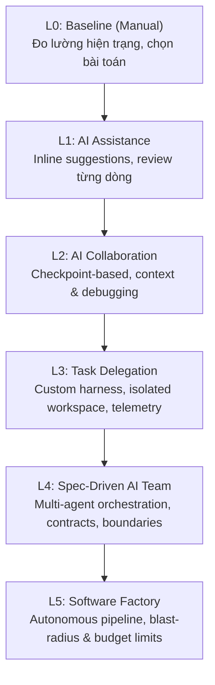
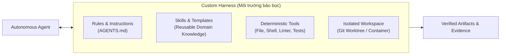
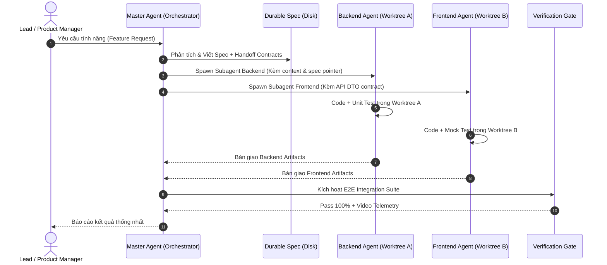

# AE01: AI PRODUCTIVITY AND HARNESSES
## Master Curriculum: Study & Teaching Playbook (L0 → L5)

> **Mục tiêu giáo trình**: Được thiết kế để vừa làm **lộ trình tự học chuyên sâu (Self-study Mastery)**, vừa làm **cẩm nang giảng dạy (Teaching Playbook)** chuẩn Big Tech.  
> **Thời lượng**: 8 tuần · 16 buổi (2 buổi/tuần · 2 giờ/buổi).  
> **Hệ thống phân cấp**: 2 luồng đào tạo song song (**Technical Track** & **Non-Technical Track**).

---

## I. TỔNG QUAN KHUNG NĂNG LỰC TỰ TRỊ (THE AUTONOMY LADDER)

| Cấp độ | Tên gọi | Bản chất năng lực | Trọng tâm Technical Track | Trọng tâm Non-Technical Track |
| :--- | :--- | :--- | :--- | :--- |
| **L0** | **Baseline** | Đo lường hiệu suất thủ công | Đo thời gian, bugs, effort khi fix 1 bug/feature | Đo thời gian, sai sót khi tổng hợp báo cáo Excel/Doc |
| **L1** | **Assistance** | AI làm phụ tá vi mô | Tab-complete, code suggestion, giải thích lỗi | Viết lại email, tạo công thức Excel phức tạp |
| **L2** | **Collaboration** | Làm việc theo checkpoint | Pair-programming, TDD lặp với AI, build small CLI | Tạo Dashboard phân tích, xử lý dữ liệu với Claude Artifacts |
| **L3** | **Delegation** | Giao trọn gói 1 đầu việc | Đóng gói Harness (Instructions, Rules, Tools, Worktree) | Batch processing 50 files tài liệu kèm báo cáo đối soát |
| **L4** | **AI Team** | Đa agent có phân vai | Spec-driven dev, orchestrator điều phối subagents | Agent nghiên cứu thị trường + Agent viết bài + Agent kiểm duyệt |
| **L5** | **Factory** | Nhà máy phần mềm tự trị | Pipeline tự nhận Goal $\to$ Spec $\to$ Code $\to$ Test $\to$ Package | Hệ thống tự nhận lead $\to$ phân loại $\to$ tạo báo cáo $\to$ gửi email |

---

## II. CHI TIẾT 16 BUỔI HỌC (SYLLABUS & LAB PLAYBOOK)

### PHẦN 1: FOUNDATIONS & COLLABORATION (TUẦN 1 – 3: L0 $\to$ L2)

#### 📅 Tuần 1: Lập Baseline & Bước đầu Trợ lý (L0 & L1)
* **Buổi 1 (S1 - L0): Baseline & Problem Selection**
  * **Lý thuyết**:
    * Nghịch lý năng suất AI: Tại sao 80% người dùng AI cảm thấy "nhanh hơn" nhưng thực tế output lại đầy lỗi và tốn gấp đôi thời gian fix bug?
    * Khái niệm Completion Criteria & Definition of Done (DoD).
    * Phương pháp đo lường: Đo thời gian thực hiện ($T_{baseline}$)$, số lần context switch, tỷ lệ lỗi.
  * **Thực hành Lab**:
    * *Tech Track*: Chọn 1 task trong repo mẫu (ví dụ: viết API endpoint CRUD cơ bản), làm thủ công 100%, ghi lại log thời gian, git commit, test coverage.
    * *Non-tech Track*: Chọn 1 bài toán tổng hợp dữ liệu từ 3 file CSV/Excel không đồng nhất, làm tay, ghi nhận thời gian và số lỗi công thức.
  * **Artifact bàn giao**: File `baseline-metrics.md` ghi nhận thời gian và benchmark ban đầu.

* **Buổi 2 (S2 - L1): AI Assistance & Verification Gate**
  * **Lý thuyết**:
    * Bản chất stochastic (xác suất) của LLM: "LLM không biết đúng sai, nó chỉ dự đoán token tiếp theo có vẻ hợp lý nhất".
    * Quy tắc vàng L1: **Verify Every Output** (Không bao giờ tin tưởng mù quáng).
    * Thiết lập môi trường: Cài đặt CLI, IDE extensions (Claude Code, GitHub Copilot, Gemini Code Assist).
  * **Thực hành Lab**:
    * *Tech Track*: Dùng AI gợi ý inline (tab-complete) để hoàn thành task; thực hành bắt lỗi "hallucinated APIs" (AI bịa ra hàm không tồn tại).
    * *Non-tech Track*: Dùng AI viết công thức lồng ghép `XLOOKUP`, `INDEX-MATCH` hoặc regex; tự tay verify kết quả với 5 dòng dữ liệu biên (edge cases).
  * **Rubric đánh giá**: Phát hiện được ít nhất 1 lỗi tiềm ẩn hoặc giả định sai mà AI tạo ra.

---

#### 📅 Tuần 2: Checkpoint Collaboration & Small Utilities (L2)
* **Buổi 3 (S3 - L2): Context Engineering & Checkpoint Protocols**
  * **Lý thuyết**:
    * Context Window không phải là thùng rác: Vấn đề "Lost in the Middle" và Context Pollution.
    * Kỹ thuật Checkpoint Collaboration: Chia nhỏ bài toán thành 3-4 checkpoints kiểm soát được thay vì "one-shot prompt".
    * Kỹ thuật Few-shot ví dụ mẫu (Input $\to$ Expected Output format).
  * **Thực hành Lab**:
    * *Tech Track*: Thiết kế prompt có cấu trúc (System Prompt, Context, Constraints, Examples) để tạo một CRUD service. Dừng lại ở từng checkpoint: (1) Interface, (2) Unit tests, (3) Implementation.
    * *Non-tech Track*: Cung cấp bối cảnh công ty, brand guidelines và số liệu raw; yêu cầu AI tạo báo cáo tuần theo từng checkpoint: (1) Outline, (2) Số liệu chính, (3) Phân tích rủi ro.
  * **Rubric đánh giá**: Không để AI tự ý nhảy cóc sang bước sau khi bước trước chưa được con người nghiệm thu.

* **Buổi 4 (S4 - L2): Building Your First AI Utility**
  * **Lý thuyết**:
    * Biến "Chat prompt" thành "Utility tool" có thể tái sử dụng.
    * Xác định rõ Inputs, Outputs, Error states và Boundary conditions.
  * **Thực hành Lab**:
    * *Tech Track*: Xây dựng 1 CLI script nhỏ (Node.js/Python) tự động parse git commit history và sinh CHANGELOG chuẩn Conventional Commits.
    * *Non-tech Track*: Xây dựng 1 web tool nội bộ (qua Claude Artifacts / Streamlit) upload file hóa đơn PDF và xuất ra bảng tính sạch.
  * **Rubric đánh giá**: Tool chạy ổn định với ít nhất 3 bộ dữ liệu đầu vào khác nhau mà không bị crash.

---

#### 📅 Tuần 3: Debugging With AI & Completing L2 Milestone (L2 $\to$ L3)
* **Buổi 5 (S5 - L2): Root-Cause Debugging & Business Regression**
  * **Lý thuyết**:
    * Triết lý Ponytail / 7-Rung Ladder: Tránh "quick patch" vá triệu chứng, bắt AI tìm đến tận root cause.
    * Phương pháp đưa Error Stack Trace, Environment logs và Minimal Reproducible Example vào Context.
  * **Thực hành Lab**:
    * *Tech Track*: Đưa 1 bug bất đồng bộ (Race condition hoặc Memory leak giả lập) cho AI debug; ép AI giải thích 3 nguyên nhân khả dĩ trước khi viết code sửa.
    * *Non-tech Track*: Đưa 1 bảng số liệu bị lệch logic dòng tiền; yêu cầu AI truy vết dòng bị sai sót logic thay vì chỉ tính lại tổng.
  * **Milestone L2**: Hoàn thành một sản phẩm nhỏ chạy trơn tru, có kiểm thử, đo lường được hiệu suất tăng tối thiểu 50% so với L0 Baseline.

---

### PHẦN 2: HARNESS ENGINEERING & TASK DELEGATION (TUẦN 3 – 5: L3)

* **Buổi 6 (S6 - L3): Defining Delegable Tasks & Acceptance Criteria**
  * **Lý thuyết**:
    * Sự khác biệt giữa "Nhờ AI hỗ trợ" (L1/L2) và "Ủy quyền trọn gói" (L3 Delegation).
    * Gherkin Syntax & Acceptance Criteria: Viết yêu cầu rõ ràng đến mức Agent không thể hiểu sai (`Given - When - Then`).
    * Khái niệm Durable Disk Artifacts: Agent bàn giao kết quả qua file và log, không qua cửa sổ chat.
  * **Thực hành Lab**:
    * Viết một file đặc tả kỹ thuật `spec.md` chuẩn cho một tính năng/nhiệm vụ độc lập.

* **Buổi 7 (S7 - L3): Building Custom Harness**
  * **Lý thuyết**:
    * **Harness là gì?** Cỗ xe cương ngựa: AI là ngựa, Harness là dây cương, yên xe và lộ trình.
    * 4 trụ cột của Harness:
      1. *Instructions*: System Prompt, Boundary rules (`AGENTS.md`).
      2. *Skills*: Kịch bản từng bước (Step-by-step recipe).
      3. *Tools*: Khả năng đọc, ghi, chạy lệnh terminal an toàn.
      4. *Verification Gate*: Bộ test tự động kiểm chứng kết quả.
  * **Thực hành Lab**:
    * *Tech Track*: Cấu hình repo với quy chuẩn Agent Rules (như cấu trúc `agent-harness-kit`), định nghĩa skill `/test`, skill `/lint`.
    * *Non-tech Track*: Tạo một workflow trên Cowork hoặc Claude Project với Knowledge Base, System Instructions và Template báo cáo cố định.

* **Buổi 8 (S8 - L3): Running Autonomous Agent in Isolated Workspace**
  * **Lý thuyết**:
    * Nguyên lý Blast-Radius Isolation: Tại sao không bao giờ cho Agent chạy trực tiếp trên branch chính hoặc máy thật.
    * Git Worktree Isolation: Cơ chế tạo workspace riêng biệt cho Agent làm việc song song.
    * Thu thập Execution Logs & Telemetry.
  * **Thực hành Lab**:
    * Khởi chạy Claude Code / AGY CLI trong một worktree độc lập. Giao `spec.md`, để agent tự suy nghĩ, gọi tool, sửa file, chạy test mà không có sự can thiệp của con người.
    * Kiểm tra git diff và transcript logs sau khi agent báo hoàn thành.

* **Buổi 9 (S9 - L3): Edge Cases, Config Tuning & L3 Milestone Defense**
  * **Lý thuyết**:
    * Missing-data and Flaky-behavior testing: Thử thách Agent với đề bài thiếu dữ kiện hoặc lỗi mập mờ.
    * Tinh chỉnh cấu hình Harness (Prompt refinement, tool restriction).
  * **Milestone L3**: Bàn giao một tính năng hoàn chỉnh được Agent thực hiện 100% tự động, có test pass, bằng chứng thực thi rõ ràng trên disk.

---

### PHẦN 3: MULTI-AGENT ORCHESTRATION (TUẦN 5 – 6: L4)

* **Buổi 10 (S10 - L4): Architecture of Spec-Driven Multi-Agent Teams**
  * **Lý thuyết**:
    * Khi nào dùng Multi-agent? Khi nào Single Agent tốt hơn? (Tránh bẫy bùng nổ Token & Latency).
    * Handoff Contracts: Hợp đồng giao tiếp giữa các Agent (API Schema, JSON DTO, Shared Types).
    * Phân vai Agent: Planner / Architect $\to$ Implementer $\to$ Reviewer / Tester.
  * **Thực hành Lab**:
    * Thiết kế hợp đồng giao tiếp giữa 2 agent: Agent A tạo backend endpoint, Agent B tạo giao diện tiêu thụ endpoint đó.

* **Buổi 11 (S11 - L4): Orchestrating Headless Subagents**
  * **Lý thuyết**:
    * Kỹ thuật Durable Context Bridges: Không truyền context qua chat memory ngắn hạn; truyền qua con trỏ file (`spec.md`, `schema.prisma`) và disk state.
    * Cơ chế giám sát: Master Agent theo dõi tiến độ, phát hiện agent con bị lặp vô tận (Loop detection) hoặc hallucination.
  * **Thực hành Lab**:
    * Kích hoạt Master Agent tự động spawn 2 subagents chạy song song trong 2 worktree khác nhau, thực hiện hai phần việc độc lập.

* **Buổi 12 (S12 - L4): Independent Cross-Verification & L4 Milestone**
  * **Lý thuyết**:
    * Independent Verification: Không để agent tự chấm bài của mình. Một verification engine độc lập (hoặc test runner trung lập) phải là người quyết định cuối cùng.
    * Đo đạc hiệu năng: So sánh chất lượng và token cost giữa 1 Single Agent to xác vs Team 2 Agent chuyên biệt.
  * **Milestone L4**: Hệ thống đa agent giải quyết thành công một bài toán full-stack hoặc đa bước phức tạp, hợp nhất kết quả hoàn hảo.

---

### PHẦN 4: SOFTWARE FACTORY & PRODUCTION OPERATIONS (TUẦN 7 – 8: L5)

* **Buổi 13 (S13 - L5): Building the Autonomous Factory Pipeline**
  * **Lý thuyết**:
    * Khái niệm **Software Factory**: Biến kỹ thuật phần mềm thành dây chuyền tự động (Goal $\to$ Spec $\to$ Code $\to$ Test $\to$ Package $\to$ Release).
    * Quản trị rủi ro & Blast Radius: Cấu hình Sandbox bảo mật cấp container/OS, Read-only mounts, chặn quyền truy cập mạng bừa bãi.
  * **Thực hành Lab**:
    * Cấu hình một GitHub Actions / Local runner pipeline nhận 1 issue GitHub, tự động dựng harness, giao agent fix, chạy test, đóng gói artifact nếu pass.

* **Buổi 14 (S14 - L5): Limits, Failure Budgets & Error Recovery**
  * **Lý thuyết**:
    * Cài đặt trần an toàn (Guardrails): Max step limit, Token budget limit (ví dụ: tối đa $2/task), Timeout limit.
    * Xử lý ngoại lệ tự động: Cơ chế Fallback, Retry có backoff, Circuit breaker khi Agent gặp lỗi không giải được.
  * **Thực hành Lab**:
    * Giả lập tình huống hiểm: Inject một test case lỗi logic hoặc prompt mâu thuẫn; kiểm tra xem Factory có biết "dừng lại và cảnh báo con người" thay vì đốt cạn tiền token hay không.

* **Buổi 15 (S15 - L5): Autonomy Audit & ROI Economics**
  * **Lý thuyết**:
    * Phân tích kinh tế học của AI Agent: Chi phí con người ($/giờ) vs Chi phí Token + Infra ($/task).
    * Trade-off Matrix: Tốc độ (Latency) vs Chất lượng (Accuracy) vs Mức độ tự trị (Autonomy).
    * Quyết định cấp độ tự trị phù hợp cho từng loại hình doanh nghiệp: Khi nào nên dừng ở L3? Khi nào đáng đầu tư lên L5?
  * **Thực hành Lab**:
    * Lập bảng báo cáo `ROI-Audit.md` đo lường toàn bộ hành trình từ L0 đến L5: Thời gian tiết kiệm được, chi phí token tiêu tốn, tỷ lệ can thiệp của con người (Human-in-the-loop rate).

* **Buổi 16 (S16 - L5): Unguided Capstone Run & Design Defense**
  * **Thực hành Capstone (Unguided Run)**:
    * Học viên nhận một đề bài hoàn toàn mới từ giảng viên ngay tại lớp.
    * Học viên không được can thiệp gõ code; chỉ được điều phối hệ thống Factory / Harness của mình để hoàn thành bài toán từ A-Z trong 60 phút.
  * **Design Defense (Bảo vệ trước Mentor)**:
    * Trình bày bằng chứng thực thi (Evidence: Logs, Video Playwright, Test reports).
    * Phản biện các quyết định thiết kế kiến trúc trước hội đồng.

---

## III. BỘ CÂU HỎI VẤN ĐÁP & HƯỚNG DẪN GIẢNG DẠY (TEACHER DEFENSE GUIDE)

### Q1: "Khi nào KHÔNG NÊN dùng Multi-Agent mà chỉ dùng Single Agent?"
* **Câu trả lời chuẩn**:
  * *Nguyên lý*: Đa agent luôn đi kèm chi phí ẩn cực lớn: độ trễ (latency), chi phí token tăng cấp số nhân (x3–x5), và sai số tích lũy (compounding errors) qua các vòng handoff.
  * *Tiêu chí định lượng (Quantitative criteria)*:
    1. **Context Window Contamination**: Chỉ tách subagent khi nhiệm vụ con đòi hỏi nạp khối lượng tài liệu/code quá lớn khiến context của main agent bị loãng (vượt quá 40-50% context window hiệu dụng).
    2. **Tool Boundary & Privilege Separation**: Khi 1 tác vụ đòi hỏi quyền hạn đặc thù (ví dụ: agent review chỉ có quyền Read-only, agent executor có quyền Shell).
    3. **Parallel Independent Worktrees**: Khi các module hoàn toàn tách biệt về mặt không gian (ví dụ: repo frontend và repo backend riêng) có thể code song song mà không cần lock tài nguyên.
  * *Kết luận*: Nếu task chỉ gói gọn trong 1 context window, luôn ưu tiên **Single Agent + Deterministic Tools xịn + Clean Prompt**.

### Q2: "Indirect Prompt Injection: Git Worktree có bảo vệ được an toàn không?"
* **Câu trả lời chuẩn**:
  * *Khẳng định*: **Git Worktree hoàn toàn KHÔNG bảo vệ được an toàn trước Prompt Injection!** Worktree chỉ là phân tách git branch trên cùng một file system của máy host. Nếu agent có quyền shell, nó hoàn toàn có thể đọc trộm file ngoài worktree, đọc biến môi trường `.env`, hoặc chạy `curl` đẩy secret ra ngoài.
  * *Giải pháp chuẩn L5*:
    1. **OS/Container Isolation**: Bọc agent trong Docker container hoặc microVM (Firecracker/gVisor), mount thư mục code dạng giới hạn, cấm truy cập thư mục gốc của host (`/`, `~/.ssh`, `~/.aws`).
    2. **Network Egress Filtering**: Chỉ whitelist các domain của LLM provider (api.anthropic.com, api.openai.com). Chặn toàn bộ outbound traffic lạ để chống exfiltration data.
    3. **Least Privilege Execution**: Chạy shell bằng user không có quyền sudo; cấm triệt để các lệnh hủy diệt (`rm -rf`, `drop table`) bằng bash wrapper / hook interceptor.

### Q3: "Làm sao chống Agent gian lận test (Định luật Goodhart) trong Software Factory?"
* **Câu trả lời chuẩn**:
  * *Nguyên lý*: Khi một thước đo trở thành mục tiêu, nó không còn là thước đo tốt nữa (Agent sẽ tìm đường tắt dễ nhất để pass test).
  * *Giải pháp 3 lớp*:
    1. **Immutable Test Suite (Quyền bất khả xâm phạm)**: Cấu hình file permissions hoặc git hook chặn agent sửa các file trong thư mục `tests/` hoặc `specs/`. Nếu agent sửa test file, pipeline tự động đánh fail.
    2. **Independent Test Execution**: Không để agent tự chạy test rồi báo "Em pass rồi". Harness pipeline trên CI runner độc lập sẽ tự pull code về và chạy bộ test ẩn (Hidden test cases mà agent chưa từng nhìn thấy trong prompt).
    3. **Runtime Evidence Gate**: Đòi hỏi bằng chứng khách quan: Coverage report thực tế, video ghi hình E2E Playwright với telemetry banner, log truy vấn cơ sở dữ liệu thật (không chấp nhận mock toàn bộ).
