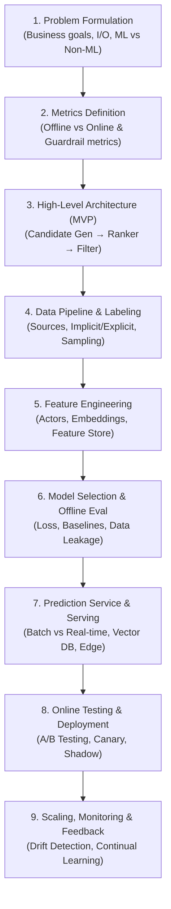

# ML & AGENTIC AI SYSTEM DESIGN INTERVIEW PREPARATION
## Big Tech Interview Guide: 9-Step Framework, Syllabus & Case Studies

> **Nguồn gốc tài liệu**: Phân tích và tổng hợp từ khóa học *ML / Agentic AI Interview Preparation* (Mentor: Anh Đạt Phạm - ML/Agentic Engineer tại Nvidia; Benchmark: 259 USD / 10 buổi).  
> **Mục tiêu**: Chuẩn bị cho các vòng phỏng vấn **Machine Learning System Design**, **GenAI/LLM Architecture**, và **Agentic AI Engineering** tại Big Tech (Nvidia, Qualcomm, OKX, TikTok, Google, Amazon, Meta).

---

## I. CÔNG THỨC 9 BƯỚC ML & AGENTIC SYSTEM DESIGN KINH ĐIỂN

Trong mọi vòng phỏng vấn ML/GenAI System Design kéo dài 45–60 phút, ứng viên phải dẫn dắt cuộc thảo luận theo một khung có cấu trúc lặp lại được:

### Chi tiết 9 bước thực thi:
1. **Problem Formulation**:
   * Làm rõ yêu cầu (Clarifying questions): Latency SLA (<50ms?), Scale (QPS, DAU, Item catalog), Tần suất cập nhật (Real-time vs Batch).
   * Định nghĩa ML Objective và phân loại bài toán (Binary classification, Multi-class, Ranking, Retrieval, Generation).
   * **Đặc biệt**: Phải trả lời được *"Khi nào KHÔNG NÊN dùng ML/AI mà dùng rule-based hoặc heuristic?"*.
2. **Metrics Definition**:
   * *Offline Metrics*: Accuracy, Precision, Recall, F1, ROC-AUC, PR-AUC, NDCG@k, MRR, BLEU/ROUGE, RAG Triad (Context Relevance, Groundedness, Answer Relevance).
   * *Online Metrics*: CTR (Click-Through Rate), CVR (Conversion Rate), Session Duration, Revenue, User Retention.
   * *Counter / Guardrail Metrics*: Latency p95/p99, Unsubscribe rate, Negative feedback rate, LLM Hallucination rate, Token cost / query.
3. **High-Level Architecture (MVP)**:
   * Mô hình kinh điển Multi-stage: Candidate Generation (Retrieval / ANN) $\to$ Scoring / Ranking $\to$ Re-ranking / Filtering (Diversity, Freshness, Business Rules).
4. **Data Collection & Preparation**:
   * Nguồn dữ liệu (User profile, Context, Interaction history).
   * Chiến lược gán nhãn: Natural labels, Negative sampling (Random vs Hard negatives), Pseudo-labeling, Active learning.
5. **Feature Engineering**:
   * Phân loại actor: User features, Item features, Contextual features, Cross features (User-Item interaction).
   * Embeddings (Two-tower, Graph embeddings, Dense vector representation).
   * Xử lý độ trễ: Static features (Batch/Offline Store) vs Dynamic real-time features (Redis / Online Feature Store).
6. **Model Selection & Offline Evaluation**:
   * Chọn model phù hợp: Logistic Regression / GBDT (LightGBM, XGBoost) vs Deep Neural Nets vs Transformer. Trade-off giữa độ chính xác và độ trễ phục vụ.
   * Chiến lược chia tập train/dev/test theo thời gian (Time-based split) để triệt tiêu Data Leakage.
7. **Prediction Serving & Inference Architecture**:
   * Kiến trúc serving: Sync vs Async, Microservices, gRPC.
   * Tối ưu hóa mô hình: Quantization (INT8, FP8), Pruning, Knowledge Distillation, TensorRT-LLM, vLLM (PagedAttention, Continuous batching).
   * Vector Search / ANN: HNSW, IVF-PQ, ScaNN, Milvus / Qdrant / Pinecone.
8. **Online Testing & Rollout**:
   * Phân luồng traffic: Shadow Deployment (chạy song song không trả kết quả) $\to$ Canary Deployment (1% - 5%) $\to$ A/B Testing.
   * Kiểm định giả thuyết thống kê (p-value, sample size, minimum detectable effect).
9. **Scaling, Monitoring & Continual Learning**:
   * Giám sát phân phối dữ liệu (Data Drift / Covariate Shift) và Concept Drift (Hành vi người dùng thay đổi).
   * Chiến lược Retrain: Định kỳ (Cronjob hàng đêm/tuần) vs Event-triggered (khi metric online tụt dưới ngưỡng).

---

## II. CHI TIẾT 10 BUỔI HỌC THEO GIÁO TRÌNH (SYLLABUS BREAKDOWN)

### Buổi 1 — Nền tảng & Problem Formulation
* Tại sao hệ thống ML/AI thất bại khi đưa lên production (Production ML stack: Non-ML vs ML components).
* Step 1 (Problem Formulation) & Step 2 (Metrics: Offline vs Online).

### Buổi 2 — Architecture & Data Pipelines
* Step 3 (Kiến trúc MVP Multi-model) & Step 4 (Data Sources & Actors).
* Chiến lược Labeling: Natural labels, Negative sampling, Semi-supervised.
* Case study: Ads Click Prediction / Video Recommendation Data Pipeline.

### Buổi 3 — Feature Engineering & Feature Stores
* Thiết kế Feature theo từng Actor (User/Item/Query/Context).
* Tiền xử lý dữ liệu phi cấu trúc (Text, Image, Video).
* Workshop: Thiết kế Feature cho Newsfeed Ranking & Semantic Search.

### Buổi 4 — Modeling & Offline Evaluation
* Lựa chọn Model: GBDT vs Neural Nets vs Foundation Models.
* Time-based split, xử lý Class Imbalance, Calibration (Platt scaling, Isotonic regression).
* Case study: Sentiment Analysis & OCR Pipeline.

### Buổi 5 — Prediction Service & High-Throughput Serving
* Batch vs Real-time vs Hybrid Serving (Mô hình Netflix).
* Approximate Nearest Neighbor (ANN) & Vector Database Serving.
* ML on the Edge: Quantization, Pruning, Distillation.

### Buổi 6 — Experimentation, Scaling & Monitoring
* A/B Testing, Multi-armed Bandit, Shadow/Canary Deployments.
* Distributed Training: Data Parallelism vs Model Parallelism (ZeRO, FSDP).
* Continuous Learning & Human-in-the-loop (HITL).

### Buổi 7 — Recommendation Systems (RecSys Deep Dive)
* Two-Tower Model, Matrix Factorization, Graph Neural Networks (PinSage).
* Learning to Rank (LTR): Pointwise, Pairwise, Listwise.
* Giải quyết Cold Start, Diversity, Serendipity, Freshness.
* Mock Interview 25 phút: Thiết kế Video Recommendation System (YouTube/TikTok).

### Buổi 8 — Search, Ranking & Ads Systems
* Inverted Index + Dense Vector Search (Hybrid Retrieval).
* Query Understanding: Spell correction, Entity extraction, Query expansion.
* Ads Serving Pipeline: CTR Prediction, Real-Time Bidding (RTB), Second-price auction.

### Buổi 9 — NLP, Computer Vision & Trust/Safety
* Pipeline xử lý ngôn ngữ & hình ảnh: BERT, ViT, YOLO, OCR.
* Autonomous Vehicles & Ride Matching Systems (Uber/Grab).
* Trust & Safety: Phát hiện Spam, Gian lận thanh toán, Nội dung độc hại đa phương thức.

### Buổi 10 — GenAI, LLM Systems & Capstone Mock Interview
* Tư duy GenAI: Prompting vs RAG vs Fine-tuning vs Agents.
* RAG Architecture nâng cao: Chunking strategies, Hybrid Search, Cohere Re-ranker, GraphRAG.
* Agentic AI Architecture: ReAct framework, Function / Tool Calling, Planning, Memory management.
* LLM Serving & Optimization: KV Caching, PagedAttention (vLLM), Speculative Decoding, TensorRT-LLM.
* Guardrails & Evaluation: NeMo Guardrails, Llama-Guard, LLM-as-a-judge, Golden Evaluation Datasets.
* **Capstone Mock Interview**: Phỏng vấn thử 1-1 theo chuẩn Big Tech.

---

## III. MỐI LIÊN HỆ GIỮA AE01 (HARNESS) VÀ KHÓA PHỎNG VẤN NÀY

Hai khóa học này bổ trợ hoàn hảo cho nhau:
1. **AE01 (AI Productivity & Harnesses)** dạy **cách xây dựng môi trường tự trị (Harness, Sandbox, Multi-agent worktree)** để AI làm việc và tăng tốc phát triển phần mềm.
2. **Khóa ML / Agentic System Design** dạy **tư duy kiến trúc hệ thống AI quy mô lớn**, giúp bạn hiểu sâu sắc bản chất hạ tầng (Serving, KV Cache, Latency, Evaluation) để thiết kế những Agentic Systems chịu tải hàng triệu người dùng.
