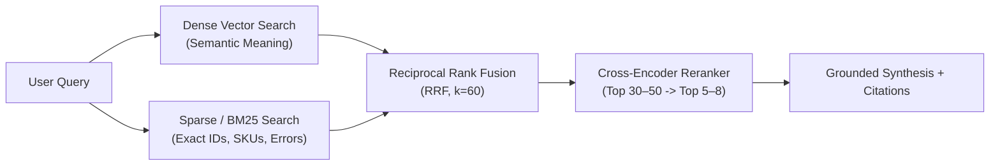

# AI Agent, Context Engineering & Hybrid RAG Architecture

> Distilled from `muratcankoylan/Agent-Skills-for-Context-Engineering` (`★ 18k+`), `qdrant/skills`, and `redis/agent-skills`. Build deterministic, token-efficient AI systems grounded in production retrieval, bounded tools, and isolated execution contexts.

---

## 1. Context Engineering & Degradation Defense

Every token loaded into the context window competes for model attention. Optimize **tokens-per-task** (not tokens-per-request — premature truncation that forces repeated file reads increases total cost and latency).

### The 4-Bucket Context Mitigation Framework
| Strategy | Mechanism | Production Standard |
|---|---|---|
| **Write** | Externalize working state out of chat memory | Write plans, schemas, and intermediate reports to scratch/artifact files on disk; reference paths instead of repeating text |
| **Select** | Pull only high-signal snippets on demand | Use indexed symbol/chunk retrieval and tight line slices (`StartLine`/`EndLine`); never inject entire repos or uncompressed logs |
| **Compress** | Summarize long trajectories with structural fidelity | Preserve the **Artifact Trail** (`Session Intent`, `Files Modified`, `Decisions Made`, `Current State`, `Next Steps`) so compacted agents never redo finished work |
| **Isolate** | Partition noisy multi-step search from core reasoning | Dispatch focused research/grep/build-debug tasks to isolated subagents that return compact, schema-validated syntheses |

### The 5 Context Failure Modes & Guards
1. **Lost-in-the-Middle**: Information buried in the center of a long prompt suffers steep recall drop. Pin critical invariants, output schemas, and user constraints at the **head** and **tail** of context.
2. **Context Poisoning**: Leaving failed tool outputs or refuted hypotheses inside active history causes repeated error loops. Purge stale failure branches or fork a clean turn once root cause is confirmed.
3. **Context Distraction**: Irrelevant tool descriptions and verbose boilerplate dilute routing accuracy. Enforce strict top-level skill budgets and unload stale tool outputs.
4. **Context Confusion**: Mixing unrelated tasks into one prompt degrades accuracy. Restrict each agent/subagent turn to a single cohesive objective.
5. **Context Clash**: Conflicting facts across retrieved chunks or stale docs cause silent hallucinations. Attach `source_ts` / `precedence` metadata and enforce deterministic conflict resolution rules.

---

## 2. Agent Tool & MCP Schema Engineering

Poor tool definitions are the #1 source of multi-step agent loops and schema token bloat:

- **Consolidation Over 1:1 REST Mirroring**: Expose fewer, workflow-aligned tools (e.g., `get_customer_billing_context` instead of `get_user` + `list_invoices` + `get_subscriptions` + `list_payments`). Fewer coarse-grained tools cut routing ambiguity and save thousands of schema tokens.
- **Unambiguous Namespacing**: Prefix every MCP tool with its system (`qdrant_search`, `github_list_prs`, `postgres_query`) and include explicit `when to use` vs `when NOT to use` clauses in descriptions.
- **Output Budgeting & Projection**: Support a `format: "concise" | "detailed"` (or cursor `limit` / `fields`) parameter. Never dump raw megabyte JSON blobs or unpaginated tables back into an LLM context window; return handles/URIs for oversized artifacts.
- **Actionable Recovery Errors**: Return structured error messages stating (1) what failed, (2) valid enum/range constraints, and (3) exact next remediation call—never raw stack traces or generic `500 Internal Error`.
- **Deterministic Trust Boundaries**: Validate every tool argument via strict runtime schemas (`zod` / JSON Schema) and enforce `tenant_id` / RBAC authorization inside the host server handler, NEVER via system prompt instructions.

---

## 3. Production Hybrid RAG & Vector Indexing

### Ingestion & Contextual Chunking
1. Split documents along **structural boundaries** (Markdown headings, AST functions, table rows) at **`256–512` tokens** with `~10–15%` overlap rather than blind fixed character splits.
2. **Contextual Retrieval Header**: Prepend each chunk's document title, section path, entity IDs, and timestamp before embedding so isolated chunks never lose pronoun or entity identity.
3. **Idempotent Upserts**: Hash normalized chunk content (`SHA-256`) into deterministic point IDs so re-ingestion skips unchanged vectors and cleans up deleted source sections cleanly.

### Two-Stage Hybrid Retrieval Pipeline

- Never rely solely on dense cosine similarity when queries contain exact identifiers (`ERR_CONNECTION_REFUSED`, UUIDs, ticker codes, table names)—pair Dense + Sparse lexical retrieval with RRF (`k=60`) and a Cross-Encoder reranker on top candidates.

### Multi-Tenant Isolation & HNSW Quantization (`qdrant/skills`)
- **Single Collection + Payload Partitioning (Default)**: Store all modest-sized tenants in one collection with a keyword payload index configured with **`is_tenant: true`** (clusters tenant points on disk for sequential reads). Filter every search and scroll query with a mandatory `must` filter on `tenant_id` *before* vector scoring. Promote elephant tenants to custom shard keys or dedicated collections only when one tenant monopolizes disk/RAM.
- **Prevent RAM OOM via Quantization**: Keep resident memory (RSS) safely `< 80%` of host RAM. Use **Scalar (`int8`) quantization** (`4x` RAM reduction, `< 1%` recall drop) as default, or **Binary quantization** (`32x` RAM reduction) paired with **`oversampling: 2.0–3.0`** and full-precision **`rescore: true`** from disk page cache (`with_payload: false`, `with_vectors: false` when latency-bound).
- **Bulk Ingestion Hygiene**: Create payload filter indexes *before* bulk upserts, and tune segment count to workload (`default_segment_number` near CPU core count for low query latency vs `2` large segments for high ingestion throughput).

---

## 4. Semantic Caching, Intent Routing & Memory Architecture

- **Task-Scoped Semantic Cache**: Place a vector cache-aside lookup (`GET` embedding similarity before invoking the LLM) keyed strictly by `(tenant_id, task_namespace, prompt_template_version, model_id)`. **NEVER** mix deterministic SQL/code generation caches with conversational chat caches.
- **Conservative Thresholds & Bypass**: Start with high similarity thresholds (`0.92–0.96`), strip volatile greetings, and explicitly bypass the semantic cache on mutating tool actions or live-time queries ("today", "latest balance").
- **Fast Intent Router First**: Classify deterministic intents (`billing_help`, `sql_lookup`, `escalation`) using lightweight embedding similarity (`< 15ms` latency, `< $0.0001`) before invoking expensive reasoning models.
- **Structured Agent Memory**: Separate **Working Context** (current turn), **Episodic Memory** (timestamped events/outcomes), and **Semantic Facts** (`valid_from` / `superseded_by` temporal attributes so updated user preferences override stale facts without erasing audit history).

---

## See Also

- [`references/context-compression-and-multi-agent-memory.md`](references/context-compression-and-multi-agent-memory.md) — Compaction artifact-trail schemas, probe-based compression evals, multi-agent coordination topologies, temporal memory resolution, and Qdrant HNSW quantization tuning tables.
- [`../llm-eval-design/SKILL.md`](../llm-eval-design/SKILL.md) — Offline/CI task contracts, failure taxonomies, calibrated LLM-as-Judge agreement ($\kappa$), paired comparisons, and regression gates.
- [`../llm-wiki/SKILL.md`](../llm-wiki/SKILL.md) — Agent-compiled Markdown knowledge bases, citation contracts, and staleness linting.
