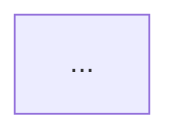

# Bilingual Engineering Blog Authoring & OPSEC Standard (`blog.khanhdp.com`)

## Overview

This skill governs authoring, backfilling, and daily autonomous publishing for **Kido Engineering Blog** (`~/kido-blog`, `https://blog.khanhdp.com`). Every technical breakthrough, root-cause war story, and Architectural Decision Record (ADR) harvested from daily engineering sessions is distilled into a **Pure-Tech, OPSEC-Sanitized, Dual-Language (Vietnamese + English)** engineering monograph.

---

## Core Operating Principles

### 1. Daily Harvest & "Skip-If-Quiet" Rule (No Filler Content)
- **Source Material**: Draw directly from `~/profile/journal/daily/YYYY-MM-DD.md`, `~/profile/journal/decisions/YYYY-MM-DD-architecture-decisions.md`, and `~/profile/media/content/HARVESTED_BRAIN_GEMS.md`.
- **Natural Cadence (No Forced Posts)**:
  - When a day has substantive technical work (ADRs, performance optimizations, concurrency fixes, infra hardening, or reusable `@kt/*` algorithms), write and publish the daily bilingual deep-dive.
  - **If a day has no new technical material (rest day, pure admin, or zero engineering ADRs), skip writing a blog post for that day.** Never fabricate or force low-signal filler posts.
- **Chronological Integrity**: Always set `pubDate: "YYYY-MM-DD"` in frontmatter to match the true date of the engineering work.

### 2. Mandatory Bilingual 1-to-1 Parity (`VI` + `EN`) & Evergreen SEO Slug Standard
Every article MUST be published simultaneously in both languages with the **exact same `<kebab-slug>.md` filename**:

| Edition | Content Directory | Public URL | `hreflang` |
| :--- | :--- | :--- | :--- |
| **Vietnamese (`VI`)** | `~/kido-blog/src/content/blog/<kebab-slug>.md` | `https://blog.khanhdp.com/blog/<kebab-slug>/` | `vi`, `x-default` |
| **English (`EN`)** | `~/kido-blog/src/content/blog-en/<kebab-slug>.md` | `https://blog.khanhdp.com/en/blog/<kebab-slug>/` | `en` |

- Both files must share the same `pubDate`, `category`, `tags`, `metrics`, and `relatedEpisodes` (with English `title` translations in the English file).
- Mermaid diagrams, mathematical proofs, and code comments in `src/content/blog-en/<kebab-slug>.md` must be written in clear, authoritative English.

#### 2.1 Evergreen SEO Keyword Slug Rules (`<kebab-slug>.md`)
- **Derive Strictly from the Sanitized English Architectural Title**:
  - `<kebab-slug>.md` MUST be a clean, evergreen English technical keyword slug (5–9 words, lowercase ASCII `[a-z0-9-]`, e.g., `redis-singleflight-stampede-prevention-and-distributed-lock-ttl.md`) distilled from the English `title` and core architecture pattern.
- **STRICTLY PROHIBITED in Filename Slugs**:
  - ❌ **NEVER derive slugs from raw `git log` / commit messages** (which leak commit typos like `fearture-chuy-nay`, `change-projec-structre-init`, `mabye-get`, or internal employee/ticket/bank tokens like `employee-nhi`, `pwlp-admin`, `scraper-techcombank`).
  - ❌ **NEVER append date suffixes (`-YYYY-MM-DD.md`) to filenames.** Dates belong exclusively in frontmatter (`pubDate: "YYYY-MM-DD"`); URLs must remain timeless evergreen SEO monographs.
  - ❌ **NEVER include Vietnamese words (`chuy`, `nay`, `nhi`), raw commit verbs (`feat`, `fix`, `chore`, `init`, `initial-commit`, `merge`), or ticket prefixes (`pwlp-*`) in slugs.**

### 3. Strict OPSEC & Zero Project / Client / Commit / Ticket Disclosure Guardrail
All blog posts on `blog.khanhdp.com` are public-facing engineering monographs. **Never expose client brand names, internal repository names, Docker container names, real VPS IP addresses, cloud/VPS host providers, bank names, Jira/Linear ticket IDs, raw git commit messages, or real customer/teammate names.**

| Forbidden Internal Token | Mandatory Sanitized Replacement |
| :--- | :--- |
| `vantoi`, `vantoicalis`, `vantoi-calis`, `vantoi-calis-api` | `High-Concurrency Fitness Platform`, `core-api-service` |
| `vantoi_postgres`, `vantoi_valkey`, `vantoi_api`, `vantoi_web` | `db_postgres`, `cache_valkey`, `app_api`, `app_web` |
| `ops_bridge`, `vt-infra`, `vt-canary`, `phr_garage` | `edge_proxy_bridge`, `core-infra`, `canary-stack`, `legacy_tenant_app` |
| `limart`, `hoaculimart` | `Multi-Branch POS ERP`, `retail-pos-platform` |
| `checkin-app`, `checkins.json`, `backup_data_*.xlsx` | `Workforce ERP Platform`, `telemetry_events.json`, `snapshot_export.xlsx` |
| `index-web`, `index-api`, `index-data`, `index-ai`, `index-admin-cms`, `index-signoz`, `index.vn`, `idx-vn` | `enterprise-web`, `enterprise-api`, `market-data-pipeline`, `ai-agent-gateway`, `enterprise-cms`, `observability-stack` |
| `linkpul`, `linkpul-api`, `linkpul-gateway`, `linkpul-dashboard`, `linkpul-admin*`, `linkpul-launchpad`, `linkpul-infra`, `AdPulHQ` | `shortlink-platform`, `shortlink-edge-gateway`, `shortlink-dashboard`, `shortlink-admin`, `adtech-core` |
| `12-week-year-api`, `12-week-year-dashboard`, `12-week-year-mobile`, `12wy`, `fruits-inventory` | `okr-execution-engine`, `perishable-inventory-erp` |
| `pwlp`, `PWLP-283`, `PWLP-290`, `PWLP-291`, `PWLP-*` | `Enterprise Admin Console`, `Core Platform Architecture` (zero ticket IDs) |
| `greenbull`, `mozyfin`, `antofin` | `quant-trading-platform`, `financial-analytics-engine` |
| `tikat`, `tikat.vn`, `fbstory.tikat.vn`, `tikat-gemini-auto-gen-image` | `micro-saas-suite`, `media-saas.example.com` |
| `200lab`, `gonnacrash`, `systemdesign.200lab.io` | `Distributed Traffic Simulator`, `architecture-simulator.example.com` |
| `Techcombank`, `Vietcombank`, `MBBank`, `BIDV`, `VPBank`, `TPBank`, `Sacombank`, `ACB` | `Tier-1 Banking Gateway`, `ISO-8583 / OpenBanking Webhook Provider` |
| `Contabo`, `OVH`, `Hetzner`, `DigitalOcean`, `Vultr`, `Linode` | `Bare-Metal Cloud VPS`, `Dedicated NVMe Compute Node` |
| `144.91.88.242`, `15.235.244.192`, `vps-friend`, `asus-tuf` | `103.xx.xx.xx`, `secondary-vps-node`, `local-gpu-workstation` |
| `tvadiep`, `Điệp`, `trinhcongly`, `employee Nhi`, `Nhi` | `frontend-engineer-d`, `Kỹ sư Đ` (VI) / `Engineer D` (EN), `lead-reviewer`, `Staff Member #104` |
| `Sơn Đinh`, `Nguyễn Tiến Mạnh`, `Tuấn Trương`, `Minh Chu`, `Đức Trung`, `Khang Trần`, `Tuấn Kiên`, `Duy Nguyễn`, `Văn Tới` | `User #8842`, `User #4012`, `User #7109`, `Master Coach`, etc. |

#### 3.1 Zero Raw Commit Quotes or Internal Artifact Framing in Prose
- ❌ **NEVER quote raw git commit messages or commit dates in prose** (e.g., never write `Trong đợt triển khai được ghi nhận qua commit ngày 2026-02-10 (\`PWLP-283...\`)`, `commit ngày YYYY-MM-DD`, or `Based on the YYYY-MM-DD commits across ...`).
- ❌ **NEVER mention Jira/Linear ticket IDs (`PWLP-*`, `IDX-*`), raw commit SHA hashes, or raw repository folder names in article narratives.**
- ✅ **Mandatory Authoritative Framing**: Frame every article as an independent **Production Architecture Monograph, High-Concurrency Post-Mortem, or Telemetry-Driven Systems Audit** (e.g., *"Trong quá trình kiểm toán hiệu năng hệ thống ở ngưỡng tải cao..."* / *"During a production telemetry audit under peak concurrency..."*).

> [!IMPORTANT]
> **Preserving External Chronicles URLs**: Inside the `relatedEpisodes` frontmatter array, keep the `slug` field untouched (matching `~/kido-chronicles/public/data/catalog.json`, e.g., `tap-139-...` or `gc-tap-1-...`) so links to `https://truyen.khanhdp.com/tap/<slug>/` resolve with 0 broken links, while ensuring `relatedEpisodes[].title` and the entire markdown body are 100% sanitized.

---

## 4. The 3-Stage Big-Tech Evolutionary Article Template

Every article (both VI and EN) must follow the **Big-Tech Evolutionary Architecture Progression**:

```markdown
---
title: "<Action-Oriented Engineering Title with Concrete Metrics (use single quotes ' inside double-quoted YAML string)>"
description: "<1-2 sentence executive summary of the root cause, architecture pattern, and measured impact>"
pubDate: "YYYY-MM-DD"
category: "<Distributed Systems | Database & Storage | Performance & Caching | Cloud & Infrastructure | Security & Cryptography | Frontend & Edge UX>"
tags: ["Tag1", "Tag2", "Tag3", "Tag4"]
metrics: "<Metric 1> • <Metric 2> • <Metric 3>"
relatedEpisodes:
  - id: 139
    title: "<Sanitized Episode Title>"
    slug: "tap-139-..."
---

## Executive Summary & Architectural Comparative Matrix

| Architecture Option | Pros | Cons | Performance & Complexity | Recommendation |
| :--- | :--- | :--- | :--- | :--- |
| **Option A: Naive Baseline** | ... | ... | ... | ❌ Reject at scale |
| **Option B: Intermediate Patch** | ... | ... | ... | ⚠️ Partial mitigation |
| **Option C: Tier-1 Production Standard** | ... | ... | ... | ✅ **Recommended** |



## 1. Naive Approach (Giải pháp Sơ khởi)
- Show the intuitive implementation or legacy code pattern and why teams initially write it this way.

## 2. Scale Bottlenecks & Failure Modes (Điểm nghẽn khi Scale)
- Quantify exact failure modes under concurrency, network jitter, or large datasets (Big-O complexity, lock contention, memory amplification, p99 latency spikes).

## 3. Tier-1 Production Architecture (Chuẩn Big Tech Production)
- Present the production-grade solution with clean TypeScript / SQL / Nginx / Docker code snippets, mathematical invariants, and before/after production benchmarks.
```

---

## 5. Verification & Deployment Workflow

Before committing or pushing any changes in `~/kido-blog`:

```bash
cd ~/kido-blog

# 1. Run the automated Bilingual Parity, Slug Hygiene & OPSEC Sanitization Gate:
#    Validates 1-to-1 VI/EN parity, zero forbidden tokens in both filenames and bodies,
#    zero -YYYY-MM-DD date-suffixed slugs, and zero raw commit quotes / ticket IDs.
bun run verify
# (Or auto-fix accidental token hits: bun run src/scripts/verify-opsec-and-bilingual.mjs --fix)

# 2. Run full Astro static build (verifies schema types, VI + EN routes, sitemap, and RSS):
bun run build

# 3. Commit, push, and watch GitHub Actions until green ✓:
git add -A
git commit -m "Feat(blog): Add bilingual <topic> engineering deep-dive"
git push origin main
gh -R khanhdp-labs/kido-blog run list --limit 1
```
