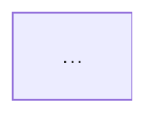

# Bilingual Engineering Blog Authoring & OPSEC Standard (`blog.khanhdp.com`)

## Overview

This skill governs authoring, backfilling, and daily autonomous publishing for **Kido Engineering Blog** (`~/kido-blog`, `https://blog.khanhdp.com`). Every technical breakthrough, root-cause war story, and Architectural Decision Record (ADR) harvested from daily engineering sessions is distilled into a **Pure-Tech, OPSEC-Sanitized, Dual-Language (Vietnamese + English)** engineering monograph.

---

## Core Operating Principles

### 1. Daily Harvest & "Skip-If-Quiet" Rule (No Filler Content)
- **Source Material**: Draw directly from `~/profile/journal/daily/YYYY-MM-DD.md`, `~/profile/journal/decisions/YYYY-MM-DD-architecture-decisions.md`, and `~/profile/media/content/HARVESTED_BRAIN_GEMS.md`.
- **Natural Cadence (No Forced Posts)**:
  - When a day has substantive technical work (ADRs, performance optimizations, concurrency fixes, infra hardening, or reusable `@kt/*` algorithms), write and publish the daily bilingual deep-dive.
  - **If a day has no new technical material (rest day, pure admin, or zero engineering ADRs), skip writing a blog post for that day.** Never fabricate or force low-signal filler posts.
- **Chronological Integrity**: Always set `pubDate: "YYYY-MM-DD"` in frontmatter to match the true date of the engineering work.

### 2. Mandatory Bilingual 1-to-1 Parity (`VI` + `EN`)
Every article MUST be published simultaneously in both languages with the **exact same `<kebab-slug>.md` filename**:

| Edition | Content Directory | Public URL | `hreflang` |
| :--- | :--- | :--- | :--- |
| **Vietnamese (`VI`)** | `~/kido-blog/src/content/blog/<kebab-slug>.md` | `https://blog.khanhdp.com/blog/<kebab-slug>/` | `vi`, `x-default` |
| **English (`EN`)** | `~/kido-blog/src/content/blog-en/<kebab-slug>.md` | `https://blog.khanhdp.com/en/blog/<kebab-slug>/` | `en` |

- Both files must share the same `pubDate`, `category`, `tags`, `metrics`, and `relatedEpisodes` (with English `title` translations in the English file).
- Mermaid diagrams, mathematical proofs, and code comments in `src/content/blog-en/<kebab-slug>.md` must be written in clear, authoritative English.

### 3. Strict OPSEC & Zero Project/Client Disclosure Guardrail
All blog posts on `blog.khanhdp.com` are public-facing engineering monographs. **Never expose client brand names, internal repository names, Docker container names, real VPS IP addresses, or real customer/teammate names.**

| Forbidden Internal Token | Mandatory Sanitized Replacement |
| :--- | :--- |
| `vantoi`, `vantoicalis`, `vantoi-calis`, `vantoi-calis-api` | `High-Concurrency Fitness Platform`, `core-api-service` |
| `vantoi_postgres`, `vantoi_valkey`, `vantoi_api`, `vantoi_web` | `db_postgres`, `cache_valkey`, `app_api`, `app_web` |
| `ops_bridge`, `vt-infra`, `vt-canary`, `phr_garage` | `edge_proxy_bridge`, `core-infra`, `canary-stack`, `legacy_tenant_app` |
| `limart`, `hoaculimart` | `Multi-Branch POS ERP`, `retail-pos-platform` |
| `checkin-app` | `Gamified Habit Tracker App` |
| `index-web`, `index-api`, `index-data`, `index-ai`, `index.vn`, `idx-vn` | `enterprise-web`, `enterprise-api`, `market-data-pipeline`, `ai-agent-gateway` |
| `greenbull`, `mozyfin`, `antofin` | `quant-trading-platform`, `financial-analytics-engine` |
| `tikat`, `tikat.vn`, `fbstory.tikat.vn` | `micro-saas-suite`, `media-saas.example.com` |
| `200lab`, `gonnacrash`, `systemdesign.200lab.io` | `Distributed Traffic Simulator`, `architecture-simulator.example.com` |
| `144.91.88.242`, `15.235.244.192`, `vps-friend`, `asus-tuf` | `103.xx.xx.xx`, `secondary-vps-node`, `local-gpu-workstation` |
| `tvadiep`, `Điệp` | `frontend-engineer-d`, `Kỹ sư Đ` (VI) / `Engineer D` (EN) |
| `Sơn Đinh`, `Nguyễn Tiến Mạnh`, `Tuấn Trương`, `Minh Chu`, `Đức Trung`, `Khang Trần`, `Tuấn Kiên`, `Duy Nguyễn`, `Văn Tới` | `User #8842`, `User #4012`, `User #7109`, `Master Coach`, etc. |

> [!IMPORTANT]
> **Preserving External Chronicles URLs**: Inside the `relatedEpisodes` frontmatter array, keep the `slug` field untouched so links to `https://truyen.khanhdp.com/episodes/<slug>` resolve without 404s, while ensuring `relatedEpisodes[].title` and the entire markdown body are 100% sanitized.

---

## 4. The 3-Stage Big-Tech Evolutionary Article Template

Every article (both VI and EN) must follow the **Big-Tech Evolutionary Architecture Progression**:

```markdown
---
title: "<Action-Oriented Engineering Title with Concrete Metrics>"
description: "<1-2 sentence executive summary of the root cause, architecture pattern, and measured impact>"
pubDate: "YYYY-MM-DD"
category: "<Distributed Systems | Database & Storage | Performance & Caching | Cloud & Infrastructure | Security & Cryptography | Frontend & Edge UX>"
tags: ["Tag1", "Tag2", "Tag3", "Tag4"]
metrics: "<Metric 1> • <Metric 2> • <Metric 3>"
relatedEpisodes:
  - id: 139
    title: "<Sanitized Episode Title>"
    slug: "tap-139-..."
---

## Executive Summary & Architectural Comparative Matrix

| Architecture Option | Pros | Cons | Performance & Complexity | Recommendation |
| :--- | :--- | :--- | :--- | :--- |
| **Option A: Naive Baseline** | ... | ... | ... | ❌ Reject at scale |
| **Option B: Intermediate Patch** | ... | ... | ... | ⚠️ Partial mitigation |
| **Option C: Tier-1 Production Standard** | ... | ... | ... | ✅ **Recommended** |



## 1. Naive Approach (Giải pháp Sơ khởi)
- Show the intuitive implementation or legacy code pattern and why teams initially write it this way.

## 2. Scale Bottlenecks & Failure Modes (Điểm nghẽn khi Scale)
- Quantify exact failure modes under concurrency, network jitter, or large datasets (Big-O complexity, lock contention, memory amplification, p99 latency spikes).

## 3. Tier-1 Production Architecture (Chuẩn Big Tech Production)
- Present the production-grade solution with clean TypeScript / SQL / Nginx / Docker code snippets, mathematical invariants, and before/after production benchmarks.
```

---

## 5. Verification & Deployment Workflow

Before committing or pushing any changes in `~/kido-blog`:

```bash
cd ~/kido-blog

# 1. Run the automated Bilingual Parity & OPSEC Sanitization Gate:
bun run verify
# (Or auto-fix any accidental token hits: bun run src/scripts/verify-opsec-and-bilingual.mjs --fix)

# 2. Run full Astro static build (verifies schema types, VI + EN routes, sitemap, and RSS):
bun run build

# 3. Commit, push, and watch GitHub Actions until green ✓:
git add -A
git commit -m "Feat(blog): Add bilingual <topic> engineering deep-dive"
git push origin main
gh -R khanhdp-labs/kido-blog run list --limit 1
```
