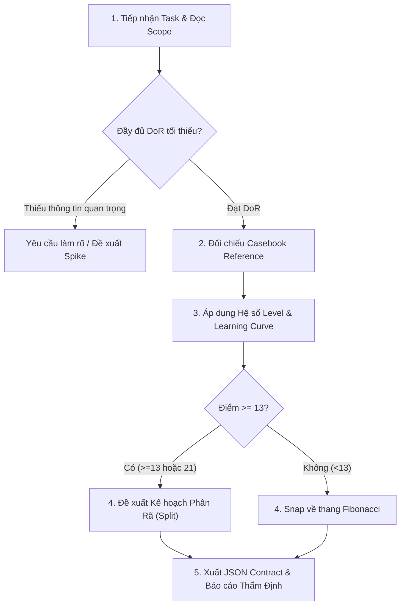

# EST POINT — Story Point Estimation & Productivity Framework

Hệ thống kỹ năng thẩm định và ước lượng **Story Point** chuẩn hóa, kết hợp giữa **Story Point Estimation Reference v1.0 (Practical Casebook)** và **Khung Quy Chuẩn Vận Hành TechPulse 2026 (Point-Based System)**.

---

## 1. Triết lý & Các Nguyên Tắc Bất Biến

1. **Bản chất của Point:** Point phản ánh **độ phức tạp của bài toán, quy mô kỹ thuật và rủi ro**, không phải đơn vị tính thời gian hành chính (Man-day / Man-hour) hay KPI đo tốc độ cá nhân.
2. **Mốc neo khởi tạo (TechPulse Baseline):**  
   $$\text{1 Point} = \text{1 Ngày Công Việc Standard}$$  
   Mốc 1 Point đại diện cho khối lượng và độ phức tạp tiêu chuẩn mà một nhân sự giải quyết trọn vẹn trong 1 ngày làm việc bình thường.
3. **Thang điểm Fibonacci chuẩn:**  
   Chỉ sử dụng tập số chuẩn: `[1, 2, 3, 5, 8, 13, 21]`.
   - **1 (Trivial):** Rất nhỏ; phạm vi rõ; rủi ro gần như bằng 0.
   - **2 (Simple):** Đơn giản; một chức năng hoặc thay đổi nhỏ.
   - **3 (Standard):** Công việc thông thường; có xử lý logic và kiểm thử.
   - **5 (Medium-High):** Nhiều thành phần; có tích hợp hoặc xử lý ngoại lệ.
   - **8 (Complex):** Nhiều luồng xử lý; phụ thuộc hoặc rủi ro đáng kể.
   - **13 (Very Complex):** Phạm vi lớn hoặc nhiều điểm chưa rõ; **bắt buộc phân rã**.
   - **21 (Epic):** **Tuyệt đối không đưa trực tiếp vào Sprint**; phải phân tích và chia nhỏ.
4. **Không cộng điểm cơ học theo checklist:** Phân tích tổng thể tác động và rủi ro để chọn mức Fibonacci tiệm cận phù hợp.
5. **Ghi nhận điểm đơn cấp (No Double Counting):** Điểm chỉ được cộng **duy nhất một lần** ở một cấp quản lý (hoặc Story cha, hoặc Subtask con). Tuyệt đối không cộng cả hai.
6. **Bug Fixing (Severity ≠ Point):** Severity đo mức độ ảnh hưởng (Critical/Major/Minor); Point đo độ phức tạp sửa lỗi. Bug Critical có thể chỉ 1 Point nếu do gán sai biến; Bug Minor có thể 8 Point nếu liên quan race condition.
7. **Epic as a Feature (Chống phân rã vụn vặt):** Không cho phép xé nhỏ task thành các sub-task quá vụn để lấy số lượng / tích điểm ảo. Mỗi task được estimate phải tạo ra giá trị tính năng thực sự (*Feature value*).

---

## 2. Ma Trận Điều Chỉnh: Level & Learning Curve (Đường Cong Học Tập)

Quy chuẩn TechPulse áp dụng các hệ số hiệu chỉnh thực tế:

### A. Hệ số Trình độ (Senior vs Junior)
| Cấp bậc | Hệ số điều chỉnh | Mô tả |
| :--- | :---: | :--- |
| **Junior** | `1.0x` (Mốc chuẩn) | Chưa có kinh nghiệm sẵn, cần thời gian làm quen và làm theo hướng dẫn |
| **Senior** | `0.5x` | Đã có sẵn kinh nghiệm, kiến thức nền tảng và template kiến trúc |

### B. Hệ số Đường cong học tập (Learning Curve)
| Tần suất thực hiện | Hệ số điều chỉnh | Ví dụ minh họa |
| :--- | :---: | :--- |
| **Lần 1 (Task mới)** | `1.0x` | Xây dựng Module API CRUD lần đầu tiên |
| **Lần 2 (Task tương tự)** | `0.7x` | Làm Module CRUD cho đối tượng khác có cấu trúc tương đương |
| **Lần 3+ (Đã chuẩn hóa)** | `0.4x` | Tái sử dụng template, script tự động, component có sẵn |

> **Công thức tính điểm điều chỉnh:**  
> $$\text{Adjusted Point} = \text{Base Casebook Point} \times \text{Level Factor} \times \text{Learning Curve Factor}$$  
> *Sau đó snap về mốc Fibonacci chuẩn gần nhất hoặc báo cáo chi tiết.*

---

## 3. Danh Mục Tham Chiếu Chuẩn (Casebook Reference V1.0)

### A. Frontend Development
| Mã | Case công việc | Base Point | Điều kiện / Phạm vi chuẩn |
| :--- | :--- | :---: | :--- |
| `FE-01` | Thay đổi text, label | 1 | Không đổi layout hoặc logic |
| `FE-02` | Thay đổi màu, font, border | 1 | Có sẵn Design System |
| `FE-03` | Điều chỉnh spacing/kích thước | 1 | Không ảnh hưởng responsive |
| `FE-04` | Thêm Button theo thiết kế sẵn | 1 | Tái sử dụng component hiện có |
| `FE-05` | Thêm Input đơn giản | 2 | Có validation cơ bản |
| `FE-06` | Xây dựng Modal / Popup | 2 | Có thiết kế và component nền |
| `FE-07` | Bảng dữ liệu đơn giản | 3 | Có API, phân trang cơ bản |
| `FE-08` | Form nhập liệu hoàn chỉnh | 3 | Validation, submit, loading, error state |
| `FE-09` | Trang Listing | 3 | Có API, loading, empty, error state |
| `FE-10` | Trang Detail | 3 | Có API, hiển thị dữ liệu và trạng thái |
| `FE-11` | Search UI | 3 | Search API đã có |
| `FE-12` | Filter nhiều điều kiện | 5 | Kết hợp filter, sort và pagination |
| `FE-13` | Dashboard nhiều biểu đồ | 5 | API và thư viện chart đã có |
| `FE-14` | Phân quyền hiển thị UI | 3 | Backend đã cung cấp permission |
| `FE-15` | Luồng đăng nhập nhiều bước | 5 | Nhiều trạng thái và validation |
| `FE-16` | Realtime UI | 8 | WebSocket, reconnect, đồng bộ trạng thái |
| `FE-17` | Giao diện kéo-thả phức tạp | 8 | Nhiều trạng thái và xử lý dữ liệu kéo thả |
| `FE-18` | Refactor toàn bộ module FE | 13 | Bắt buộc phân rã nhỏ |

### B. Backend Development
| Mã | Case công việc | Base Point | Điều kiện / Phạm vi chuẩn |
| :--- | :--- | :---: | :--- |
| `BE-01` | Thêm field vào Entity | 1 | Không có migration phức tạp |
| `BE-02` | API lấy dữ liệu đơn giản | 2 | 1 bảng, logic đơn giản |
| `BE-03` | API CRUD cơ bản | 3 | Validation, xử lý lỗi đầy đủ |
| `BE-04` | API Search / Filter | 3 | Truy vấn trên schema sẵn có |
| `BE-05` | API Pagination / Sorting | 2 | Không yêu cầu tối ưu đặc biệt |
| `BE-06` | API Upload file | 3 | Có sẵn storage service (S3/GCS) |
| `BE-07` | API Download file | 2 | Có sẵn cơ chế lưu trữ |
| `BE-08` | Role / Permission | 5 | Nhiều role và ma trận permission |
| `BE-09` | Đăng nhập JWT (Access + Refresh) | 5 | Quản lý token, refresh logic |
| `BE-10` | Google / Facebook OAuth | 3 | SDK và provider đã sẵn sàng |
| `BE-11` | Email Notification | 3 | Có sẵn email provider |
| `BE-12` | Notification có trạng thái đọc | 5 | Lưu trữ, trạng thái read/unread |
| `BE-13` | Realtime Notification | 8 | WebSocket, quản lý connection pool |
| `BE-14` | Tích hợp Cổng thanh toán | 8 | Sandbox hoạt động, scope 1 provider |
| `BE-15` | Webhook Receiver | 5 | Signature verification, idempotency, retry |
| `BE-16` | Referral System | 8 | Rule thưởng và cây giới thiệu |
| `BE-17` | Commission Calculation | 8 | Nhiều điều kiện và đối soát |
| `BE-18` | Tối ưu 1 truy vấn DB | 3 | Đã xác định slow query và nguyên nhân |
| `BE-19` | Thiết kế lại DB Module | 8 | Nhiều bảng và ràng buộc quan hệ |
| `BE-20` | Queue Processing | 8 | Queue, retry, dead-letter failure handling |
| `BE-21` | Pipeline Data lớn | 13 | Bắt buộc phân rã nhỏ |

### C. Database Development
| Mã | Case công việc | Base Point | Điều kiện / Phạm vi chuẩn |
| :--- | :--- | :---: | :--- |
| `DB-01` | Thêm 1 column | 1 | Migration đơn giản, tương thích dữ liệu |
| `DB-02` | Thêm index cho 1 bảng | 1 | Đã xác định index và tác động |
| `DB-03` | Thêm 1 bảng mới | 2 | Schema đơn giản |
| `DB-04` | Tạo quan hệ giữa 2 bảng | 2 | Quan hệ rõ, không convert data lớn |
| `DB-05` | Migration có transform data | 3 | Có rollback / backup kế hoạch |
| `DB-06` | Schema cho module nhỏ | 3 | Ít bảng, quan hệ đơn giản |
| `DB-07` | Schema nhiều quan hệ | 5 | Nhiều bảng và constraint |
| `DB-08` | Tối ưu query nhiều JOIN | 5 | Có query plan và test dataset |
| `DB-09` | Deduplicate dữ liệu lớn | 8 | Cần rule deduplicate và kiểm chứng |
| `DB-10` | Thay đổi cấu trúc DB Live | 8 | Zero-downtime migration, backward compatible |
| `DB-11` | Migration đa module | 13 | Bắt buộc phân rã theo batch |

### D. Mobile Development (iOS / Android / Flutter / React Native)
| Mã | Case công việc | Base Point | Điều kiện / Phạm vi chuẩn |
| :--- | :--- | :---: | :--- |
| `MO-01` | Thay text hoặc icon | 1 | Không đổi luồng |
| `MO-02` | Thay UI component đơn giản | 1 | Component có sẵn |
| `MO-03` | Màn hình thông tin tĩnh | 2 | Layout và API đơn giản |
| `MO-04` | Form nhập liệu | 3 | Validation, submit state |
| `MO-05` | Tích hợp API vào màn hình | 2 | API ổn định, mapping rõ |
| `MO-06` | Luồng đăng nhập Mobile | 5 | Token, biometric, error state |
| `MO-07` | Tích hợp Camera | 3 | Dùng API/lib chuẩn |
| `MO-08` | Scan QR / Barcode | 5 | Permission, camera preview, scan state |
| `MO-09` | Push Notification | 5 | FCM/APNs và deep link cơ bản |
| `MO-10` | GPS / Location tracking | 5 | Permission, background fetch, lỗi pin |
| `MO-11` | Offline Data & Sync | 8 | SQLite/Realm, conflict resolution |
| `MO-12` | Background Processing | 8 | Xử lý lifecycle iOS/Android ngặt nghèo |
| `MO-13` | In-App Purchase (IAP) | 8 | StoreKit / Google Play Billing |
| `MO-14` | Tương thích đa phiên bản OS | 5 | Ma trận thiết bị xác định |
| `MO-15` | Tối ưu hiệu năng toàn app | 13 | Bắt buộc phân rã theo màn hình/profiling |

### E. QA / Tester
*(Chỉ dùng khi QA được quản lý thành Task estimate độc lập; không cộng dồn nếu Story đã bao gồm DoD kiểm thử)*
- `QA-01`: Kiểm tra thay đổi text / UI đơn giản $\rightarrow$ **1 Point**
- `QA-03`: Kiểm thử Form cơ bản $\rightarrow$ **2 Point**
- `QA-05`: Kiểm thử CRUD hoàn chỉnh $\rightarrow$ **3 Point**
- `QA-08`: Kiểm thử ma trận Phân quyền (Multi-role) $\rightarrow$ **5 Point**
- `QA-09`: Kiểm thử luồng Thanh toán (Sandbox, Callback, Edge-cases) $\rightarrow$ **5 Point**
- `QA-10`: Kiểm thử tích hợp đa hệ thống $\rightarrow$ **8 Point**
- `QA-12`: Regression toàn hệ thống $\rightarrow$ **13 Point** (Bắt buộc chia nhỏ)

### F. BA & UI/UX Design
- **BA:** Viết Story đơn giản (**1pt**) | Viết AC (**2pt**) | Flow chức năng (**2pt**) | BRD Module (**5pt**) | Payment/Commission phức tạp (**8pt**).
- **UI/UX:** Sửa component/icon (**1pt**) | Thiết kế Form/Popup (**2pt**) | Dashboard (**3pt**) | Full State Flow (Loading, Empty, Error, Success) (**5pt**) | Design System component batch (**8pt**).

### G. DevOps & System
- `DO-01`: Thay biến môi trường / Config $\rightarrow$ **1 Point**
- `DO-03`: Cấu hình SSL / Domain $\rightarrow$ **2 Point**
- `DO-04`/`DO-05`: CI/CD Pipeline cơ bản $\rightarrow$ **3 Point**
- `DO-06`: Dockerize 1 Service $\rightarrow$ **3 Point**
- `DO-09`: Centralized Logging $\rightarrow$ **5 Point**
- `DO-10`: Thiết lập Staging / Prod Environment $\rightarrow$ **5 Point**
- `DO-11`: Auto-scaling & Performance Tuning $\rightarrow$ **8 Point**

### H. Bug Fixing Matrix
- **Bug UI / Typo / CSS / Handler thiếu:** **1 Point**
- **Bug Form Validation / Mapping API sai:** **2 Point**
- **Bug Filter nhiều điều kiện / Lỗi công thức nghiệp vụ:** **3 Point**
- **Bug Permission / Đồng bộ giữa 2 module:** **5 Point**
- **Bug Payment Callback / Mất dữ liệu / Race Condition Concurrency:** **8 Point**
- *Nếu chưa rõ nguyên nhân bug:* **Tạo Spike 1 - 2 Point để điều tra; không đoán Point.**

---

## 4. Quy Trình 5 Bước Thẩm Định Cho AI Agent

Khi nhận yêu cầu ước lượng từ User / PM / Tech Lead:



### Checklist Kiểm Tra DoR (Definition of Ready):
1. Mục tiêu và phạm vi có tường minh không?
2. Đã có Acceptance Criteria (Tiêu chí chấp nhận) có thể kiểm chứng chưa?
3. Phụ thuộc (Dependencies) và ranh giới tích hợp đã xác định chưa?
4. Đã xác định rõ cấp ghi nhận điểm (Story level hay Subtask level) chưa?

---

## 5. Output Contract Chuẩn (JSON & Markdown)

Khi trả kết quả, luôn cung cấp **JSON Contract** kèm theo phân tích thẩm định chi tiết:

### Standard JSON Schema:
```json
{
  "task_id": "TECH-2026-XYZ",
  "suggested_point": 3,
  "fibonacci_point": 3,
  "confidence": "high",
  "baseline": {
    "case_id": "FE-08",
    "case_name": "Form nhập liệu hoàn chỉnh",
    "case_point": 3
  },
  "modifiers": {
    "level": "junior",
    "level_factor": 1.0,
    "repeat_count": 1,
    "learning_curve_factor": 1.0,
    "raw_calculated_point": 3.0
  },
  "rationale": [
    "Form có 5 trường nhập liệu với validation regex ở client",
    "Đầy đủ trạng thái loading, error message và disabled submit button",
    "Gọi API POST có sẵn theo contract swagger"
  ],
  "assumptions": [
    "API backend đã ready trên staging",
    "Design system có sẵn component Input và Button"
  ],
  "uncertainty": [],
  "comparable_cases": [
    "FE-08: Form nhập liệu (3 Point)",
    "BE-03: API CRUD cơ bản (3 Point)"
  ],
  "split_recommendation": [],
  "missing_information": [],
  "human_approval_required": true
}
```

---

## 6. Hướng Dẫn CLI Tool Hỗ Trợ

Skill tích hợp sẵn công cụ Node.js độc lập để tra cứu và tính toán nhanh:

```bash
# 1. Tra cứu case trong Casebook theo từ khóa
node ~/.gemini/config/skills/est-point/scripts/estimate.js search "payment"

# 2. Liệt kê toàn bộ case theo vai trò (frontend, backend, mobile, qa, etc.)
node ~/.gemini/config/skills/est-point/scripts/estimate.js list backend

# 3. Tính điểm kết hợp hệ số TechPulse (BasePoint, Level [junior|senior], Repeat [1|2|3])
node ~/.gemini/config/skills/est-point/scripts/estimate.js calc 8 senior 2
# Output: {"basePoint": 8, "level": "senior", "repeatCount": 2, "adjusted": 2.8, "fibPoint": 3}

# 4. Tạo mẫu JSON Contract nhanh
node ~/.gemini/config/skills/est-point/scripts/estimate.js contract "TASK-102" 5 "high" "Tích hợp Webhook payment"
```

---

## 7. Tài Liệu Tham Khảo Kèm Theo
- **Casebook V1.0 Đầy Đủ:** `references/casebook.md`
- **Quy Chuẩn Năng Suất TechPulse 2026:** `references/techpulse-quy-chuan.md`

---

## 8. Liên Kết Với Skill Tạo Task (`github-task-breakdown`) & GitHub Projects V2

Khi tạo mới hoặc cập nhật Task / Sub-issue / Bug trên GitHub thông qua skill **`github-task-breakdown`**:
1. **Bắt buộc thẩm định điểm qua `est-point` trước khi tạo/cập nhật task**:
   - Đối chiếu Casebook (`FE-01..FE-18`, `BE-01..BE-21`, `DB-01..DB-11`, `BUG-01..BUG-14`, ...) để lấy **Base Casebook Point**.
   - Áp dụng hệ số **Level** (`Junior = 1.0x`, `Senior = 0.5x`) và **Learning Curve** (`1st = 1.0x`, `2nd = 0.7x`, `3rd+ = 0.4x`), hoặc chọn mốc Fibonacci chuẩn (`1, 2, 3, 5, 8, 13, 21`) qua `node ~/.gemini/config/skills/est-point/scripts/estimate.js calc <basePoint> <level> <repeat>`.
2. **Ghi nhận vào Issue Body & GitHub Projects V2 (`Index` — `PVT_kwDODcsuC84BDOQk`)**:
   - Trong phần `### 📋 Thông tin Task` của Issue Body, ghi rõ:
     `- **Point Est**: <P> Point (<Case ID> — <Tóm tắt cơ sở ước lượng>)`
   - Đồng bộ trực tiếp lên bảng **GitHub Projects V2**:
     - **`Point Est`** (`PVTF_lADODcsuC84BDOQkzhoOFI0`, kiểu `NUMBER`): Điền Story Point ước lượng cho tất cả task từ **Sprint 60 trở đi**.
     - **`Point Act`** (`PVTF_lADODcsuC84BDOQkzhoOFJM`, kiểu `NUMBER`): Điền Story Point thực tế khi task đã hoàn thành (`Status = Done` / `Ready for QA`).
     - **`Estimate`** (`PVTF_lADODcsuC84BDOQkzg1NEgA`, kiểu `NUMBER`): Giữ đồng bộ hoặc để theo quy chuẩn Sprint hiện hành.

