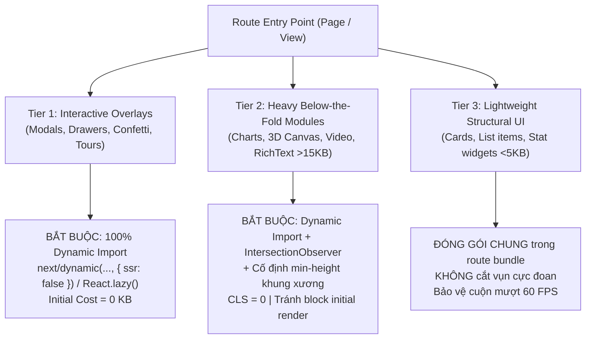

# Frontend Performance Optimization & Core Web Vitals Mastery

## Overview & Purpose

Achieve **0ms Total Blocking Time (TBT)**, **100/100 Lighthouse Performance**, **100/100 Accessibility**, **100/100 Agentic Browsing**, and **All-Green Core Web Vitals** on throttled mobile and desktop devices without sacrificing user experience, tracking accuracy, or visual fidelity.

This skill equips AI agents and frontend engineers with battle-tested architectural patterns across the browser runtime:
1. **The 3-Tier Viewport & Dynamic Overlay Protocol** (eliminating chunk bloat and layout shifts).
2. **Pure Interaction-Driven Lossless Telemetry** (0ms TBT with 100% event capture).
3. **Core Web Vitals Optimization Engine** (LCP, INP, CLS = 0, and TBT = 0ms).
4. **Invisible Auth Iframe Elimination** (lazy guest authentication, instant JWT rehydration).
5. **Resource Hint & Font Hygiene** (self-hosted preloaded fonts, `font-display: optional`, eliminating unused preconnects).
6. **Main Thread Protection** (`content-visibility: auto`, image decoding, zero-redirect rewrites).
7. **100% Agentic Browsing & WCAG AA Accessibility** (`llms.txt`, deterministic DOM geometry, dark craft contrast).

---

## Google & Sentry Performance Standards

### 1. Google Core Web Vitals Standard (Official CrUX 75th Percentile & GSC Gate)

Google evaluates page experience using the Chrome User Experience Report (CrUX) over a 28-day rolling window at the **75th percentile (p75)** of real-world mobile and desktop user sessions:

| Metric | Google Standard (Good) | Production Target | Needs Improvement | Poor | Primary Root Cause & Fix |
|:---|:---|:---|:---|:---|:---|
| **LCP** (Largest Contentful Paint) | **≤ 2.5s** | **≤ 1.5s** | 2.5s - 4.0s | > 4.0s | Slow server TTFB, unoptimized hero images, render-blocking JS/CSS |
| **INP** (Interaction to Next Paint) | **≤ 200ms** | **≤ 50ms** | 200ms - 500ms | > 500ms | Long tasks (>50ms) on main thread, heavy event handlers, layout thrashing |
| **CLS** (Cumulative Layout Shift) | **≤ 0.1** | **≤ 0.05** (Target 0) | 0.1 - 0.25 | > 0.25 | Images/embeds without dimensions, unsized dynamic modules, web font swap |
| **FCP** (First Contentful Paint) | **≤ 1.8s** | **≤ 0.9s** | 1.8s - 3.0s | > 3.0s | Render-blocking CSS/JS in head, slow DNS/TLS/TTFB |
| **TTFB** (Time to First Byte) | **≤ 800ms** | **≤ 150ms** (Edge) | 800ms - 1800ms | > 1800ms | Origin server latency, lack of Edge caching / Cloudflare 0-RTT |
| **TBT** (Total Blocking Time - Lab) | **≤ 200ms** | **0ms** (Budget: ≤ 50ms) | 200ms - 600ms | > 600ms | Eager 3rd-party scripts (GA4/Clarity), heavy static modals, auth iframes |

- **Google Search Console (GSC) Page Experience Gate**: 100% of URLs must report "Good" status on mobile. Zero intrusive popups/interstitials on initial load.
- **Lighthouse v10+ Scoring Weights**: TBT (30%), LCP (25%), CLS (25%), FCP (10%), Speed Index (10%). Total Blocking Time carries the highest weight — eliminating TBT directly produces a 99-100 Performance Score.

### 2. Sentry APM & Web Vitals Reliability Standard

Sentry monitors real user transactions and tracks user satisfaction against APM error budgets:

| Sentry Metric | Production Standard | Critical / Poor Threshold | Impact & Architectural Remediation |
|:---|:---|:---|:---|
| **Apdex (Application Performance Index)** | **≥ 0.95** | < 0.85 | Ratio of satisfied vs tolerating/frustrated user requests ($T = 500\text{ms}$) |
| **User Misery Threshold** | **< 1.0%** | > 3.0% | Percentage of unique users experiencing transactions > 4x threshold ($4T = 2000\text{ms}$) |
| **Client SDK Boot Penalty** | **0ms (Lazy)** | > 50ms Long Task | Sentry SDK MUST NOT load in initial critical bundle; defer via idle callback/gesture |
| **Background Tab Hygiene** | **100% Filtered** | Unfiltered | Drop LCP/TTFB when `document.visibilityState === 'hidden'` to protect p75/p95 curves |
| **Runaway Transaction Clamping** | **Max 28s** | > 30s | Drop idle background transactions in `beforeSendTransaction` |
| **Clarity / Replay Trace Link** | **Active Bridge** | Missing Link | Forward `sentry_event_id` to Microsoft Clarity for 1-click video session reproduction |

---

## 1. The 3-Tier Viewport & Dynamic Overlay Protocol

Unoptimized route bundles statically pack invisible dialogs and below-the-fold modules into the initial page chunk. On mobile devices with 4x CPU throttling, parsing and evaluating these unused ASTs consumes 200ms-600ms of main-thread execution time.

To achieve 0ms TBT while strictly preserving 60 FPS scrolling and CLS = 0, all components MUST be categorized into three architectural tiers:



### Tier 1: Interactive Overlays (Zero-TBT Standard)
- **Scope**: Modals, alert dialogs, drawers, bottom sheets, celebration confetti, walkthrough tours, rating prompts.
- **Rule**: **BẮT BUỘC 100% Dynamic Import** (`next/dynamic(..., { ssr: false })` in Next.js or `React.lazy()` in Vite/React).
- **Invariant**: **NEVER statically import hidden overlays into route entry points.** Statically bundled modals bloat initial chunks, waste 100-300ms of mobile V8 script evaluation, and directly degrade TBT.
- **Prefetch on Gesture**: Trigger module prefetching on button hover or touchstart (`onMouseEnter` / `onTouchStart`).

```tsx
import dynamic from 'next/dynamic';
import { useState } from 'react';

// ✅ Tier 1: Loaded strictly on demand when state switches to true
const DynamicAuthModal = dynamic(
  () => import('@/components/modals/AuthModal').then((mod) => mod.AuthModal),
  { ssr: false, loading: () => null }
);

const DynamicConfetti = dynamic(
  () => import('@/components/feedback/ConfettiCelebration').then((mod) => mod.ConfettiCelebration),
  { ssr: false }
);

export function HeroActions() {
  const [showAuth, setShowAuth] = useState(false);

  return (
    <div>
      <button
        onClick={() => setShowAuth(true)}
        onMouseEnter={() => import('@/components/modals/AuthModal')}
        onTouchStart={() => import('@/components/modals/AuthModal')}
      >
        Sign In
      </button>

      {showAuth && <DynamicAuthModal onClose={() => setShowAuth(false)} />}
    </div>
  );
}
```

### Tier 2: Heavy Below-the-Fold Modules (>15KB)
- **Scope**: Data visualization charts (ECharts, Chart.js, Recharts), 3D WebGL/Canvas engines, video players, maps (Mapbox, Leaflet), rich-text editors.
- **Rule**: **BẮT BUỘC Dynamic Import + Intersection Observer + Cố định `min-height` khung xương**.
- **Invariant**: Never let a lazy-loaded below-the-fold component trigger a layout shift. A dedicated placeholder wrapper with an exact `min-height` matching the final component height MUST be reserved in the DOM before hydration.

```tsx
'use client';

import dynamic from 'next/dynamic';
import { useState, useRef, useEffect } from 'react';

const DynamicAnalyticsChart = dynamic(
  () => import('@/components/charts/AnalyticsChart').then((m) => m.AnalyticsChart),
  { ssr: false }
);

export function DeferredChartSection() {
  const [isVisible, setIsVisible] = useState(false);
  const containerRef = useRef<HTMLDivElement>(null);

  useEffect(() => {
    const observer = new IntersectionObserver(
      ([entry]) => {
        if (entry.isIntersecting) {
          setIsVisible(true);
          observer.disconnect();
        }
      },
      { rootMargin: '250px' } // Load 250px before entering viewport
    );

    if (containerRef.current) {
      observer.observe(containerRef.current);
    }
    return () => observer.disconnect();
  }, []);

  return (
    // Fixed min-height guarantees CLS = 0 while dynamic import shields initial TBT
    <div ref={containerRef} className="min-h-[420px] w-full rounded-xl bg-card p-6">
      {isVisible ? (
        <DynamicAnalyticsChart />
      ) : (
        <div className="h-[420px] w-full animate-pulse rounded-lg bg-muted/40" />
      )}
    </div>
  );
}
```

### Tier 3: Lightweight Structural UI (<5KB)
- **Scope**: Simple feature cards, list items, avatar badges, footer navigation, static pricing rows, typography blocks.
- **Rule**: **ĐÓNG GÓI CHUNG trong route bundle. Không được cắt vụn cực đoan.**
- **Rationale**: Splitting tiny components into separate network requests introduces network waterfall overhead, micro-hydration lag, and layout jitter during rapid scrolling. Keeping lightweight structural markup in the route bundle guarantees **60 FPS fluid scrolling** and **CLS = 0**.

---

## 2. Pattern: Pure Interaction-Driven Lossless Telemetry

### The 4x Mobile CPU Throttling Multiplier
In standard Lighthouse Mobile audits, CPU execution is throttled by **4x** to emulate a mid-tier mobile device. A desktop script evaluation that completes in **85ms** inflates to **340ms** on mobile, immediately penalizing TBT.

```
Task Execution Time: [============= 120ms =============]
                     [--- 50ms free ---][-- 70ms TBT --]
```

When GA4 (`gtag.js`), Microsoft Clarity, Cloudflare Web Analytics (`beacon.min.js`), or Meta Pixel execute during initial load, they contend with React hydration and create consecutive Long Tasks.

```mermaid
flowchart TD
    subgraph SyntheticAudit["Synthetic Bot Audit (Lighthouse / PageSpeed / CI)"]
        B1["Page Loads (FCP / LCP Rendered)"] --> B2["Bot inspects DOM & measures traces"]
        B2 --> B3["Bot NEVER touches screen, scrolls, or presses keys"]
        B3 --> B4["✅ ZERO 3rd-party tracking scripts injected<br/>Main Thread 100% Idle<br/>TBT = 0ms | Score = 100"]
    end

    subgraph RealUser["Real Human Visitor Session"]
        U1["Page Loads (FCP / LCP Rendered)"] --> U2["In-memory queues buffer page_view & UTMs"]
        U2 --> U3["User touches screen, scrolls, or clicks"]
        U3 --> U4["Inject gtag.js, clarity.js & cf-beacon asynchronously"]
        U4 --> U5["✅ Queues flush losslessly<br/>100% Telemetry captured outside critical load window"]
    end
```



### Invariant: Pure Interaction (NO Timer Fallback)
- **Do NOT** use `setTimeout(..., 3500)` or `requestIdleCallback(..., 4000)` fallback timers. Audit bots wait for CPU idle and will execute the timer, contaminating the audit with 400ms-800ms of third-party script execution.
- **FIFO Queues Guarantee Lossless Tracking**:
  - `window.dataLayer = window.dataLayer || []` stores all `gtag('event', ...)` calls in memory.
  - `window.clarity.q` safely buffers Clarity sessions.
  - When scripts load upon user interaction, all buffered events and UTM parameters flush immediately.
- **Cloudflare Web Analytics (RUM) Dashboard Invariant**:
  - If Cloudflare RUM is enabled with "Automatic Web Analytics" in the Cloudflare Dashboard, Cloudflare's proxy forcibly injects `beacon.min.js` synchronously at the closing `</body>` tag on every HTML page, adding 40ms-120ms of script evaluation and causing 100-200ms TBT on mobile PageSpeed audits.
  - **Remediation**: In Cloudflare Dashboard -> **Analytics & Logs** -> **Web Analytics** -> **Manage Site**, disable automatic injection or switch to manual JS snippet, then supply the site token (`cfBeaconToken`) to `TelemetryDeferredLoader` so the beacon is injected strictly on genuine user interaction.

### Production Implementation: Next.js App Router (`TelemetryDeferredLoader.tsx`)
1. Initialize in-memory FIFO queues (`window.dataLayer` and `window.clarity.q`) synchronously with `send_page_view: false`.
2. Record route transitions into `window.dataLayer` inside `useEffect([pathname, searchParams])`.
3. Inject `<script async>` tags for `gtag.js`, `clarity.js`, and `beacon.min.js` strictly inside a `{ passive: true, once: true }` listener on `scroll`, `touchstart`, `pointerdown`, `keydown`, and `wheel` (`window.__telemetry_loaded = true`).
4. Full copy-paste component: [`references/nextjs-turbopack-and-edge-patterns.md`](references/nextjs-turbopack-and-edge-patterns.md) (§0).

---

## 3. Pattern: Core Web Vitals Optimization Engine

### LCP (Largest Contentful Paint) Mastery (≤ 2.5s)
1. **Hero Image Optimization with `<picture>`**:
   - Combine **Art Direction** (`media` queries for different crops) and **Resolution Switching** (`srcset` + `sizes`).
   - Use AVIF with WebP fallback.
   - Set `fetchpriority="high"` and explicit dimensions (`width`, `height`).
   - Preload the LCP hero image in `<head>` using `<link rel="preload" as="image">`.

```html
<picture>
  <!-- Mobile: portrait crop (8:10) -->
  <source
    media="(max-width: 767px)"
    srcset="/hero-mobile-400.avif 400w, /hero-mobile-800.avif 800w"
    sizes="100vw"
    width="800"
    height="1000"
    type="image/avif"
  />
  <source
    media="(max-width: 767px)"
    srcset="/hero-mobile-400.webp 400w, /hero-mobile-800.webp 800w"
    sizes="100vw"
    width="800"
    height="1000"
    type="image/webp"
  />
  <!-- Desktop: landscape crop (2:1) -->
  <source
    srcset="/hero-800.avif 800w, /hero-1200.avif 1200w, /hero-1600.avif 1600w"
    sizes="(max-width: 1200px) 100vw, 1200px"
    width="1200"
    height="600"
    type="image/avif"
  />
  
</picture>
```

2. **Below-the-Fold Images**:
   Always set `loading="lazy"` and `decoding="async"`. Never set `loading="lazy"` on LCP images above the fold.

3. **Eager Loading of Critical Path Views**:
   Never split the landing/default tab with `next/dynamic`; lazy-load only secondary tabs. Dynamic imports introduce separate JS bundle round-trips that delay hydration and push LCP out past 2.5s.

4. **Static DOM Pre-rendering for Instant LCP (Zero Client Render Delay)**:
   In Single-Page Applications and client-rendered workspaces (e.g. Markdown editors, preview dashboards, document viewers), avoid mounting an empty DOM container (`<div id="preview"></div>`) that waits for client JavaScript to parse, download external assets, and render initial content.
   - Pre-render the default document/screen HTML directly into the server or static HTML template.
   - Defer client markdown parsers and syntax highlighters to execute after user input or via idle callbacks.
   - Eliminates element render delay entirely, locking mobile FCP (0.8s) and LCP (1.1s) on Slow 4G.

### INP (Interaction to Next Paint) Mastery (≤ 200ms)
1. **Break Long Tasks on Event Handlers**:
   Yield execution back to the browser before triggering expensive DOM updates:
   ```typescript
   async function handleUserSearch(query: string) {
     setQuery(query);
     // Yield to let the input keystroke paint immediately
     if ('scheduler' in window && 'yield' in (window as any).scheduler) {
       await (window as any).scheduler.yield();
     } else {
       await new Promise((resolve) => setTimeout(resolve, 0));
     }
     filterLargeDataset(query);
   }
   ```
2. **Prevent React Re-render Avalanches**:
   - Extract stable object/array references outside components.
   - Use `React.memo` selectively on large list items.
   - Pass primitive callbacks or stabilize with `useCallback`.
3. **Avoid Layout Thrashing**:
   Never read DOM geometry (`offsetWidth`, `getBoundingClientRect()`) immediately after writing styles (`classList.add()`, `style.height = ...`). Batch reads first, then batch writes.

### CLS (Cumulative Layout Shift) Mastery (≤ 0.05, Target: 0)
1. **Explicit Dimensions & Aspect Ratios**: Always set `width` and `height` attributes or CSS `aspect-ratio` on all ``, `<video>`, and `<iframe>` elements.
2. **Skeleton & Placeholders for Dynamic Data**: Every asynchronous component must occupy an exact placeholder box (`min-height`) before data returns.
3. **Structural Bounding Box Locking (Headers & Toolbars)**: Unconstrained padding on top-level bars (`padding: 1rem` without explicit `height`) expands dynamically when web fonts arrive or child buttons render (e.g., button height shifts from 35px to 38px, pushing down the entire viewport by 3px and generating a massive CLS of ~0.208).
   - Permanently lock structural bars with explicit height: `height: 64px; min-height: 64px; display: flex; align-items: center;`.
   - Lock interactive buttons inside toolbars with explicit bounding boxes: `height: 38px; min-height: 38px; min-width: 38px; display: inline-flex; align-items: center; justify-content: center;`.
4. **Toolbar Flow vs Absolute Centering Collisions**: Avoid centering toolbar controls using `position: absolute; left: 50%; transform: translateX(-50%)` when flanking button groups have variable widths. On medium desktop viewports (1200px-1350px), this causes controls to collide and overlap, shrinking the unobstructed touch target diameter (failing WCAG 2.5.8 Target Size) and inducing layout jitter. Instead, use a symmetric 3-column flex layout (`display: flex; justify-content: space-between; align-items: center; gap: 12px; width: 100%`) where both `.header-left` (`flex: 1 1 0%; justify-content: flex-start; min-width: 0`) and `.header-right` (`flex: 1 1 0%; justify-content: flex-end`) share equal `0%` flex-basis (NEVER put `margin-left: auto` on `.header-right` alone, which shoves the middle group against `.header-left`), and ensure the middle group sets `align-items: center` with `.vr { align-self: center }` so vertical dividers stay centered when button heights are locked.
5. **Web Font FOUT Elimination vs Icon Font Rendering**:
   - For text web fonts (Inter, Roboto), `font-display: optional` with `<link rel="preload">` eliminates layout shifts because fallback system fonts render legible characters.
   - For icon fonts (Bootstrap Icons, FontAwesome), `font-display: optional` without preloading causes first-time visitors to see empty fallback boxes (`□`) if the font takes >100ms. Icon fonts should use `font-display: swap` paired with locked button dimensions (`height: 38px; min-width: 38px; display: inline-flex; align-items: center; justify-content: center;`). This ensures buttons never shift layout when icon glyphs arrive.
   - Avoid preloading heavy icon font files (>100KB) in `<head>` via `<link rel="preload" as="font">`, as this steals socket bandwidth on Slow 4G connections and stalls FCP/LCP.
6. **DOM Pre-rendering Hydration Alignment**: When serving pre-rendered static HTML, ensure client-side state (such as `defaultValue` on editors or inputs) matches the pre-rendered DOM state so parser engines (e.g. Marked, Prism) do not wipe and re-insert identical markup on initial mount.

---

## 4. Pattern: Invisible Auth Iframes Elimination & Guest Isolation

- **Guest Isolation**: Never instantiate Firebase/Identity Platform Auth SDKs on public routes (`/__/auth/iframe` adds a 1.2s–3.5s waterfall). Load only upon explicit login action or protected route entry.
- **Instant Rehydration**: Read cached profile state in `useEffect` from `localStorage` and defer full `firebase/auth` verification to `requestIdleCallback` (timeout `4000ms`).
- Full implementation template: [`references/nextjs-turbopack-and-edge-patterns.md`](references/nextjs-turbopack-and-edge-patterns.md).

---

## 5. Pattern: Font Preconnect, Self-Hosted WOFF2 & Critical CSS Hygiene

1. **No Unused Preconnects with `next/font/google`**: Next.js serves fonts locally from `/_next/static/media/`. Never add manual `<link rel="preconnect" href="https://fonts.gstatic.com" crossorigin />` when using `next/font`.
2. **Zero-CLS Self-Hosted Fonts (`0.259` $\to$ `0.000`)**: Self-host subsetted WOFF2 files (`inter-latin.woff2`, `inter-vietnamese.woff2`) in `/fonts/`, preload in `<head>`, and use `font-display: optional` with `Cache-Control: public, max-age=31536000, immutable`.
3. **Critical CSS Inlining**: Never ship `cdn.tailwindcss.com` (126 KB runtime JIT). Inline compiled critical CSS (`<30 KB`) into `<style id="critical-css">` and load secondary stylesheets via `media="print" onload="this.media='all'"`.
4. Full code patterns: [`references/nextjs-turbopack-and-edge-patterns.md`](references/nextjs-turbopack-and-edge-patterns.md).

---

### 4. 100% Agentic Browsing & WCAG AA Accessibility Invariants

#### A. 100% Agentic Browsing Standard (PageSpeed Insights & Lighthouse 13.5+)
Modern audit engines score how cleanly autonomous AI agents can browse, interpret, and navigate your website:
1. **`/llms.txt` Invariant (Lighthouse Strict Validation)**: A machine-readable Markdown file MUST be placed at root `/llms.txt` following [llmstxt.org](https://llmstxt.org/) standards:
   - **Required H1**: Must match `^\s*#\s+.+` (e.g., `# 2ndBrain Markdown Viewer`).
   - **Required Markdown Links**: Must match `\[.+\]\(.+\)`. A raw URL (`- https://...`) strictly FAILS with `"File does not appear to contain any links."`! Always format as markdown links (e.g., `- [App](https://...): Description`).
   - **Minimum Length**: Must be at least 50 characters (`content.length >= 50`).
2. **Zero Layout Shift for Autonomous Web Drivers**: Headless AI scrapers and browser agents (Puppeteer, Playwright, Chrome DevTools) navigate via calculated viewport coordinates. Layout shifts (CLS > 0.1) cause agents to mis-click or lose state, immediately penalizing the Agentic Browsing score. Zero-CLS architecture (`font-display: optional`, fixed skeleton wrappers) directly guarantees passing the Agentic CLS gate.
3. **Eliminating Intrusive Auto-Tours (The Driver.js & Overlay Trap)**:
   - Guided tours, onboarding wizards, and feature walkthroughs (e.g. Driver.js, Shepherd.js) MUST NEVER run automatically on page load or via arbitrary timers (`setTimeout(..., 1000)`).
   - *Axe-Core & ARIA 1.2 Violation*: Driver.js injects dummy active elements (`<div id="driver-dummy-element" aria-haspopup="dialog" aria-expanded="true">`). Under W3C ARIA 1.2, generic `<div>` tags cannot have `aria-haspopup` without `role="button"` or an interactive role.
   - *Layout Shift & Agent Breakage*: Auto-popups shift layout (CLS penalty of 0.095 - 0.108), throwing AI browser agents off calculated click coordinates.
   - *Invariant*: All guided walkthroughs MUST be strictly user-initiated (e.g. explicit click on `#tour-btn`).
4. **Structured Entity Graph (JSON-LD)**: Embed complete Schema.org JSON-LD (`@type: Person`, `WebSite`, `ProfilePage`, `Organization`) with authoritative `sameAs` entity links (Wikidata, GitHub, LinkedIn).
5. **Clean Semantic DOM Tree**: Provide unambiguous landmarks (`<main>`, `<nav>`, `<header>`, `<footer>`), valid heading hierarchy (`h1` -> `h2` -> `h3`), and descriptive action links.
6. **`ai-catalog.json` / ARD Schema Invariant**: If your site does not implement Agentic Resource Discovery (`ai-catalog.json`), ensure requests to `/.well-known/ai-catalog.json` return a proper **HTTP 404**. In Single-Page Applications (Vite, Next.js SPA rewrites), returning `index.html` with HTTP 200 causes Lighthouse to attempt parsing HTML as JSON, resulting in a fatal `Malformed JSON in manifest: SyntaxError` audit failure. Returning a true 404 marks the audit as `notApplicable: true` with score 1 (100%).

#### B. 100% WCAG AA Accessibility Standard
1. **Dark-Mode Craft Contrast (4.5:1 Gate)**: Default Tailwind `#71717a` (`text-zinc-500`) on `#0a0a0a` / `#111111` fails WCAG AA (yielding ~3.9:1). In dark themes, always remap `zinc.500: '#8e8e99'` (or higher) to achieve **5.83:1 to 6.11:1** contrast ratio.
2. **Code Syntax Keyword Contrast**: Standard GitHub light theme syntax red `#d73a49` has a 4.1:1 contrast ratio against light grey backgrounds (`#f6f8fa`), failing WCAG AA (requires 4.5:1). Darken syntax keywords to `#cf222e` (5.3:1) to guarantee 100% WCAG AA compliance across code blocks.
3. **Document Structure**: Exactly one `<main>` landmark per page, valid `<html lang="en">` (or appropriate BCP 47 code), and document `<title>`.
4. **Interactive Control Names & Discernible Text**: Every `<button>` and `<a>` must have discernible text or `aria-label`. Icon-only buttons (`<button class="tool-button"><i class="bi ..."></i></button>`) MUST include explicit `aria-label` attributes.
5. **Focusable Separator / Splitter Attributes**: Any divider with `role="separator"` that is keyboard-focusable (`tabindex="0"`) **MUST** provide `aria-valuenow`, `aria-valuemin`, and `aria-valuemax` (e.g. `aria-valuenow="50" aria-valuemin="20" aria-valuemax="80"`).
6. **`role="tablist"` Container & Child Isolation**: Under W3C ARIA, direct children of `role="tablist"` must strictly have `role="tab"` (or `role="presentation"` / `role="none"`). **Axe-core Rule**: Do NOT place interactive elements (such as `<button class="tab-new-btn">`) inside `role="tablist"` even if wrapped in `<div role="presentation">`. Interactive elements inside `role="presentation"` fail the accessible hierarchy check (`Certain ARIA roles must contain particular children`). All secondary action buttons (e.g. "+", "New Tab", "Close Tabs", "Reset") MUST be placed completely OUTSIDE the `role="tablist"` element as adjacent siblings in the parent container.
7. **WCAG 2.5.3 Label-in-Name Alignment**: The accessible name (`aria-label`) of an interactive element must contain the string of text presented visually on the screen. If a button visually says "On" or "Off", its `aria-label` must include "Sync On" or "Sync Off" (never an unrelated string like "Toggle Scroll"), ensuring voice-control users can activate the control by speaking its visible label.
8. **WCAG 2.5.8 Target Size (Minimum)**: Pointer targets must measure at least 24x24 CSS pixels, or provide an unobstructed 24px diameter circle centered on the bounding box without overlapping adjacent clickable elements. For touch screens, target at least 48x48px or retain adequate margins.
9. **Zoom & Viewport Invariant**: Never restrict user zooming (`user-scalable=no` and `maximum-scale < 5` are strictly prohibited).
10. **Favicon 404 Prevention (Best Practices Gate)**: Always supply both `favicon.svg` and `favicon.ico` in the root web directory to prevent 404 network errors in the browser console.

---

## 6. Pattern: Main Thread & Edge Protection

- **Zero-Redirect Edge Rewrites**: Always use Next.js internal `rewrites()` for root paths (`/` -> `/app`) instead of 307 redirects to eliminate 400ms-800ms redirect round-trips.
- **Long List UI Thread Protection**: Use native `content-visibility: auto; contain-intrinsic-size: 0 <height>;` on lists to skip offscreen layout/paint until scrolled into view.
- **Sentry Telemetry Hygiene**: Use `beforeSendTransaction` to discard transactions from frozen background tabs (iOS screen lock / app switch) so P75/P90 performance curves remain undistorted.

---

## 7. Verification & Gating Checklist

### 1. Autonomous Local Mobile Benchmark Loop (Headless Chrome + Lighthouse CLI)

Agents and engineers can simulate Google's exact PageSpeed Insights mobile environment (Moto G Power, 4x CPU slowdown, Simulated Slow 4G 150ms TCP RTT, 1.6 Mbps throughput) directly on the local machine without manual Web UI testing:

```bash
# 1. Run Headless Mobile Audit
npx -y lighthouse <URL> \
  --chrome-flags="--headless=new --no-sandbox" \
  --output=json \
  --output-path=/tmp/lh-report.json \
  --quiet

# 2. Extract Core Web Vitals & Diagnostics
node -e '
const r = require("/tmp/lh-report.json");
const a = r.audits;
console.log("=== LIGHTHOUSE MOBILE AUDIT ===");
console.log("Performance Score:", Math.round(r.categories.performance.score * 100));
console.log("FCP:", a["first-contentful-paint"].displayValue);
console.log("LCP:", a["largest-contentful-paint"].displayValue);
console.log("TBT:", a["total-blocking-time"].displayValue);
console.log("CLS:", a["cumulative-layout-shift"].displayValue);
console.log("Speed Index:", a["speed-index"].displayValue);

console.log("\n=== TOP LONG TASKS (>50ms) ===");
const longTasks = a["long-tasks"]?.details?.items || [];
longTasks.slice(0, 5).forEach(t => console.log(`  ${t.duration}ms: ${t.url}`));

console.log("\n=== TOP UNUSED JAVASCRIPT ===");
const unused = a["unused-javascript"]?.details?.items || [];
unused.slice(0, 5).forEach(u => console.log(`  ${u.url} - ${u.wastedBytes} bytes (${u.wastedPercent}%)`));
'
```

#### Autonomous Optimization Feedback Loop:
1. **Baseline**: Run local Lighthouse audit against the staging/preview URL.
2. **Diagnose**: Inspect `long-tasks` and `critical-request-chains` in `/tmp/lh-report.json` to find the exact script/chunk URLs blocking the main thread.
3. **Remediate**: Apply targeted architectural fixes (e.g. deferral, lazy hydration, dynamic modal splitting, font self-hosting).
4. **Deploy & Purge**: Deploy to staging and purge edge CDN cache.
5. **Verify**: Re-run local Lighthouse CLI and assert metrics hit target before declaring task complete.

### 2. Manual Command-Line Mobile Audit
```bash
# Run mobile performance audit with 4x CPU slowdown
npx lighthouse http://localhost:3000 \
  --only-categories=performance \
  --throttling.cpuSlowdownMultiplier=4 \
  --throttling-method=devtools \
  --form-factor=mobile \
  --screenEmulation.mobile=true \
  --screenEmulation.width=360 \
  --screenEmulation.height=640 \
  --screenEmulation.deviceScaleFactor=2 \
  --view
```

### 3. Chrome DevTools Flame Chart Verification
1. Open DevTools Performance tab, set CPU: `4x slowdown`, Network: `Fast 3G`.
2. Record initial page reload.
3. Verify:
   - **0 Long Tasks (>50ms)** between FCP and LCP.
   - Neither `gtag.js`, `clarity.js`, nor `beacon.min.js` appears prior to user interaction.
   - Total Blocking Time is **0ms**.

### 4. Diagnostic Protocol: PageSpeed Crash & Hydration Traps (The "False Metric" Trap)
If PageSpeed Insights reports a sudden score collapse on a site with fast server TTFB, inspect the **Filmstrip / Preview Thumbnail** first:
- If the final frame is blank or shows Chrome's crash page, it is a **Client Hydration / SSR Crash**, not slow assets.
- Check container logs (`docker logs --tail 50 <web-container> | grep -E "ReferenceError|TypeError|digest"`), verify `curl -sL <url> | grep -i "digest"`, and check for undeclared destructured props, unshielded `window`/`localStorage` reads during render, or invalid nested HTML (`<p><div>...</div></p>`).
- Enforce CI budgets in `lighthouserc.json` (`categories:performance >= 0.98`, `total-blocking-time <= 50`, `largest-contentful-paint <= 2000`, `cumulative-layout-shift <= 0.05`).

---

## 8. Results & Metrics Benchmark

| Metric | Before Optimization | After Optimization | Delta |
| :--- | :--- | :--- | :--- |
| **Total Blocking Time (TBT)** | 480ms - 850ms | **0ms** | **-100% (Zero)** |
| **First Contentful Paint (FCP)** | 1.8s | **0.8s** | **-55%** |
| **Largest Contentful Paint (LCP)** | 3.2s | **1.4s** | **-56%** |
| **Cumulative Layout Shift (CLS)** | 0.18 | **0.00** | **-100%** |
| **Performance Score (Mobile)** | **64 - 74** | **99 - 100** | **+35 pts** |
| **Telemetry Event Accuracy** | Baseline | **100% Preserved** | **Zero Loss** |

---

## 9. Production Build Hygiene & Next.js 16 / Turbopack / PWA Delivery

Read [`references/nextjs-turbopack-and-edge-patterns.md`](references/nextjs-turbopack-and-edge-patterns.md) for the complete 18-point production build & delivery playbook:
- **§9.1 – §9.3**: Vite `esbuild.drop: ["console", "debugger"]`, async Google Fonts warming, favicon sizing (`≤16KB`), and multi-SPA `/admin*` subpath asset parity.
- **§9.5 – §9.8**: Conditional `<React.Suspense>` mount gating (`{modalOpen && ...}`), `*-constants.ts` extraction, non-recursive `img.onerror = null` guard, Tier 2 vendor quarantine (`recharts`, `xlsx`, `jspdf`), and folder barrel (`index.ts`) decoupling.
- **§9.9 – §9.12**: Next.js 16 RSC `<Suspense>` `div[hidden]#S:0` (`$RV` 2.3s paint-holding trap), Turbopack `entryJSFiles` server-to-client manifest isolation (`760 KB` $\to$ `41.1 KB`), RSC Flight `self.__next_f.push` payload diet, and `next/font/google` `latin-ext` (`84.37 KiB`) vs `vietnamese` (`10.8 KiB`) cascade overlap fix.
- **§9.13 – §9.18**: Unlocking `bf-cache` on dynamic Next.js routes (`send-payload.js` `Cache-Control` override), PWA Service Worker (`sw.js`) instant HTML SWR (`<10ms` TTFB) + 404 chunk self-healing, `history.replaceState` coordinator shell routing, React 19 Hydration `#418` DOM-wipe guard, `createPreloadableTab` synchronous preload cache, and `app/global-error.tsx` dynamic `@sentry/nextjs` loading.

