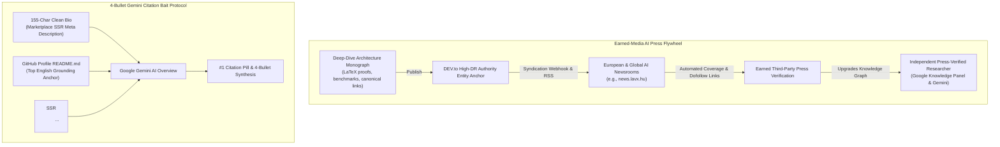

# GEO-SEO Suite — AI Search, Knowledge Graph & Generative Engine Optimization

> **Core Philosophy:** AI search engines do not just rank pages — they **extract passages, resolve Knowledge Graph entities, and cite authoritative sources**. Being the **#1 Citation Pill** in Google AI Overviews, ChatGPT Search, Perplexity, and Claude is the new Ranking #1.

---

## 1. Command & Workflow Quick Reference

| Command / Mode | Action | Primary Script / Reference |
| :--- | :--- | :--- |
| `/geo audit <url>` | Full 6-Pillar GEO + SEO Audit (0–100 Composite Score) via 5 parallel subagents | `references/scoring-methodology.md` |
| `/geo citability <url>` | Deterministic passage-level AI citation readiness scorer (134–167w optimal blocks) | `scripts/citability_scorer.py` |
| `/geo crawlers <url>` | Verify AI crawler access (`GPTBot`, `OAI-SearchBot`, `ClaudeBot`, `PerplexityBot`, `Google-Extended`) + IETF `Content-Signal` directive in `robots.txt` | `references/geo-ai-visibility.md` |
| `/geo llmstxt <url>` | Validate or generate `/llms.txt` and `/llms-full.txt` for LLM ingestion | `scripts/llmstxt_generator.py` |
| `/geo brands <url>` | Scan off-site brand mentions & entity authority across Reddit, YouTube, Wikipedia, Wikidata, ORCID, GitHub, LinkedIn | `scripts/brand_scanner.py` |
| `/geo platforms <url>` | Platform-specific readiness for Google AI Overviews, ChatGPT, Perplexity, Gemini, Claude, Copilot | `references/geo-platform-analysis.md` & `references/platform-algorithms.md` |
| `/geo schema <url>` | Detect, validate, and generate SSR JSON-LD (`Person`, `ProfilePage`, `Organization`, `SoftwareApplication`, `Article`, `FAQPage`) | `references/geo-schema.md` & `schema/*.json` |
| `/geo technical <url>` | Technical SEO, Core Web Vitals, SSR vs CSR check, HTTP `Accept: text/markdown` Content Negotiation, and RFC 8288 `Link` headers | `scripts/fetch_page.py`, `scripts/seo_audit.py` & `references/geo-technical.md` |
| `/geo content <url>` | E-E-A-T evaluation + **9 Princeton GEO Methods** (+40% citations, +37% stats) + **4-Bullet Executive Summary Grounding Block** | `references/geo-content.md` & `references/princeton-geo-research.md` |
| `/geo entity <name/id>` | **Knowledge Graph & Share-of-SERP v2.0 Audit**: Google Knowledge Panel (`/g/...`), Wikidata (`Q...`), ORCID (`0009-...`), and Page-1 SERP Monopoly (`X/10 Slots`) | Section 5 below |

---

## 2. Composite GEO Score (0–100) & 5-Subagent Parallel Architecture

When executing a full audit (`/geo audit <url>`), run discovery first (`python3 scripts/fetch_page.py <url>` and `python3 scripts/seo_audit.py <url>`), then evaluate across the **6 weighted pillars** (or dispatch 5 parallel `flash` subagents):

```
GEO_Score = (Citability * 0.25)
          + (Brand      * 0.20)
          + (EEAT       * 0.20)
          + (Technical  * 0.15)
          + (Schema     * 0.10)
          + (Platform   * 0.10)
```

| Pillar | Weight | Subagent / Reference | Deterministic Script |
| :--- | :--- | :--- | :--- |
| **1. AI Citability & Visibility** | **25%** | `references/geo-ai-visibility.md` | `python3 scripts/citability_scorer.py <url>` |
| **2. Brand & Entity Authority** | **20%** | `references/geo-ai-visibility.md` | `python3 scripts/brand_scanner.py <url>` |
| **3. Content Quality & E-E-A-T** | **20%** | `references/geo-content.md` | `references/princeton-geo-research.md` |
| **4. Technical & Agent-Readiness** | **15%** | `references/geo-technical.md` | `python3 scripts/fetch_page.py <url>` |
| **5. Structured Data (JSON-LD)** | **10%** | `references/geo-schema.md` | `schema/*.json` & `references/schema-templates.md` |
| **6. Platform Optimization** | **10%** | `references/geo-platform-analysis.md` | `references/platform-algorithms.md` |

### Score Rating Bands
- **90–100 (Excellent)**: Primary citation source across Google AI Overviews, ChatGPT, and Perplexity.
- **75–89 (Good)**: Strong foundation; targeted passage or entity graph fixes needed.
- **60–74 (Fair)**: Moderate presence; missing self-contained answer blocks or off-site entity corroboration.
- **40–59 (Poor)**: Weak signals; CSR-blocked or unstructured manifesto text that LLMs skip.
- **0–39 (Critical)**: Invisible to AI crawlers (`robots.txt` blocked or zero entity grounding).

---

## 3. High-Impact GEO Optimization Playbook

### 3.1. The 4-Bullet Executive Summary Grounding Block (Capture #1 AI Overview Citation Pill)
Google AI Overviews (Gemini) and Perplexity strongly prefer pages that provide a **pre-digested, fact-dense summary block** immediately after the hero/definition lead rather than long narrative "manifesto" paragraphs.
- **Lead Definition Sentence (40–60 words)**:
  - Pattern: `"[Entity / Brand] ([Aliases / Handle]) is a [Canonical Role / Category] founded/born in [Year/Location], specializing in [Core Domains] and creator of [Flagship Works]."`
- **4 Scannable Executive Bullets** (`<ul>` or `<dl>` directly in initial SSR HTML):
  1. **Education / Origin / Foundation**: Concrete institution, year, and foundational achievement.
  2. **Experience / Track Record**: Quantified years, scale metrics, and industry vertical.
  3. **Core Stack & Flagship Works**: Named open-source packages, systems, and quantified benchmarks (`p99 latency`, `RPS`, `0ms TBT`).
  4. **Verified Digital Identity**: Canonical URL, Knowledge Graph IDs (`Wikidata`, `ORCID`), and primary technical profiles.

### 3.2. Passage Citability Engineering (`scripts/citability_scorer.py`)
AI answer engines chunk pages by headings (`<h2>`/`<h3>`). Every core section should score **≥ 75/100** across the 5 deterministic dimensions:
1. **Answer Block Quality (30 pts)**: Question-style or clear topical heading + direct answer in the first 60 words + explicit definition pattern (`"X is..."`, `"X refers to..."`).
2. **Self-Containment (25 pts)**: Optimal passage length **134–167 words** (acceptable: 100–200 words); pronoun density (`it, they, this, that`) **< 2%** so the chunk makes sense when extracted out of context; **3+ proper nouns** per passage.
3. **Structural Readability (20 pts)**: Sentence length 10–20 words, bulleted lists, or comparison tables.
4. **Statistical Density (15 pts)**: Concrete percentages, dollar/latency figures, years, and named sources.
5. **Uniqueness Signals (10 pts)**: Original benchmarks, empirical test results, or architecture case studies.

### 3.3. The 9 Princeton GEO Methods (`references/princeton-geo-research.md`)
Empirical findings from Princeton / Georgia Tech / Allen AI / IIT Delhi (*GEO: Generative Engine Optimization*):

| Method | Visibility Boost | Implementation Rule |
| :--- | :--- | :--- |
| **1. Cite Authoritative Sources** | **+40%** | Link and attribute claims to primary specs, RFCs, or peer-reviewed benchmarks |
| **2. Statistics Addition** | **+37%** | Replace vague adjectives ("fast", "scalable") with exact metrics (`12.4ms p95`, `99.99% SLA`) |
| **3. Quotation Addition** | **+30%** | Include attributed technical insights or architectural principles |
| **4. Authoritative Tone** | **+25%** | Direct, verifiable engineering prose; zero fluff |
| **5. Easy-to-Understand** | **+20%** | Lead with plain-language summary before deep technical mechanics |
| **6. Technical Terms** | **+18%** | Use canonical domain terminology (`Singleflight`, `JSON-LD @graph`, `RFC 8288`) |
| **7. Unique Vocabulary** | **+15%** | High lexical diversity; avoid repetitive boilerplate |
| **8. Fluency Optimization** | **+15–30%** | Clean transitions, semantic HTML5 (`<article>`, `<section>`, `<dl>`, `<table>`) |
| ~~9. Keyword Stuffing~~ | **-10% (Penalty)** | **NEVER stuff keywords** — LLMs penalize unnatural repetition |

---

## 4. Agent-Readiness & Technical Infrastructure Checks

Beyond standard SEO (`title`, `meta description`, `canonical`, `sitemap.xml`, Core Web Vitals), verify these **4 modern AI Agent protocols**:

1. **AI Crawler Access (`robots.txt`)**:
   - Explicitly allow `GPTBot`, `OAI-SearchBot`, `ChatGPT-User`, `ClaudeBot`, `Claude-Web`, `PerplexityBot`, `Google-Extended`, `Googlebot`, `Bingbot`, `Applebot-Extended`.
2. **IETF `Content-Signal` Directive (`draft-romm-aipref-contentsignals`)**:
   - Declare downstream AI usage rights in `robots.txt`:
     ```txt
     Content-Signal: search=yes, ai-input=yes, ai-train=yes
     ```
3. **`/llms.txt` & `/llms-full.txt` Standard**:
   - Serve a clean Markdown index at `/llms.txt` (`H1` Brand/Entity name, `> ` summary blockquote, categorized links with 1-line factual descriptions, and canonical entity identifiers).
4. **HTTP `Accept: text/markdown` Content Negotiation & RFC 8288 `Link` Headers**:
   - Test with `curl -sI -H "Accept: text/markdown" <url>` to check if the edge/server supports direct Markdown delivery or advertises machine-readable resources via `Link:` headers.
5. **Codebase Internal Link Graph & Orphan/Dead-End Route Audit (`Hub & Spoke`)**:
   - When auditing a Next.js/Astro codebase, scan all `<Link href>` / `<a href>` against defined page routes to eliminate: (a) **Orphan Pages** (0 incoming internal links), (b) **Dead-End Pages** (0 outgoing contextual links), (c) **Shallow Buried Pages** (>3 clicks from root hub), and (d) **Weak Anchor Text** (`"click here"`, `"read more"` — replace with entity/topic-rich anchors).
6. **Intent-Based Keyword Clustering (`1-Cluster-1-Page` Anti-Cannibalization)**:
   - Pair `scripts/autocomplete_ideas.py` with a 3-tier topical hierarchy (*Level 1: Pillar Hub ➔ Level 2: Subtopic Cluster ➔ Level 3: Supporting Keywords*). Never target the same intent cluster across two URLs; map modifiers deterministically (`how to X` ➔ Tutorial, `X vs Y` ➔ Comparison Matrix, `best X` ➔ Benchmark List).
7. **Bilingual / Multilingual `hreflang` Reciprocity & Self-Canonical Guardrail**:
   - Every localized page (`/vi/...`, `/en/...`) MUST use a **self-referencing `<link rel="canonical">`** (never canonicalize a translated page back to the default language, which de-indexes the translation) paired with reciprocal `<link rel="alternate" hreflang="vi|en|x-default" />` links across all language variants.

---

## 5. Knowledge Graph Triangulation & Page-1 SERP Monopoly (Share-of-SERP v2.0)

When auditing a **Person, Founder, Author, or Brand Entity**, ranking #1 on a single domain is not enough because Google's **Host Crowding Rule** caps any single root domain at ~2 organic slots on Page 1. To achieve **10/10 Page-1 SERP Monopoly** and lock in the **Google Knowledge Panel (`/g/...`)**:

### Phase 1: Knowledge Graph Triangulation (`Website <-> Wikidata <-> ORCID`)
1. **Canonical Entity Hub (`@id: https://<domain>/#person` or `#organization`)**:
   - Server-rendered JSON-LD `@graph` containing `ProfilePage` + `Person` (or `Organization`) + `WebSite`.
   - Include `mainEntityOfPage`, `identifier` (`googleKgMID: /g/...`, `Wikidata: Q...`, `ORCID: 0009-...`), and exhaustive `sameAs` array.
2. **Wikidata Entity (`Q...`)**:
   - Verify live JSON via `https://www.wikidata.org/wiki/Special:EntityData/<QID>.json`.
   - Audit claims: `P2671` (Google Knowledge Graph ID `/g/...`), `P856` (Official Website), `P1581` (Official Blog), `P496` (ORCID iD), `P2037` (GitHub), `P6634` (LinkedIn), `P2002` (X/Twitter), `P11245` (YouTube).
3. **ORCID Public Record (`0009-...`)**:
   - Verify public works via `curl -s -H "Accept: application/json" https://pub.orcid.org/v3.0/<ORCID>/works`.
   - Ensure all flagship open-source/research works have matching titles, URLs, and consistent package scopes with the official website and BibTeX (`/orcid-works.bib`).

### Phase 2: 10-Domain Entity Fortress (Share of SERP `SoV = X/10 Slots`)
Measure Page-1 Share of Voice across 4 query tiers:
1. **Query 1 (Handle / Brand Exact Match)** — Target: **10/10 Slots (100% Monopoly)**
2. **Query 2 (Name + Role / Category Authority)** — Target: **10/10 Slots + AI Overview #1 Citation Pill**
3. **Query 3 (International / Unaccented Name)** — Target: **≥ 8/10 Slots + Verified Knowledge Panel**
4. **Query 4 (Pure Head Brand / Full Name)** — Target: **≥ 7/10 Slots + Images/Video Rich Pack**

To push homograph/competitor noise from Page 1 to Page 2, occupy independent high-DR domains that each claim 1–2 Page-1 slots and cross-link via `sameAs` / canonical citations:
- **Owned Tier**: Root Hub (`domain.com`), Subdomains (`blog.domain.com`, `docs/truyen.domain.com`)
- **Authority Registry Tier**: `orcid.org`, `wikidata.org`, `scholar.google.com`, `npmjs.com` / `pypi.org`
- **Social & Video Tier**: `linkedin.com/in/...`, `github.com/...`, `youtube.com/@...` (triggers Video Pack), `x.com/...`
- **Technical Syndication Tier**: `viblo.asia`, `dev.to`, `medium.com`, `hashnode.com`, `substack.com`, press/news domains.
- **Consistency Invariant & Auto-Syndication (`~/profile/AGENTS.md`)**: Whenever auditing or updating Kido's entity ecosystem (`khanhdp.com`, `blog.khanhdp.com`, `truyen.khanhdp.com`), ALWAYS read `~/profile/AGENTS.md` first. `DEVTO_API_KEY`, `VIBLO_API_KEY`, and `INDEXNOW_KEY` are stored in `~/profile/.env` and auto-loaded by `python3 ~/profile/media/pipeline/publish_viblo.py` and `python3 ~/profile/media/pipeline/publish_devto.py` — run them directly to keep syndicated articles 100% in sync without asking for tokens.

---

## 6. The Earned-Media AI Press Flywheel & 4-Bullet Gemini Citation Engineering (Kido GEO Protocol v3.0)

Modern Generative Engine Optimization (GEO) has evolved beyond isolated on-page keyword tweaks. Search engine LLMs (Google Gemini AI Overviews, ChatGPT Search, Perplexity Pro) operate on a multi-stage grounding pipeline: **Entity Graph Triangulation ➔ High-DR Authority Extraction ➔ 155-Char SSR Meta Compression ➔ Independent Third-Party Press Corroboration**.



### 6.1. The 155-Character SSR Marketplace Meta-Description Rule
High-authority creator and agent marketplaces (such as `agensi.io/creators/<username>`) render server-side `<meta name="description" content="...">` directly extracted from the first 155–160 characters of the user profile bio.
- **The Naive Failure Mode**: Creators often stuff raw machine identifiers into the beginning of their bio (e.g., `ORCID: 0009-0005-7192-2664 | Wikidata: Q141718572 | KGMID: /g/11zyg5zq1c`). When SSR generates `<meta name="description">`, the text truncates mid-identifier (`...`), completely hiding the entity's real qualifications, systems, and products. Even worse, Google Gemini AI Overview parses these raw tokens as the primary summary of the entity, wasting one of its scarce 4 bullet slots explaining "Identifier codes" rather than authority, experience, or systems architecture.
- **The Production Standard (Kido Protocol)**:
  - **First 155 Characters**: 100% reserved for high-signal natural language positioning, category authority, and flagship products:
    > `Systems Architect & Pioneer in Autonomous AI Agents (Personal Assistants to One-Person Enterprise OS). Author of Agent Harness Kit & blog.khanhdp.com.`
  - **Machine Identifiers**: Place `ORCID`, `Wikidata`, and `KGMID` strictly in JSON-LD structured data (`sameAs`, `identifier`, `mainEntityOfPage`) and in footer/profile metadata tables, NEVER inside the top 155-character bio snippet.

### 6.2. 4-Bullet Answer-First Citation Bait Block & GitHub Profile Grounding Dominance
Google Gemini AI Overview extracts facts from pre-digested, structured bullet blocks rather than reading multi-page narrative prose.
- **The HTML Citation Structure**:
  ```html
  <div class="executive-summary" itemscope itemtype="https://schema.org/Person">
    <ul>
      <li><strong>Role & Vision:</strong> Senior Software Engineer, Systems Architect & Pioneer in Autonomous AI Agents (Personal AI Assistants to Autonomous One-Person Enterprise OS).</li>
      <li><strong>Core Systems & Stack:</strong> Author of Agent Harness Kit (65+ specialized production skills), distributed caching, and zero-downtime micro-service infrastructure.</li>
      <li><strong>Verified Track Record:</strong> 3x Consecutive Best Performance Award (2022–2024) across 6 years as FinTech Tech Lead; Keynote Speaker on Enterprise AI Agents; 1st Prize Startup Runway 2018 (DUE).</li>
      <li><strong>Primary Multi-Pillar Hub:</strong> Official research published at https://blog.khanhdp.com (AI, Systems, Investing, Books, Health).</li>
    </ul>
  </div>
  ```
- **The GitHub Profile README Grounding Dominance**:
  - For technical and English-intent queries (e.g., `"<Name> Systems Architect"`), Google AI Overview draws **up to 90% of its grounding facts directly from `github.com/<username>/<username>/blob/main/README.md`**.
  - **Golden Invariant**: Whenever updating positioning, career awards, or flagship systems on the main portfolio/hub (`khanhdp.com`), you **MUST** simultaneously synchronize `~/<username>/README.md` and push to GitHub. If the GitHub README diverges, Google Gemini will output conflicting or stale grounding.

### 6.3. The DEV.to ➔ International AI Newsroom Earned-Media Flywheel
First-party claims on personal portfolios (`<domain>/about`) have limited authority weight in Google's Knowledge Graph until corroborated by independent third-party press (*Earned Media*).
- **The Mechanism**:
  1. Author high-density technical monographs containing empirical benchmarks, formal LaTeX equations, ASCII architecture diagrams, and canonical back-links.
  2. Publish on high Domain Rating (DR 90+) platforms such as DEV Community (`dev.to/<username>`).
  3. International AI news aggregation desks and European tech publications (e.g., `news.lavx.hu`) continuously ingest DEV.to tech feeds, automatically translating and publishing editorial coverage (e.g., *"Kỹ sư Việt Nam Dương Phúc Khánh xuất bản năm chuyên khảo mã nguồn mở về hệ thống phân tán"*).
  4. These third-party articles provide natural, permanent dofollow editorial citations.
- **Entity Authority Transformation**: This automated earned-media flywheel elevates an entity from **First-Party Self-Claim** to **Independent Press-Verified Technology Researcher**, solidifying the Google Knowledge Panel (`/g/...`) and protecting against algorithmic de-indexing.

### 6.4. Dual-Track Multi-Pillar Hub Architecture (Preserving Technical Authority)
When expanding an engineering blog (`blog.<domain>`) into a comprehensive life and knowledge ecosystem, uncontrolled topic expansion can dilute domain topical authority (*Topical Authority Decay*).
- **The Solution**: Structure the primary hub around cohesive clusters under a unified taxonomy:
  - **Pillar A (Deep Tech & AI Architecture)**: *Autonomous AI Agents, One-Person Enterprise OS, High-Concurrency Distributed Systems, Database Internals*. (Feeds technical crawlers and Dev.to syndication).
  - **Pillar B (High-Performance Living & Mindset)**: *Personal Finance & Investing, Books & Mental Models, Health & Fitness Discipline, Solopreneurship*. (Expands organic audience without polluting technical JSON-LD `@graph`).
- **Schema & Feed Segregation**:
  - Use JSON-LD `Article` and `BlogPosting` with explicit `about` / `mentions` pointing to authoritative Wikidata entities (`Q11660` for AI, `Q1341490` for Distributed Computing, `Q41187` for Investing).
  - Provide topic-specific RSS feeds (`/rss.xml`, `/rss/tech.xml`, `/rss/finance.xml`) so technical aggregators ingest only architectural monographs while mainstream readers access the full multi-pillar spectrum.

---

## 7. Bundled Scripts Usage

Run scripts directly from this skill's `scripts/` directory:

```bash
# 1. Deterministic Passage Citability Scorer (0-100 score per section)
python3 scripts/citability_scorer.py "https://example.com"

# 2. Full Page Fetch, SSR vs CSR Detection, Schema & AI Crawler Check
python3 scripts/fetch_page.py "https://example.com"

# 3. Quick Technical SEO & Meta/Heading/Speed Audit
python3 scripts/seo_audit.py "https://example.com"

# 4. Generate or Validate /llms.txt
python3 scripts/llmstxt_generator.py "https://example.com"

# 5. Scan Brand Mentions & Entity Signals
python3 scripts/brand_scanner.py "https://example.com" "Brand Name"

# 6. Zero-API Google Autocomplete Keyword & Question Expander
python3 scripts/autocomplete_ideas.py "target keyword"
```
