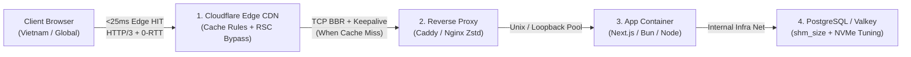

# Infrastructure, Edge CDN & Linux Kernel Performance Optimization

A production-grade playbook for eliminating network, edge CDN, reverse proxy, container runtime, and Linux kernel bottlenecks. Together with `frontend-performance-lighthouse` (Browser/CWV) and `backend-performance-optimization` (App/DB/Cache), this skill completes the **Full-Stack Performance Triad** used by `/op-goal`.



---

## 1. Automated Infra & Edge Diagnostic Runbook (Measure First)

Before tuning server code, always isolate **Network RTT (`Connect` + `TLS`)** from **Server Compute (`TTFB - TLS`)** and inspect Edge CDN headers:

### 1.1. Dissect Network RTT vs. Server Compute Time
```bash
# Run 2 sequential requests on a single HTTP/2 connection:
# Request 1 measures cold TCP + TLS + TTFB; Request 2 (Connect=0, TLS=0) isolates pure 1-RTT + Server Compute
curl -s -w "URL=%{url_effective} Connect=%{time_connect}s TLS=%{time_appconnect}s TTFB=%{time_starttransfer}s Total=%{time_total}s\n" \
  -o /dev/null "https://your-domain.com/" \
  -o /dev/null "https://your-domain.com/"
```
- **Interpretation**:
  - If `Request 2 TTFB` $\approx$ `Request 1 Connect` (1 network RTT, e.g. `220ms–400ms` between Vietnam and Europe/US), **server compute is already `<10ms`** — the remaining latency is pure geographic distance (`cf-cache-status: DYNAMIC`).
  - If `Request 2 TTFB` $\gg$ `Request 1 Connect`, the bottleneck is inside the origin server or database (use `backend-performance-optimization`).

### 1.2. Inspect Cloudflare Edge Cache & PoP Routing (`cf-ray`, `cf-cache-status`)
```bash
curl -sI https://your-domain.com/ | grep -iE "^(http/|cache-control|cdn-cache-control|cf-cache-status|cf-ray|vary|alt-svc)"
```
- Check the 3-letter IATA airport code at the end of `cf-ray` (e.g. `-SIN` Singapore, `-HKG` Hong Kong, `-HAN` Hanoi, `-SGN` Ho Chi Minh City vs. `-DFW` Dallas when a local VPN is active).
- **Cloudflare Free Tier Evening Peering Reroute (`-SJC` / `800ms+` TTFB on `HIT`)**: During evening peak hours in Vietnam (19:30–22:30), local ISPs often route Cloudflare Free tier traffic to US West Coast (`-SJC` / `-LAX`), causing `TCP + TLS + HTTP` handshakes to take `800ms–1,100ms` even when `cf-cache-status: HIT`. To achieve `<10ms` TTFB for returning users regardless of ISP routing, pair edge caching with **Service Worker Instant HTML `Stale-While-Revalidate (SWR)` + 404 Chunk Self-Healing** (see `frontend-performance-lighthouse` §9.14).
- If `cf-cache-status: DYNAMIC` appears despite `s-maxage=30`, Cloudflare is bypassing edge cache because HTML caching is disabled by default unless an explicit Cache Rule is active.

---

## 2. Cloudflare Edge Caching for SSR / Next.js App Router (`<25ms` Global TTFB)

### 2.1. Why `s-maxage` Alone Returns `cf-cache-status: DYNAMIC` on HTML
By default, Cloudflare only caches static file extensions (`.js`, `.css`, `.png`, `.woff2`, `.webp`) and marks all HTML routes (`content-type: text/html`) as `cf-cache-status: DYNAMIC`, forwarding every request across the ocean to the origin VPS.

### 2.2. The Next.js App Router RSC Cache Poisoning Trap (`Vary: RSC`)
In Next.js App Router, client-side transitions (`router.push('/route')`, `router.replace('/route')`, `<Link prefetch>`) send `GET /route` **without** `?_rsc=` query parameters, distinguished only by the HTTP request header `RSC: 1` (expecting a `text/x-component` Flight payload starting with `:HL[...]`). Standard Cloudflare plans ignore `Vary: RSC` when caching HTML.
- **Bidirectional Failure Modes if `RSC: 1` is Not Excluded at the Edge**:
  1. **RSC Poisons HTML (Black Screen with `:HL[...]` Raw Text on Safari/Chrome)**: If an `RSC: 1` request hits a cold Cloudflare Edge PoP first, Cloudflare caches `content-type: text/x-component` (`:HL["/_next/static/chunks/...", "style"]...`) as the response for `https://domain.com/route`. Subsequent browser loads render raw Flight text on a black background.
  2. **HTML Poisons RSC (App Router Crash on PWA Startup)**: If `text/html` is cached first, and the app opens `start_url` then runs `router.replace('/route')` with `RSC: 1`, Cloudflare returns `text/html` instead of Flight data, crashing Next.js into `global-error.tsx` after a 1-frame flash.
- **Cloudflare Wirefilter Absent-Header Syntax Trap**:
  - **NEVER** write `len(http.request.headers["rsc"]) eq 0` in Cloudflare Rulesets! When a header is absent, `http.request.headers["rsc"]` is `unset`, so `len(...) eq 0` evaluates to `false` for all normal browser requests and silently turns every page into `cf-cache-status: DYNAMIC`.
  - **ALWAYS** use `not any(http.request.headers["rsc"][*] != "")` (or `ne ""`), which correctly evaluates to `true` when the `RSC` header is absent and `false` when `RSC: 1` is present.

### 2.3. Safe SSR HTML Edge Caching Standard (`CDN-Cache-Control` + Cache Rule)
1. **Origin Headers (`next.config.mjs`) — Scope Edge Caching to Pure HTML Document Requests**:
   Use Next.js header matching (`missing: [{ type: 'header', key: 'rsc' }, { type: 'header', key: 'next-router-prefetch' }]`) and emit explicit `CDN-Cache-Control` / `Cloudflare-CDN-Cache-Control` headers so Cloudflare knows exact edge TTLs while browsers always revalidate (`max-age=0`, preserving `bf-cache = 1.0`):
   ```javascript
   // next.config.mjs
   async headers() {
     return [
       {
         source: '/',
         missing: [
           { type: 'query', key: 'tab' },
           { type: 'header', key: 'rsc' },
           { type: 'header', key: 'next-router-prefetch' },
         ],
         headers: [
           {
             key: 'Cache-Control',
             value: 'public, max-age=0, s-maxage=30, stale-while-revalidate=3600',
           },
           {
             key: 'CDN-Cache-Control',
             value: 'public, max-age=30, stale-while-revalidate=3600',
           },
         ],
       },
       {
         source: '/',
         has: [{ type: 'header', key: 'rsc' }],
         headers: [
           {
             key: 'Cache-Control',
             value: 'private, no-cache, max-age=0, must-revalidate',
           },
         ],
       },
     ];
   }
   ```
2. **Cloudflare Cache Rule (Dashboard or API)**:
   Create a single Cache Rule for public SSR HTML pages:
   - **Expression**:
     ```text
     (http.host eq "your-domain.com" and http.request.method eq "GET" and not http.request.uri.path starts_with "/api/" and not http.request.uri.path starts_with "/_next/" and not http.request.uri.query contains "_rsc" and not any(http.request.headers["rsc"][*] != "") and not any(http.request.headers["authorization"][*] != ""))
     ```
   - **Action**: `Eligible for cache` $\rightarrow$ **Edge TTL**: `Use cache-control header if present, bypass cache if not`.
3. **Cloudflare Speed & Protocol Checklist**:
   - **HTTP/3 (with QUIC)**: `ON` (eliminates head-of-line blocking on lossy mobile 4G networks).
   - **0-RTT Connection Resumption**: `ON` (eliminates 1 full TLS round-trip for returning visitors).
   - **Early Hints (`103`)**: `ON` (allows Cloudflare to push `<link rel="preload">` CSS/JS headers while fetching HTML from origin).
   - **Brotli / Zstandard Compression**: `ON`.
4. **Mandatory 3-Step Bidirectional Cache Isolation Verification**:
   After deploying or updating any Cloudflare Cache Rule on a Next.js domain, ALWAYS run this verification sequence across cached routes:
   ```bash
   # 1. Warm HTML cache & confirm HIT with text/html
   curl -sI https://your-domain.com/route >/dev/null
   curl -sI https://your-domain.com/route | grep -iE "http/|content-type|cf-cache-status"
   # Expected: content-type: text/html; charset=utf-8 AND cf-cache-status: HIT

   # 2. Send RSC: 1 request & confirm DYNAMIC with text/x-component
   curl -sI -H "RSC: 1" https://your-domain.com/route | grep -iE "http/|content-type|cf-cache-status"
   # Expected: content-type: text/x-component AND cf-cache-status: DYNAMIC

   # 3. Re-verify HTML request was not poisoned by RSC
   curl -sI https://your-domain.com/route | grep -iE "http/|content-type|cf-cache-status"
   # Expected: content-type: text/html; charset=utf-8 AND cf-cache-status: HIT
   ```

---

## 3. Linux VPS Kernel & Network Stack Tuning (`sysctl`)

When an origin VPS in Europe or North America serves users in Asia (or communicates with external APIs), default Linux kernel TCP settings (`cubic` congestion control and small socket buffers) severely throttle throughput upon minor packet loss.

### 3.1. Production `/etc/sysctl.d/99-infra-performance.conf`
Apply these non-destructive kernel optimizations on every Linux production VPS (`sudo sysctl --system`):

```ini
# 1. Google TCP BBR Congestion Control (30-60% lower transcontinental latency)
net.core.default_qdisc = fq
net.ipv4.tcp_congestion_control = bbr

# 2. TCP Fast Open (TFO) & Time-Wait Socket Reuse
net.ipv4.tcp_fastopen = 3
net.ipv4.tcp_tw_reuse = 1
net.ipv4.tcp_fin_timeout = 15
net.ipv4.tcp_keepalive_time = 300
net.ipv4.tcp_keepalive_intvl = 30
net.ipv4.tcp_keepalive_probes = 5

# 3. High-Concurrency Ephemeral Ports & SYN Backlog
net.core.somaxconn = 8192
net.ipv4.tcp_max_syn_backlog = 8192
net.ipv4.ip_local_port_range = 10240 65535

# 4. UDP Socket Buffers for HTTP/3 (QUIC) on Caddy / Nginx
net.core.rmem_max = 7500000
net.core.wmem_max = 7500000

# 5. Memory & Valkey/Redis Background Save Resilience
vm.swappiness = 10
vm.overcommit_memory = 1
```

### 3.2. Verification Command (Read-Only SSH Check)
```bash
ssh user@vps "sysctl net.ipv4.tcp_congestion_control net.core.default_qdisc vm.swappiness vm.overcommit_memory"
```

---

## 4. Reverse Proxy Optimization (Caddy & Nginx)

### 4.1. Caddy High-Performance Reverse Proxy Standard (`Caddyfile`)
By default, Caddy enables HTTP/3 and automatic HTTPS, but explicit `encode zstd gzip` and upstream keepalive pooling reduce CPU overhead and eliminate internal loopback TCP handshakes:

```caddyfile
your-domain.com {
    encode zstd gzip

    # Immutable static assets caching
    @static path /_next/static/* /favicon.ico /icon.png /apple-icon.png /pwa-*.png
    header @static Cache-Control "public, max-age=31536000, immutable"

    reverse_proxy 127.0.0.1:3002 {
        transport http {
            keepalive 120s
            keepalive_idle_conns 64
             keepalive_idle_conns_per_host 64
        }
    }
}
```

### 4.2. Nginx Upstream Keepalive & `add_header` Inheritance Standard
1. **Upstream Keepalive Pool**: Without `keepalive 64;` and `proxy_http_version 1.1; proxy_set_header Connection "";`, Nginx opens and closes a new ephemeral TCP socket to Node.js/Bun on **every single request**.
2. **Location-Block Security Header Inheritance**: In Nginx, defining any `add_header` (such as `add_header Cache-Control ...`) inside a child `location` block **silently drops all security headers** (`X-Frame-Options`, `X-Content-Type-Options`) defined in the parent `server` block. Always re-declare security headers inside every `location` block that sets `Cache-Control`:
   ```nginx
   location ~* \.(?:css|js|woff2|webp|svg)$ {
       expires 1y;
       add_header Cache-Control "public, max-age=31536000, immutable" always;
       add_header X-Frame-Options "SAMEORIGIN" always;
       add_header X-Content-Type-Options "nosniff" always;
       add_header Referrer-Policy "strict-origin-when-cross-origin" always;
   }
   ```

---

## 5. Docker Runtime, PostgreSQL Shared Memory & Disk Hygiene

### 5.1. PostgreSQL Container `shm_size` & NVMe Planner Tuning
Docker defaults container `/dev/shm` to **64 MB**. When PostgreSQL executes parallel analytical queries, CTE window functions, or multi-asset ROI joins, exceeding 64 MB of shared memory crashes the query with `ERROR: could not resize shared memory segment: No space left on device`.
- **Implementation Standard (`docker-compose.yml`)**:
  ```yaml
  services:
    postgres:
      image: postgres:16-alpine
      shm_size: 512mb
      command:
        - "postgres"
        - "-c"
        - "shared_buffers=512MB"
        - "-c"
        - "effective_cache_size=2GB"
        - "-c"
        - "work_mem=16MB"
        - "-c"
        - "random_page_cost=1.1" # Crucial on SSD/NVMe so PG favors Index Scans over Seq Scans!
      logging:
        driver: "json-file"
        options:
          max-size: "10m"
          max-file: "3"
  ```
  - Setting `random_page_cost=1.1` (down from PostgreSQL's legacy spinning-disk default of `4.0`) instructs the query planner that random SSD I/O is nearly as fast as sequential I/O, making PostgreSQL strongly favor composite B-Tree Index Scans.

### 5.2. Docker Log Rotation & Build Cache Hygiene
Unbounded `json-file` container logs and dangling Docker build caches are the #1 cause of `ENOSPC: no space left on device` production outages on 40–80 GB VPS disks.
- Always declare `logging.options.max-size: "10m"` and `max-file: "3"` on all services.
- In CI/CD deployment scripts (`deploy.sh`), prune dangling images after successful promotion:
  ```bash
  docker image prune -f --filter "until=24h" >/dev/null 2>&1 || true
  ```

---

## 6. Zero-Downtime Blue-Green Rollout & Dual-Network Isolation

In containerized production architectures where reverse proxies (Caddy/Nginx) live on a DMZ network (`ops_bridge`) and databases/caches (PostgreSQL/Valkey) reside on an isolated internal network (`<project>-infra`):
- **Problem**: Launching the candidate container (`<service>_next`) solely on `--network ops_bridge` leaves it unable to reach PostgreSQL or Valkey. If the deployment script's health check only tests `grep -q '"status":'`, a degraded response (`{"status":"degraded","db":"disconnected"}`) falsely passes and promotes a broken container into production.
- **Implementation Standard**:
  1. Connect the candidate container to the internal backing network **before** running migrations or health probes:
     ```bash
     docker run -d --name "${CANDIDATE_CONTAINER}" --network "${EDGE_NETWORK}" ...
     if docker network inspect "${INFRA_NETWORK}" >/dev/null 2>&1; then
       docker network connect "${INFRA_NETWORK}" "${CANDIDATE_CONTAINER}" 2>/dev/null || true
     fi
     ```
  2. Assert strictly on `"status":"ok"` before swapping traffic and tearing down the old container:
     ```bash
     if docker exec "${CANDIDATE_CONTAINER}" wget -q -O - http://127.0.0.1:3000/api/health 2>/dev/null | grep -q '"status":"ok"'; then
       CANDIDATE_HEALTHY=true
     fi
     ```

---

## 7. BunnyCDN Pull Zone Architecture & Server Migration Cutover Standard (Zero `0-Byte` Cache Poisoning)

When fronting latency-sensitive Vietnam/Asia web applications with **Bunny.net CDN (`*.b-cdn.net`, DNS-Only `proxied: false` on Cloudflare)** while connecting directly to a VPS Origin IP (`OriginUrl: "https://<VPS_IP>"` + `OriginHostHeader: "<domain>"`):

### 7.1. The Delayed 35-Hour LRU Eviction & `0-Byte` Immutable Chunk Poisoning Trap
- **Failure Mode**: When migrating a service from an old VPS IP to a new VPS IP, updating Cloudflare DNS `A` records alone does **not** update a Bunny Pull Zone whose `OriginUrl` is set to the raw VPS IP (`https://<OLD_VPS_IP>`).
- **Why It Hides for 24–36 Hours**:
  1. Immediately after stopping the container on the old VPS, the site appears 100% healthy because Bunny's regional edge PoP (`BunnyCDN-VN1`) and client PWA Service Workers continue serving cached HTML (`s-maxage`) and `/_next/static/chunks/*.js` bundles, while client API calls go to `api.<domain>` (whose Cloudflare `A` record already points to the new VPS).
  2. Hours later (typically 24–36 hours), Bunny's edge LRU cache evicts a subset of `/_next/static/chunks/*.js` files and pulls them from `OriginUrl` (`https://<OLD_VPS_IP>`).
  3. If the old VPS reverse proxy (Caddy/Nginx) still has a catch-all or empty block returning `HTTP 200` with `Content-Length: 0` (`0 bytes`), Bunny caches those **`0-byte` JS files for 1 year (`max-age=31536000, immutable`)**, silently breaking React hydration and click handlers across all users!

### 7.2. Mandatory 5-Step Server / VPS Migration Cutover Checklist
Whenever migrating any application between VPS nodes or changing origin IPs, ALWAYS execute all 5 steps:
1. **Update Cloudflare DNS (`A` / `CNAME`)**: Update `A` records for API/Admin/Origin hostnames while keeping user-facing `CNAME *.b-cdn.net` (`proxied: false`) intact.
2. **Update Bunny Pull Zone `OriginUrl` & `OriginShield` via REST API**:
   ```bash
   curl -sS -X POST "https://api.bunny.net/pullzone/${PULLZONE_ID}" \
     -H "AccessKey: ${BUNNY_API_KEY}" \
     -H "Content-Type: application/json" \
     -d "{\"OriginUrl\": \"https://${NEW_VPS_IP}\", \"OriginHostHeader\": \"${ORIGIN_HOST}\", \"EnableOriginShield\": false}"
   ```
   *(Set `"EnableOriginShield": false` when the Origin VPS is already in Singapore/Asia; set `true` with `"OriginShieldZoneCode": "FR"` only when the Origin VPS is in Europe).*
3. **Purge Bunny Pull Zone Cache Immediately**:
   ```bash
   curl -sS -i -X POST "https://api.bunny.net/pullzone/${PULLZONE_ID}/purgeCache" \
     -H "AccessKey: ${BUNNY_API_KEY}"
   # Must return HTTP/2 204
   ```
4. **Verify All Referenced Static Chunks via Real `GET` Requests (Never `HEAD` Alone)**:
   Because Next.js/Caddy may return `content-length: 0` on `HEAD` (`curl -sI`) for dynamic routes, always run a real `GET` verification across all `/_next/static/*` assets referenced in the live HTML document and assert `Zero-byte=0`:
   ```bash
   python3 -c '
   import urllib.request, re
   domain = "https://your-domain.com"
   html = urllib.request.urlopen(domain + "/").read().decode("utf-8", errors="ignore")
   urls = set(re.findall(r"/_next/static/[^\x22\x27\s>]+", html))
   zeros = [u for u in sorted(urls) if len(urllib.request.urlopen(domain + u).read()) == 0]
   print(f"HTML={len(html)}B, Assets={len(urls)}, Zero-byte={len(zeros)}", zeros)
   assert len(zeros) == 0, f"Poisoned 0-byte assets detected: {zeros}"
   '
   ```
5. **Migrate Host Crontabs & CI/CD Targets**:
   Audit `crontab -l` on the old VPS (database backups, push notification cron sweeps) and GitHub Actions secrets (`SSH_HOST`) so no scheduled job is left stranded on a decommissioned host.

---

## 8. Tier-1 Docker BuildKit & Self-Hosted CI/CD Acceleration (Sub-2-Minute Builds)

High-throughput containerized deployments (Next.js App Router, Strapi CMS, NestJS APIs) on self-hosted runners frequently suffer from 4–8 minute build times and deployment collisions due to BuildKit rootfs re-scanning, cache ping-pong between environments, and zombie container reboot loops. Adhering to these battle-tested patterns achieves **sub-2-minute builds** (and **<15s on warm code changes**).

### 8.1. Eliminating the 120s+ BuildKit Post-Build `contenthash` Scan Bottleneck (And Avoiding the `overlay2` Lowerdir Whiteout Trap)
- **The Bottleneck**: When `builder` inherits `FROM deps AS builder` (carrying 100,000+ files in `node_modules`) and the `runner` stage executes `COPY --from=builder /app ./` or wildcards at the builder root (`COPY --from=builder /app/*.json ./`), or copies `.next/standalone` containing a duplicate `.next/standalone/node_modules`, BuildKit pauses for **120–150s** immediately following `RUN build` to compute cryptographic `contenthash` trees across 100,000+ files.
- **CRITICAL TRAP — Never `rm -rf node_modules` on a Lowerdir (`FROM deps AS builder`)**:
  - When `/app/node_modules` is inherited from a parent stage (`FROM deps AS builder`), it resides in a Linux `overlay2` **lowerdir**. Running `rm -rf node_modules` inside `RUN bun run build` forces the kernel `overlay2` driver to create **120,000+ character-device whiteout files (`c--------- 0, 0`)** in the `upperdir` and forces BuildKit to commit all 120,000 whiteout nodes when closing the step — adding **50–80 seconds of synchronous disk I/O** to every build!
  - Conversely, deleting directories created **within the same `RUN` step** (such as `.next/standalone/node_modules`) unlinks inodes directly in the `upperdir` in `<0.5s` with zero whiteouts.
- **The Three-Part Fix**:
  1. **Delete Only Same-Layer Temporary Outputs (Never Lowerdir `node_modules`)**:
     ```dockerfile
     # Merge static into standalone and delete ONLY upperdir build artifacts created in this step
     # DO NOT run `rm -rf node_modules` (lowerdir from deps)!
     RUN bun run build && \
         cp -r .next/static .next/standalone/.next/static && \
         rm -rf .next/standalone/node_modules .next/server .next/types .next/diagnostics
     ```
  2. **Direct Build Context Copying in `runner`**: Copy static assets and configurations (`package.json`, `public`, `messages`, `otel.js`, `entrypoint.sh`) directly from the host build context into `runner`. Never use root wildcards like `COPY --from=builder /app/*.json ./`.
  3. **Consolidate Artifacts into Narrow Subdirectory `COPY --from=builder`**: Point `COPY --from=builder` exclusively at narrow output subdirectories (`/app/.next/standalone` or `/usr/app/development/dist`). BuildKit's `contenthash` scanner only walks the specified source subdirectory and completely ignores `/app/node_modules`.

```dockerfile
# --- Stage 2: Builder ---
FROM deps AS builder
WORKDIR /app
COPY . .

# Merge static and delete ONLY same-layer standalone node_modules (zero overlay2 whiteouts)
RUN bun run build && \
    cp -r .next/static .next/standalone/.next/static && \
    rm -rf .next/standalone/node_modules .next/server .next/types .next/diagnostics

# --- Stage 3: Runner ---
FROM base AS runner
WORKDIR /app

# 1. Dependency layer reused from deps FIRST (cached 0.0s on application code changes)
COPY --from=deps --chown=nextjs:nodejs /app/node_modules ./node_modules

# 2. Configs and static assets from context (cached 0.0s independent of builder)
COPY package.json entrypoint.sh otel.js ./
COPY --chown=nextjs:nodejs public ./public
COPY --chown=nextjs:nodejs messages ./messages

# 3. Single narrow COPY from builder (scans only ~35MB standalone dir in ~2s)
COPY --from=builder --chown=nextjs:nodejs /app/.next/standalone ./
```

### 8.2. Per-Environment BuildKit Cache Namespace (`id=next-cache-${CACHE_ENV}`)
- **The "Cache Ping-Pong" Anti-Pattern**: When Dev, Staging, and Production builds share the same self-hosted runner and Docker daemon, sharing a single `--mount=type=cache,target=/app/.next/cache` causes cache ping-pong. Different environment variables (`NEXT_PUBLIC_API_URL`, `STRAPI_ADMIN_BACKEND_URL`) alter client-side chunk hashes, causing each environment to invalidate the other's compiler cache on every build.
- **Implementation**: Isolate cache IDs using a build argument `CACHE_ENV`:

```dockerfile
ARG CACHE_ENV=dev

RUN --mount=type=cache,id=next-cache-${CACHE_ENV},target=/app/.next/cache \
    --mount=type=cache,id=bun-cache,target=/root/.bun/install/cache \
    bun run build
```

Set `--build-arg CACHE_ENV=stg` or `--build-arg CACHE_ENV=prod` in environment pipelines so caches never evict each other.

### 8.3. Zero-Copy `FROM deps AS builder` & Direct Runner Layering
- In multi-stage builds where dependencies are large (e.g. 1.2–1.5 GB in Strapi or full-stack monorepos):
  - In `runner`, place `COPY --from=deps --chown=... /app/node_modules ./node_modules` **before** copying application code. When application source code changes but `package.json` and lockfiles remain untouched, the entire 1.5 GB dependency layer is `CACHED [0.0s]`.
  - In `builder`, never copy `/usr/app` on top of `./node_modules` without pruning; always build directly on top of `FROM deps AS builder` or run `rm -rf node_modules` before copying artifacts.

### 8.4. Pre-Source Prisma Client Generation Layer
- In NestJS and Prisma backend microservices, running `prisma generate` during application compilation forces schema re-parsing and client generation on every single code change.
- **Optimized Layer Order**: Copy only the `prisma/` directory and run `prisma generate` **before** copying `src/`:

```dockerfile
# 1. Install dependencies
COPY package.json bun.lockb ./
RUN bun install --frozen-lockfile

# 2. Generate Prisma Client BEFORE copying source code (CACHED 0.0s when schema untouched)
COPY prisma ./prisma
RUN bun prisma generate

# 3. Only now copy application source code
COPY tsconfig*.json nest-cli.json ./
COPY src ./src
RUN bun run build
```

When schema definitions are unchanged, Prisma client generation resolves in `0.0s`, shaving 20–40 seconds off backend CI builds.

### 8.5. Blue-Green Deployment Zombie Container & Concurrency Guard
- **The Zombie Container Failure Mode**: When a deployment fails its healthcheck after launching a container with `restart: unless-stopped`, simply exiting the CI script leaves the unhealthy container in a restart loop. If a second CI run starts simultaneously, it encounters port conflicts (`listen tcp 0.0.0.0:3000: bind: address already in use`) or misidentifies which container is active.
- **Implementation Standard**:
  1. **Strict Workflow Concurrency**: Enforce workflow-level serialization with `cancel-in-progress: false` to prevent overlapping runs:
     ```yaml
     concurrency:
       group: deploy-${{ github.ref }}
       cancel-in-progress: false
     ```
  2. **Stale Dual-Container Resolution**: If both `blue` and `green` containers are running simultaneously upon deployment startup, inspect `.State.StartedAt`, retain the newer container as `ACTIVE_SERVICE`, and gracefully stop/remove the older one before building:
     ```bash
     BLUE_RUNNING=$(docker inspect -f '{{.State.Running}}' myapp_blue 2>/dev/null || echo "false")
     GREEN_RUNNING=$(docker inspect -f '{{.State.Running}}' myapp_green 2>/dev/null || echo "false")

     if [ "$BLUE_RUNNING" = "true" ] && [ "$GREEN_RUNNING" = "true" ]; then
       BLUE_TIME=$(docker inspect -f '{{.State.StartedAt}}' myapp_blue)
       GREEN_TIME=$(docker inspect -f '{{.State.StartedAt}}' myapp_green)
       if [[ "$BLUE_TIME" > "$GREEN_TIME" ]]; then
         ACTIVE_SERVICE="blue"; INACTIVE_SERVICE="green"
       else
         ACTIVE_SERVICE="green"; INACTIVE_SERVICE="blue"
       fi
       echo "Discovered dual active containers. Preserving newer ($ACTIVE_SERVICE) and removing stale ($INACTIVE_SERVICE)..."
       docker compose stop $INACTIVE_SERVICE && docker compose rm -f $INACTIVE_SERVICE
     fi
     ```
  3. **Exit-Trap Cleanup on Healthcheck Failure**: If the candidate `$INACTIVE_SERVICE` fails its health probe, explicitly stop and remove it before `exit 1` so `restart: unless-stopped` never creates a background zombie:
     ```bash
     if [ "$HEALTHY" != "true" ]; then
       echo "Healthcheck timed out for candidate service $INACTIVE_SERVICE. Cleaning up..."
       docker compose stop "$INACTIVE_SERVICE" && docker compose rm -f "$INACTIVE_SERVICE"
       exit 1
     fi
     ```

### 8.6. Alpine Container Healthcheck IPv4 & Next.js 16 RSC OpenTelemetry Guard
1. **Alpine Linux IPv4 Healthcheck Bindings (`127.0.0.1` vs `localhost`)**:
   In Alpine-based minimal containers, `localhost` resolves to both IPv6 `[::1]` and IPv4 `127.0.0.1`. When Node.js or Bun HTTP servers bind to `0.0.0.0` (IPv4 wildcard), Alpine's BusyBox `wget` frequently attempts `[::1]` first, failing with `Connection refused` and triggering false container unhealthiness.
   - **Rule**: Always specify `http://127.0.0.1:<port>` in container `HEALTHCHECK` and Docker Compose health probes:
     ```dockerfile
     HEALTHCHECK --interval=10s --timeout=5s --start-period=30s --retries=3 \
       CMD wget -q -O - http://127.0.0.1:3000/api/health | grep -q '"status":"ok"' || exit 1
     ```

2. **Next.js 16 RSC OpenTelemetry `Math.random` Guard**:
   In Next.js 16 App Router with component caching enabled (`experimental.cacheComponents: true`), Next.js monkey-patches `Math.random()` during React Server Component (RSC) static prerendering to detect non-deterministic runtime execution.
   - **The Failure Mode**: The OpenTelemetry JS SDK (`@opentelemetry/sdk-node`) calls `Math.random()` synchronously to generate 64-bit span IDs and 128-bit trace IDs. When RSC components generate spans during build prerender, Next.js aborts static generation with:
     ```text
     NEXT_STATIC_GEN_BAILOUT: Math.random() called inside static page
     ```
   - **The Fix (`otel.js`)**: Capture `nativeMathRandom` prior to module evaluation and inject a custom `idGenerator` into `NodeSDK`:
     ```javascript
     // otel.js - Loaded via NODE_OPTIONS="--require ./otel.js"
     // Capture unpatched Math.random BEFORE Next.js static prerender monkey-patches it
     const nativeMathRandom = Math.random.bind(Math);

     const { NodeSDK } = require('@opentelemetry/sdk-node');
     const { RandomIdGenerator } = require('@opentelemetry/core');

     class SafeDeterministicIdGenerator extends RandomIdGenerator {
       generateTraceId() {
         let id = '';
         for (let i = 0; i < 32; i++) {
           id += Math.floor(nativeMathRandom() * 16).toString(16);
         }
         return id;
       }

       generateSpanId() {
         let id = '';
         for (let i = 0; i < 16; i++) {
           id += Math.floor(nativeMathRandom() * 16).toString(16);
         }
         return id;
       }
     }

     const sdk = new NodeSDK({
       idGenerator: new SafeDeterministicIdGenerator(),
       // ... additional tracer and exporter configuration
     });
     sdk.start();
     ```

### 8.7. Hash-Gated Database Migrations & Zero-Downtime Deploy Guard (`deploy.sh --check`)
Deploy scripts that unconditionally run destructive database setup commands (`DROP MATERIALIZED VIEW IF EXISTS ... CASCADE`, unconditional `ALTER TABLE ... REPLICA IDENTITY DEFAULT`) stall CI/CD pipelines for **10m–14m+** because TimescaleDB background workers (`_timescaledb_config.bgw_job`) and logical replication `walsender` hold `AccessShareLock`, blocking DDL waiting on `AccessExclusiveLock`.
- **Fast-Path Pattern**: Expose a `--check` flag on the migration runner (`bun run setup --check`) that compares a SHA-256 digest of SQL migration files against `COMMENT ON SCHEMA public` (via `pg_catalog.obj_description`).
- When the schema is unchanged and all materialized views are populated, `deploy.sh` skips stopping processor containers and skips crawler restarts entirely:
  ```bash
  if bun run setup --check >/dev/null 2>&1; then
    echo "✓ Database schema and materialized views up-to-date. Skipping migration downtime."
  else
    bun run setup
  fi
  ```
- For the full 3-layer architecture (idempotent DDL, `ispopulated` guard, and TimescaleDB background worker lock contention prevention), see the companion **`backend-performance-optimization`** skill (§8.13).

