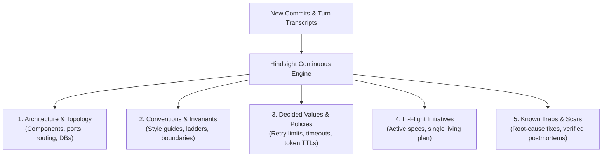

# Hindsight: Agent Memory Architecture & Cognitive Lifecycle

> **Reference Source**: Distilled from `vectorize-io/hindsight` (★ 61,100+, ArXiv:2512.12818, LongMemEval SOTA) into `agent-harness-kit`.

---

## 1. Executive Essence: RAG vs. GraphRAG vs. Hindsight

Standard RAG and traditional knowledge graphs struggle with agentic workflows because they treat conversation history as passive immutable blobs. **Hindsight** models memory as an **active cognitive loop** that continuously synthesizes, updates, and refines mental models.

| Dimension | Naive Vector RAG | Knowledge Graph (GraphRAG) | Hindsight Cognitive Loop |
| :--- | :--- | :--- | :--- |
| **Storage Unit** | Fixed chunks (token slices) | Triples (`subject-predicate-object`) | Structured Observations & Dynamic Canonical Pages |
| **Write Path** | Dumb embedding & append | Entity extraction & link creation | **Retain**: LLM extracts facts, builds temporal/causal links |
| **Read Path** | Cosine similarity top-k | Graph traversal / community summaries | **Recall** (fast facts) + **Reflect** (deep reasoning over why) |
| **Staleness Handling** | High collision / duplicate noise | Graph edge deletion (costly) | **Superseding Correction Protocol** (newer facts outrank older) |
| **Token Cost / Task** | High (dumps repeated chunk noise) | Medium | **Lowest (0.85 → 0.36 corrections, 24–40% token savings)** |

---

## 2. The 3 Memory Tiers & The 3 Core Operations

Hindsight partitions memory into 3 distinct functional tiers:
1. **World Memory**: Architecture, component topologies, runtime ports, database schemas, public facts.
2. **Experience Memory**: Past debugging sessions, test results, runtime errors, benchmark regressions, bug postmortems.
3. **Disposition Memory**: Developer habits, communication preferences, mandatory engineering constraints (e.g. 7-Rung Ponytail Ladder, English-first rules).

Driven by 3 foundational operations:
- **`retain`**: Ingests session transcripts or documents. It does *not* save raw text; it extracts entity relationships, temporal markers, and causal linkages.
- **`recall`**: Sub-50ms hybrid vector/keyword retrieval of specific facts relevant to the immediate user prompt.
- **`reflect`**: Deep cognitive synthesis over the entire memory bank to answer "WHY" questions and retrieve exact decided values.

---

## 3. The 5 Canonical Mental Model Pages Pattern

Instead of scattering unstructured notes across dozens of markdown files, every repository or agent bank maintains **5 living canonical pages**:



1. **`Architecture & Topology`**: High-level component interactions, services, ingress ports, edge CDN paths.
2. **`Conventions & Invariants`**: Non-negotiable team standards (e.g. single-commit PRs, 0 empty catch blocks, strict TypeScript).
3. **`Decided Values & Policies`**: The "last mile" decisions that never live cleanly in code (e.g. why a retry delay is 150ms instead of 500ms, why a token expiry is 90 days).
4. **`In-Flight Initiatives`**: Captured immediately once a feature plan is agreed upon. When the plan mutates, **the same page is updated in-place**—never fork a second page.
5. **`Known Traps & Battle Scars`**: Hard bugs solved, exact reproduction steps, verified remediation diffs.

---

## 4. The Invariant Correction Protocol (Anti-Stale Memory)

One of Hindsight's greatest innovations is resolving **stale agent memory hallucination**. 

When an agent observes that an existing memory page, document, or guideline contradicts what is verifiably true in the current codebase or runtime:
> **RULE**: Never silently ignore stale memory. Silently ignoring it leaves the trap armed for future agent sessions.

### Standard Correction Submission Schema:
```markdown
# Correction: <Topic / Component Name>
- **Stale Claim**: Exact quote of what the prior memory asserted.
- **Verified Truth**: What is empirically true now.
- **Evidence Source**: Exact file path, commit hash, or CLI command output verifying the change.
```
In retrieval engines adhering to this protocol, newer correction timestamps with verified evidence explicitly supersede older memory nodes.

---

## 5. Adoption in Kido Harness (`agent-harness-kit` + `/root/brain`)

Without installing external heavy daemons or paying for third-party cloud memory, Kido's local architecture adopts Hindsight's 4 core patterns natively:

1. **Qdrant Hybrid RAG (`/usr/local/bin/brain-rag`)**:
   - Uses BM25 + Dense embeddings for `recall` operations across `/root/brain`.
2. **5 Canonical Pages Mapping in `00-openclaw-hq`**:
   - `SYSTEM_TOPOLOGY.md` ➔ Architecture & Topology.
   - `AGENTS.md` / `user_global` ➔ Conventions & Invariants.
   - `20-decisions-and-drills/` (ADRs) ➔ Decided Values & Policies.
   - `tasks.md` (OpenSpec) ➔ In-Flight Initiatives.
   - `40-journals/daily/` (War Stories) ➔ Known Traps & Battle Scars.
3. **Attribution Tagging**:
   - Whenever an agent uses historical context to inform a system design decision, tag with:
     `🧠 From Memory (<Canonical Page / ADR>): <Key Context>`
