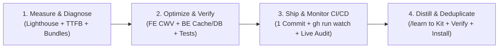

# Autonomous Performance Optimization & Skill Distillation Loop (`/op-goal`)

When the user invokes `/op-goal` (or `/goal /op-goal`), execute this end-to-end autonomous loop without stopping until every target metric, deployment check, and skill distillation gate is 100% green.

---

## Phase 1: Empirical Baseline & Root-Cause Diagnosis

1. **Read Companion Skills First**:
   - Load `frontend-performance-lighthouse` and `backend-performance-optimization`.
2. **Capture Live / Local Baseline**:
   - **TTFB & Cache Headers**: Measure cold and warm `time_starttransfer` (`curl -s -o /dev/null -w "TTFB: %{time_starttransfer}s\n"`) and inspect `Cache-Control`, `Vary`, and edge CDN headers.
   - **HTML & RSC Payload Audit**: Check HTML transfer size, hidden Suspense fallbacks (`grep -c 'id="S:0"'`), and RSC Flight serialization bloat (`self.__next_f.push`).
   - **Client Bundle & Manifest Audit**: Inspect route entry chunks (`.next/server/app/*_client-reference-manifest.js` or Vite build output) to spot leaked vendor libraries (`recharts`, `lightweight-charts`, `@radix-ui`, `xlsx`, barrel `index.ts` co-bundling).
   - **Lighthouse CLI Mobile & Desktop Audit**: Run headless Chrome Lighthouse (`--form-factor=mobile` Slow 4G + `--preset=desktop`) and inspect `elementRenderDelay`, `subgraph` critical request chains, `long-tasks`, and `bf-cache`.

---

## Phase 2: Full-Stack Optimization & Local Quality Gates

Apply root-cause fixes across both Frontend and Backend layers following the **7-Rung Ladder**:

1. **Frontend (Core Web Vitals — Target 100/100 Mobile & Desktop, 0ms TBT, 0.000 CLS)**:
   - Eliminate RSC `<Suspense>` `div[hidden]#S:0` traps around already-awaited Server Components and replace `useSearchParams()` in root client shells with Server Component prop passing + `popstate` listeners.
   - Quarantine secondary tabs, modals, and heavy chart/table/export libraries (`React.lazy` / `next/dynamic`) and bypass folder barrel (`index.ts`) imports so entry JS stays minimal (`<50 KB`).
   - Trim RSC Flight JSON payloads by pre-computing compact SSR summaries and fetching heavy time-series arrays on client interaction.
   - Remove unused `next/font/google` preloads or switch `display: 'swap'` to `'optional'` on hero text to prevent Slow 4G LCP timer resets.
   - Unlock `bf-cache` (`score = 1`) by overriding Next.js `no-store` with query-aware `Cache-Control` headers.
2. **Backend (Sub-100ms TTFB, SingleFlight Coalescing & Index Synthesis)**:
   - Wrap high-read SSR/API queries in Singleflight + Stale-While-Revalidate (`singleflight.execute` / `getOrSetCache`).
   - Detach background SWR revalidation via `setTimeout(..., 0)` so Server Component streaming never waits on background database promises.
   - Add a lightweight `.unref()` background cache warmer (`interval < ttlMs`) with warm DB connection pooling (`idle_timeout >= 120s`) so `now < entry.expiresAt` is permanently true (`<1ms` L1 RAM hit).
   - Parallelize independent queries (`Promise.all`), eliminate duplicate queries, and synthesize composite B-Tree indexes (`Equality First, Range/Sort Second`).
3. **Mandatory Local Verification**:
   - Run the project's native build, linter, and test suites (`bun run build`, `bun run test`, `tsc --noEmit`) and confirm zero errors before committing.

---

## Phase 3: Single-Commit Ship, CI/CD Watch & Live Verification

1. **Commit & Push**:
   - Package changes into a single Conventional Commit (`perf(<scope>): ...`) and push to remote.
2. **Active GitHub Actions Monitoring**:
   - Monitor the CI/CD workflow (`gh run list` / `gh run watch <run-id> --exit-status`) until all jobs (Build, Test, Zero-Downtime Deployment) finish with a green checkmark (`✓`).
   - If any job fails, inspect `gh run view <run-id> --log-failed`, fix the root cause, and re-verify.
3. **Post-Deploy Live Audit**:
   - Re-run `curl` TTFB checks and Lighthouse CLI Mobile + Desktop audits against the live production/staging URL to prove the optimization in production.

---

## Phase 4: Zero-Duplicate Skill Distillation (`/learn` + Deduplicate)

Whenever a new non-trivial root cause or architectural pattern is proven in production, persist it back into `agent-harness-kit` while strictly preventing skill bloat:

1. **Locate the Kit Checkout**:
   - Resolve the `agent-harness-kit` repository path via `readlink ~/.claude/skills/frontend-performance-lighthouse` (never hardcode user home paths).
2. **Audit & Deduplicate Existing Sections First (`Prevent Duplicate` Gate)**:
   - Before appending a new subsection to `skills/frontend-performance-lighthouse/SKILL.md`, `skills/backend-performance-optimization/SKILL.md`, or `skills/next-best-practices/*.md`, scan the file for overlapping or repetitive project-specific micro-logs (e.g., multiple sections repeating the same `React.lazy`, `onError`, barrel decoupling, `getOrSetCache`, or `@@index` pattern).
   - **Consolidate** repetitive examples into a single canonical, generalized pattern section rather than appending near-duplicate numbered subsections.
3. **Follow the 4-Step Harness Lifecycle**:
   - **Step 1 (Edit in Kit)**: Generalize the new pattern (zero project-specific secrets or `/Users/<name>` paths) and merge/deduplicate cleanly inside `agent-harness-kit`.
   - **Step 2 (Verify Locally)**: Run `./scripts/verify.sh` and `bash tests/test_harness.sh` and confirm `OK` / `0 failed`.
   - **Step 3 (Commit & Push Kit)**: Commit (`docs(skills): ...`) and `git push origin main`.
   - **Step 4 (Propagate Locally)**: Run `./scripts/install.sh --targets all --rules` so `~/.gemini`, `~/.claude`, and `~/.agents` receive the updated skills immediately.
