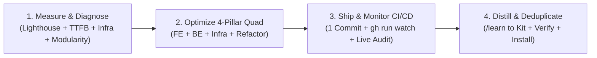

# Autonomous 4-Pillar Performance, Refactoring & Skill Distillation Loop (`/op-goal`)

When the user invokes `/op-goal` (or `/goal /op-goal`), execute this end-to-end autonomous loop across the **4-Pillar Performance & Modularity Quad (FE + BE + Infra + Refactor)** without stopping until every target metric, modularity ceiling, deployment check, and skill distillation gate is 100% green.

---

## Phase 1: Empirical Baseline & 4-Layer Root-Cause Diagnosis

1. **Load the 4-Pillar Performance & Modularity Quad Skills**:
   - **Frontend**: `frontend-performance-lighthouse`
   - **Backend**: `backend-performance-optimization`
   - **Infra & Edge**: `infra-performance-optimization`
   - **Structural Refactoring & Modularity**: `code-simplification`
2. **Capture Live / Local Baseline Across All 4 Layers**:
   - **Layer 1 — Edge CDN & Network Infra**: Dissect cold vs. warm HTTP/2 connection timing (`Connect`, `TLS`, `TTFB`) and inspect `cf-cache-status`, `cf-ray`, `Cache-Control`, `CDN-Cache-Control`, and `Vary` headers.
   - **Layer 2 — Backend App & Database**: Measure server compute time (`Warm TTFB - 1 RTT`), inspect Singleflight/Valkey cache hit rates, check DB connection pool settings, and run `EXPLAIN (ANALYZE, BUFFERS)` on slow queries.
   - **Layer 3 — Frontend Browser & Bundles**: Check HTML transfer size, hidden Suspense fallbacks (`grep -c 'id="S:0"'`), RSC Flight payload bloat (`self.__next_f.push`), entry JS manifest chunks, and run headless Chrome Lighthouse (`--form-factor=mobile` Slow 4G + `--preset=desktop`).
   - **Layer 4 — Codebase Modularity & Hygiene Audit**: Scan source files (`find apps/ src/ -type f \( -name "*.ts" -o -name "*.tsx" \) ! -name "*.spec.*" ! -name "*.test.*" -exec wc -l {} + | sort -nr | head -n 20`) to detect **God-files (`> 500 lines`)**, duplicated business logic across components/services, scattered cross-cutting triggers, and dead/orphaned files.

---

## Phase 2: 4-Pillar Quad Optimization, Refactoring & Local Quality Gates

Apply root-cause fixes across Frontend, Backend, Infra, and Codebase Modularity following the **7-Rung Ladder**:

1. **Frontend (`frontend-performance-lighthouse` — Target 100/100 Mobile & Desktop, 0ms TBT, 0.000 CLS)**:
   - Eliminate RSC `<Suspense>` `div[hidden]#S:0` traps around already-awaited Server Components and replace `useSearchParams()` in root client shells with Server Component prop passing + `popstate` listeners.
   - Quarantine secondary tabs, modals, and heavy chart/table/export libraries (`React.lazy` / `next/dynamic`) and bypass folder barrel (`index.ts`) imports so entry JS stays minimal (`<50 KB`).
   - Trim RSC Flight JSON payloads by pre-computing compact SSR summaries and fetching heavy time-series arrays on client interaction.
   - Remove unused `next/font/google` preloads or switch `display: 'swap'` to `'optional'` on hero text to prevent Slow 4G LCP timer resets.
2. **Backend (`backend-performance-optimization` — Target `<10ms` Server Compute, 100% L1/L2 Cache Hit)**:
   - Wrap high-read SSR/API queries in Singleflight + Stale-While-Revalidate (`singleflight.execute` / `getOrSetCache`).
   - Detach background SWR revalidation via `setTimeout(..., 0)` so Server Component streaming never waits on background database promises.
   - Add a lightweight `.unref()` background cache warmer (`interval < ttlMs`) with warm DB connection pooling (`idle_timeout >= 120s`) so `now < entry.expiresAt` is permanently true.
   - Parallelize independent queries (`Promise.all`), eliminate duplicate queries, and synthesize composite B-Tree indexes (`Equality First, Range/Sort Second`).
3. **Infra & Edge (`infra-performance-optimization` — Target `<25ms` Edge HIT, Zero-Downtime Rollout)**:
   - Scope `Cache-Control` and `CDN-Cache-Control` headers with `missing: [{ type: 'header', key: 'rsc' }]` so Cloudflare caches pure HTML document responses without poisoning RSC client navigations, while preserving browser `bf-cache = 1.0` (never emit `no-store` on public pages).
   - Verify Reverse Proxy (Caddy/Nginx) Zstandard/Brotli compression and upstream `keepalive` connection pooling.
   - Verify Linux VPS kernel `tcp_congestion_control = bbr`, PostgreSQL `shm_size` & `random_page_cost = 1.1`, and Docker log rotation (`max-size: 10m`).
4. **Structural Refactoring & Single-Source-of-Truth Consolidation (`code-simplification` — Target `<400 lines` per file, Zero Duplication)**:
   - **God-File Decomposition (`< 400 lines` target)**: Split bloated stores (Zustand/Redux), services (NestJS), and UI components into cohesive domain slices (`types.ts`, `calculations.ts`, `storage.ts`, `actions/*.ts`, focused sub-components) while preserving barrel re-exports for 100% backward compatibility.
   - **Single-Source-of-Truth Consolidation**: Deduplicate repeated state-merging logic, scattered auth/login triggers, and copy-pasted UI headers/modals into a single canonical hook or shared component.
   - **Dead Code & Legacy Shim Elimination**: Delete unused components, unreachable fallback branches, and obsolete third-party SDK shims.
5. **Mandatory Local Verification**:
   - Run the project's native build, linter, and test suites (`bun run build`, `bun run test`, `tsc --noEmit`) and confirm zero errors before committing.

---

## Phase 3: Single-Commit Ship, CI/CD Watch & Live Verification

1. **Commit & Push**:
   - Package changes into a single Conventional Commit (`perf(<scope>): ...`) and push to remote.
2. **Active GitHub Actions Monitoring**:
   - Monitor the CI/CD workflow (`gh run list` / `gh run watch <run-id> --exit-status`) until all jobs (Build, Test, Zero-Downtime Deployment) finish with a green checkmark (`✓`).
   - If any job fails, inspect `gh run view <run-id> --log-failed`, fix the root cause, and re-verify.
3. **Post-Deploy Live Audit**:
   - Re-run `curl` TTFB/header checks and Lighthouse CLI Mobile + Desktop audits against the live production/staging URL to prove the optimization in production.

---

## Phase 4: Zero-Duplicate Skill Distillation (`/learn` + Deduplicate)

Whenever a new non-trivial root cause or architectural pattern is proven in production, persist it back into `agent-harness-kit` while strictly preventing skill bloat:

1. **Locate the Kit Checkout**:
   - Resolve the `agent-harness-kit` repository path via `readlink ~/.claude/skills/frontend-performance-lighthouse` (never hardcode user home paths).
2. **Route to the Correct Quad Skill & Deduplicate (`Prevent Duplicate` Gate)**:
   - Route Browser/CWV/RSC bundle lessons to `skills/frontend-performance-lighthouse/SKILL.md`.
   - Route App/Singleflight/Valkey/SQL index lessons to `skills/backend-performance-optimization/SKILL.md`.
   - Route CDN/Cloudflare/Caddy/Nginx/Docker/Kernel lessons to `skills/infra-performance-optimization/SKILL.md`.
   - Route God-file decomposition, state/service slice modularization, and single-source-of-truth consolidation patterns to `skills/code-simplification/SKILL.md`.
   - Before adding any section, scan the target file (and sibling Quad skills) for overlapping or repetitive micro-logs and **consolidate** them into a single canonical pattern so zero duplicate content exists across the kit.
3. **Follow the 4-Step Harness Lifecycle**:
   - **Step 1 (Edit in Kit)**: Generalize the pattern (zero project-specific secrets or `/Users/<name>` paths) inside `agent-harness-kit`.
   - **Step 2 (Verify Locally)**: Run `./scripts/verify.sh` and `bash tests/test_harness.sh` and confirm `OK` / `0 failed`.
   - **Step 3 (Commit & Push Kit)**: Commit (`docs(skills): ...`) and `git push origin main`.
   - **Step 4 (Propagate Locally)**: Run `./scripts/install.sh --targets all --rules` so `~/.gemini`, `~/.claude`, and `~/.agents` receive the updated skills immediately.
