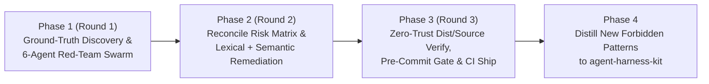

# Autonomous 6-Perspective Adversarial NDA & OPSEC Red-Team Loop (`/op-nda` / `/nda-audit`)

When the user invokes `/op-nda` or `/nda-audit` (or asks for a multi-agent NDA / OPSEC cross-review), execute this end-to-end **4-Phase, 3-Round Adversarial Red-Team Swarm** without stopping until every lexical, metadata, infrastructure, PII, and semantic business-logic leak is eliminated, hardened into pre-commit verification gates, and deployed live (`SUCCESS ✓`).

---

## Phase 1 (Round 1): Ground-Truth NDA Dictionary Discovery & 6-Perspective Red-Team Swarm

1. **Dynamic Ground-Truth NDA Extraction**:
   - Before spawning subagents, run a fast local discovery script across `~/` directory names and `~/profile/journal/daily/*.md` to extract the live ground-truth inventory of:
     - Private repository and folder names (`~/vantoi`, `~/limart`, `~/index`, `~/linkpul*`, `~/sbifpt*`, `~/12-weeks`, `~/fruits-inventory`, `~/electron-anti-detect`, `~/tikat*`, `~/ad-revive`, `~/flash-buy`, etc.).
     - Internal Jira/Linear ticket prefixes (`PWLP-*`, `AAE-*`, `AVX-*`, `LINKPUL-*`, `PACK-*`, `SM-*`, `CORE-283`, etc.).
     - Private/client domains (`*.tikat.vn`, `*.greenbull.dev`, `index.vn`, `indexapi.net`, `indexcms.com`, `vantoicalis.com`, `hoaculimart.vn`, `unfem.com`, `winter-arc.b-cdn.net`, etc.).
2. **Single-Batch Dispatch of 6 Adversarial Red-Team Subagents (`Model: "flash"`)**:
   - Combine `maximum-parallel-subagents` + `doubt-driven-development` (adversarial framing: *"Assume previous sanitization missed subtle, camelCase, hyphenated, or semantic leaks; find issues, do not validate"*).
   - Dispatch all 6 subagents concurrently in **Read-Only Forensics Mode** across `~/kido-blog`, `~/kido-chronicles`, and `~/profile/web`:

| Subagent Role | Adversarial Persona | Target Vectors & Scope |
| :--- | :--- | :--- |
| **`#redteam-1-corporate-nda`** | **Corporate Legal & NDA Counsel** | All exact, substring, camelCase, and hyphenated variants of employers, clients, internal products (`SBI`, `FPT`, `sbifpt`, `Index.vn`, `Linkpul`, `AdPul`, `Greenbull`, `Mozyfin`, `Antofin`, `Tikat`, `Vantoi`, `Limart`, `Winter Arc`, `200lab`, `GonnaCrash`, `Reelcrew`, `Itify`), and Vietnamese banks/brokers/payment gateways (`Techcombank`, `Vietcombank`, `MBBank`, `BIDV`, `VPBank`, `TPBank`, `ACB`, `Sacombank`, `SSI`, `VNDirect`, `Vietcap`, `DNSE`, `FireAnt`, `CafeF`, `Vietstock`, `Casso`, `SePay`, `PayOS`). |
| **`#redteam-2-git-tickets-commits`** | **Git Forensics & Issue Tracker Investigator** | Jira/Linear ticket IDs (`\b[A-Z]{2,10}-\d{1,5}\b`), raw commit SHA hashes (`\b[0-9a-f]{7,40}\b`), prose quoting commits (`commit ngày`, `commits across`, `git log`, `PR #`, `initial commit`), and internal file/directory paths inside code blocks. |
| **`#redteam-3-pii-people-identity`** | **HR Privacy & PII Investigator** | Any real names, nicknames, handles, email addresses, Slack channel/user IDs (`C09*`, `U09*`), Telegram links, or Discord webhooks of teammates, employees, bosses, or customers (`Nhi`, `Điệp`, `tvadiep`, `Kỹ sư Đ`, `Engineer D`, `Trịnh Công Lý`, `trinhcongly`, `Thùy Anh`, `Văn Tới`, `Sơn`, `Mạnh`, `Tuấn`, `Minh`, `Trung`, `Khang`, `Kiên`, `Duy`, etc.). Only the author (`Dương Phúc Khánh` / `Kido`) and famous public computer scientists may appear. |
| **`#redteam-4-infra-sec-ips`** | **Offensive Infra & Secrets Pentester** | All IPv4/IPv6 addresses, VPS/Cloud/CDN providers (`Contabo`, `OVH`, `Hetzner`, `DigitalOcean`, `Vultr`, `Linode`, `UpCloud`, `BunnyCDN`, `b-cdn.net`), workstation/VPS paths (`~/`, `/opt/`, `/var/www/`), internal Docker container names, DB connection strings, JWTs, API keys, and non-canonical external domains. |
| **`#redteam-5-slugs-seo-metadata`** | **Technical SEO & Slug Hygiene Auditor** | All URL slugs (`<slug>.md`), frontmatter (`title`, `description`, `category`, `tags`, `metrics`, `relatedEpisodes`), `catalog.json`, `sitemap*.xml`, and `llms.txt`. Hunts for date-suffixed slugs (`-YYYY-MM-DD.md`), truncated trailing words from word-count slicing (e.g. `-12`, `-multi`, `-job`, `-read`), typos, or awkward regex-replacement artifacts (`shortlink-core`, `AlphaBank`, `CORE-283`). |
| **`#redteam-6-semantic-business-logic`** | **Competitive Intelligence Analyst** | Deep semantic reading of high-risk articles (Anti-detect browsers, Bank scrapers/webhooks, Shortlink monetization, Stock/FinTech pipelines, POS/HR ERPs) to detect proprietary database schemas, enum values, or business rules that could identify an employer/client even after brand names are removed. |

---

## Phase 2 (Round 2): Cross-Examination, Risk Matrix & Root-Cause Remediation

1. **Synthesize the Consolidated NDA & OPSEC Risk Matrix**:
   - Classify every finding from the 6 Red-Team subagents by severity:
     - 🔴 **CRITICAL**: Direct employer/client/project name, real colleague/employee PII, real IP/secret, or unmistakable proprietary business workflow.
     - 🟠 **HIGH**: Raw git commit/ticket artifact (`PWLP-*`, `CORE-283`, `commit ngày ...`), bank/VPS provider name, or internal repo path.
     - 🟡 **MEDIUM**: Truncated URL slug (`-12`, `-multi`), awkward mechanical replacement phrase, or splintered category taxonomy.
2. **Parallel Root-Cause Remediation**:
   - **Lexical & Metadata Layer**: Fix all flagged filenames (`git mv`), frontmatter fields, and prose tokens across both VI and EN editions simultaneously (maintaining 100% 1-to-1 parity).
   - **Semantic Layer**: Rewrite any section that exposes sensitive domain mechanics (e.g. browser fingerprint spoofing, specific bank portal scraping, internal payroll/attendance rules) into **universal, white-hat Big-Tech Distributed Systems patterns** (e.g., Chromium Sandboxed Worker Isolation, ISO-8583 / OpenBanking Idempotent Webhook Ingestion, Distributed Token-Bucket Rate Limiting).

---

## Phase 3 (Round 3): Pre-Commit Gate Hardening, Zero-Trust Verification & Live Ship

1. **Upgrade Automated Verification Gates**:
   - Add every newly discovered forbidden token and filename pattern into `~/kido-blog/src/scripts/verify-opsec-and-bilingual.mjs` and verify `.git/hooks/pre-commit` is executable.
2. **Round 3 Zero-Trust Verification (Source + Compiled `dist/`)**:
   - Run `bun run verify` and `bun run build` in `~/kido-blog`, `~/kido-chronicles`, and `~/profile/web`.
   - Run an independent post-build scan directly against `dist/` HTML/XML/JSON bundles to confirm **0 leaks** in the final rendered output.
3. **Single-Commit Ship & CI/CD Watch**:
   - Commit changes (`1 Conventional Commit` per repo), push to `origin/main`, and actively watch GitHub Actions (`gh run watch`) until `SUCCESS (✓)`.
   - Probe live production URLs (`curl -sI`) to confirm HTTP/2 200 on clean slugs and HTTP/2 404 on retired slugs.

---

## Phase 4: Guardrail Distillation (`/learn` into `agent-harness-kit`)

1. Update `skills/bilingual-engineering-blog/SKILL.md` and `skills/op-nda/SKILL.md` inside `agent-harness-kit` with any newly discovered NDA patterns (using portable `~/` paths, never hardcoded `/Users/...` paths).
2. Run `./scripts/verify.sh && bash tests/test_harness.sh` (`0 errors`).
3. Commit, push to `origin/main`, and run `./scripts/install.sh --targets all --rules`.
