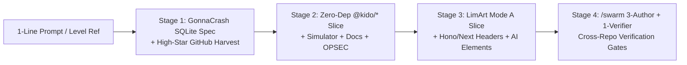

# Pattern-to-Prod (`pattern-to-prod`)

Turn any system-design concept or GonnaCrash level into a benchmarked, zero-dependency `@kido/*` slice in `~/Workspace/kido-packages` and surgical production wiring in `~/Workspace/limart` from a single short prompt—while keeping `/skill-doctor` at `100/100`.



---

## 0. Concise One-Line Triggers & Auto-Resolution

Invoke with one compact line—never wait for multi-turn questionnaires unless an escalation gate (DB schema migration, new npm dependency, auth/RBAC boundary, breaking API contract, `git push`) triggers:

- `@[~/profile/systemdesign-200lab/worlds/3-ai-apps/16-json_or_nothing.md] /pattern-to-prod`
- `/ship-pattern <topic>` (e.g., `/ship-pattern frugal-model-router`, `/ship-pattern structured-output-repair`)
- `triển pattern <level-or-topic>` / `đưa vào kido-package và limart`

On trigger, immediately resolve:
1. **Pattern Spec**: `world_order`, `level_index`, `level_key`, `budget_uc`, `best_cost_uc`, SLA metrics, and `concept_keys_json`.
2. **Target `@kido/*` Combo Suite**: Map to one of the **39 existing Domain Combo Suites** in `~/Workspace/kido-packages/packages/PACKAGES_REGISTRY.md` (NEVER invent package #40).
3. **Target LimArt Surface**: Identify affected backend libs/routes (`apps/api/src/lib/`, `store.route.ts`, `documents.route.ts`), Next.js proxy (`apps/store-web/src/app/api/store/ai-advisor/route.ts`), and UI trace widgets (`CapyArtAdvisorWidget.tsx`, `HelpChatTab.tsx`).

---

## Stage 1: Spec Extraction & High-Star GitHub Harvest

### 1.1 GonnaCrash `< 1ms` SQLite Lookup (`~/profile/systemdesign-200lab/gonnacrash.db`)
Query the compiled database instead of scanning folders:
```bash
sqlite3 ~/profile/systemdesign-200lab/gonnacrash.db \
  "SELECT world_order, level_index, level_key, title_en, budget_uc, best_cost_uc, scoring_json, traffic_kinds_json FROM levels WHERE level_key = '<level_key>';"
```
Fetch the 3-star architecture and concept grounding via `solution_md` and `fts_knowledge` (see `references/limart-and-kido-packages-wiring.md`). Extract exact SLA targets (`answered >= X%`, `ttft <= Yms`, `accuracy >= Z%`, `cost <= budget_uc`, `best_cost_uc` record).

### 1.2 Top-Star Open-Source Repo Benchmark Table
Before designing algorithms, extract proven heuristics, edge-case guards, and trade-offs from top-starred OSS implementations:

| Pattern Domain | Canonical High-Star OSS Benchmarks | Core Mechanism to Extract |
|---|---|---|
| **AI Gateway & Fallback Mesh** | `BerriAI/litellm`, `Portkey-AI/gateway` | Circuit breaker EWMA health, multi-provider failover, hedging, budget/RPM headers |
| **Intelligent Model Routing** | `lm-sys/RouteLLM`, `vllm-project/semantic-router`, `stanford-futuredata/FrugalGPT` | Query complexity classifier, calibrated router threshold `tau`, confidence cascade (`small` -> `large`) |
| **Semantic Cache & Intent Router** | `aurelio-labs/semantic-router`, `qdrant/qdrant`, `redis/redis` | Utterance centroids, cosine threshold presets, entity-lock fingerprinting, Lua atomic TTL/eviction |
| **RAG, Rerank & Evals** | `qdrant/qdrant`, `explodinggradients/ragas` | Hybrid Dense+BM25 RRF (`k=60`), two-stage cross-encoder pruning, faithfulness/groundedness metrics |
| **Structured Output & Guardrails** | `instructor-ai/instructor`, `dottxt-ai/outlines` | Deterministic schema validation + targeted retry-with-error feedback, streaming repair guards |

---

## Stage 2: `@kido/*` Zero-Dependency Slice (`~/Workspace/kido-packages`)

1. **Combo Suite Mapping**: Place every new slice under `packages/<existing-combo>/src/<slice>/` (for AI patterns: `@kido/ai-stream`; caching/RRF/crawling: `@kido/resilient-cache`; AI UI components: `@kido/admin-ui`). Full 39-suite mapping lives in `references/limart-and-kido-packages-wiring.md`.
2. **Self-Contained & Modularity Invariants**:
   - **Zero external runtime dependencies** (`"dependencies": {}`) and **zero imports from sibling slices** so Mode A surgical cherry-pick copies cleanly into external repos.
   - Keep each source and test file strictly `< 350–400` lines.
   - Include a deterministic **`simulateLevelXX<TitlePascal>()`** verifier proving naive/anti-pattern baselines fail SLA while the engineered architecture hits every 3-star threshold and matches `best_cost_uc`.
3. **Complete 6-Point Package & Registry Wiring**:
   - `packages/<combo>/tsup.config.ts`: add `'slice-name': 'src/<slice>/index.ts'` entry (`CJS + ESM + DTS`).
   - `packages/<combo>/package.json`: add `"./<slice>"` export, update `description`, append `test/<slice>.test.ts` to `scripts.test`.
   - `packages/<combo>/src/index.ts`: add `export * from './<slice>/index.js';` after auditing existing exports so **zero symbol collisions** occur.
   - `packages/PACKAGES_REGISTRY.md` & `packages/cli/src/data/registry.json`: document the new slice under the existing combo row (`totalPackages` stays `39`; run `pnpm --filter @kido/cli build && pnpm --filter @kido/cli test`).
   - `packages/<combo>/README.md`, `AGENTS.md` (if present), and `apps/docs/content/docs/packages/<pillar>/<combo>.mdx`: add architecture diagram, GonnaCrash proof matrix, OSS benchmark table, and API examples (run `pnpm --filter docs build`).
4. **Public-Repo OPSEC Zero-Leak Gate (`kido-packages` is PUBLIC)**:
   Run before reporting done (must return **0 matches**):
   ```bash
   cd ~/Workspace/kido-packages && grep -riE "limart|hoaculimart|capy|vantoi|winter[- ]arc|linkpul|<CONTABO_VPS_IP>|<OVH_VPS_IP>" packages/<combo> packages/PACKAGES_REGISTRY.md packages/cli apps/docs
   ```
   Also scan `git diff` for raw public IPv4 addresses; use neutral domain names (`ArtSupplyStore`, `CommerceCopilot`, `SaaSSupportBot`).

---

## Stage 3: LimArt Store Production Wiring (`~/Workspace/limart`)

1. **Mode A Surgical Slice (`apps/api/src/lib/`)**:
   - Create a self-contained slice (`< 350–400` lines, zero new npm deps, **never** import `@kido/*` workspace packages).
   - Reuse existing LimArt helpers (`cache.ts`, `ip-utils.ts`, `auth.ts`, `capy-rpm-rate-guard.ts`, `capy-sse-stream.ts`, `capy-quota-shield.ts`, `store-semantic-cache.ts`, `store-rag-search.ts`).
2. **Hono Route + `X-*` Telemetry Headers**:
   - Wire into `apps/api/src/routes/store.route.ts` (`handleStoreAiAdvisor`) and/or `apps/api/src/routes/documents.route.ts` (`generateWithGeminiFallback` — keep existing 3-arg signature backwards-compatible).
   - Keep `searchMode: "hybrid-meili-vector-rrf"` and empty-query fast-path intact; emit diagnostic `X-*` headers on both JSON and SSE `200` responses (plus `413/429` blocks).
   - Expose every new `X-*` response header in `apps/api/src/app.ts` CORS `exposeHeaders` (and request identity headers in `allowHeaders`).
3. **Next.js API Proxy Passthrough (`apps/store-web/src/app/api/store/ai-advisor/route.ts`)**:
   - Forward client identity headers inbound (`cf-connecting-ip`, `x-forwarded-for`, `x-real-ip`, `x-capy-session-id`, `authorization`, `cookie`).
   - Pass through `X-*` diagnostic headers on both SSE and JSON `200` responses, and short-circuit `413` or `429` (`x-quota-blocked === "1"`) without retry or `createFallbackSseResponse`.
4. **AI Elements Trace Visibility (`CapyArtAdvisorWidget.tsx` / `HelpChatTab.tsx`)**:
   - Render execution metadata (`meta` / `done` / JSON fields) inside `ChainOfThought` (`TraceLine` via `buildStoreTraceSteps` / `buildSopTraceSteps`) and `SourcesCitation` with zero CLS.
5. **Isolated Integration Tests**: Add `apps/api/tests/<feature>.test.ts` resetting in-memory state in `beforeEach` and using RFC 5737 test IPs (`203.0.113.x`).

---

## Stage 4: `/swarm` Parallel Execution & Verification Gates

For multi-repo delivery, dispatch a **disjoint `workspace: "inherit"` swarm** (never run `git commit` or `git push` inside workers):

| Swarm Role | Exclusive Repo Ownership | Primary Deliverables |
|---|---|---|
| **Author 1 (`kido-pkg-*`)** | `~/Workspace/kido-packages` ONLY | `src/<slice>/`, simulator, tests, `tsup`/`package.json`/`registry.json`/MDX docs, OPSEC scan |
| **Author 2 (`limstore-*`)** | `~/Workspace/limart` ONLY | `apps/api/src/lib/`, routes + CORS headers, `store-web` proxy + UI trace, API tests |
| **Author 3 (optional)** | `~/Workspace/agent-harness-kit` or `~/kido-blog` | Harness skill updates (`verify.sh` + `skill_doctor.py` `100/100`) or bilingual deep-dive |
| **Verifier (`verifier*`)** | **Read-only cross-repo** | Runs all builds, typechecks, test suites, OPSEC grep, symlink & `/skill-doctor` checks after authors finish |

**Mandatory Gates Before Reporting Complete**:
- `kido-packages`: OPSEC grep = 0 matches; `pnpm --filter @kido/<combo> typecheck && build && test`; `pnpm --filter @kido/cli build && test`; `pnpm --filter docs build`.
- `limart`: targeted `bun test` / `vitest` suites pass; `tsc --noEmit` in `apps/api` (0 errors in touched files) and `apps/store-web`.
- `agent-harness-kit` (if touched): `./scripts/verify.sh && bash tests/test_harness.sh`, `./scripts/install.sh --targets all`, and `skill_doctor.py` = `100/100`.
- **Release Gate**: Present verified diff summary and ask explicit user confirmation before any `git commit` / `git push` (single Conventional Commit per repo).

---

## See Also

- [`references/limart-and-kido-packages-wiring.md`](references/limart-and-kido-packages-wiring.md) — Exact `gonnacrash.db` SQLite queries, 39-suite mapping table, CLI `registry.json` schema, LimArt Mode A file/header contracts, and `/swarm` brief checklists.
