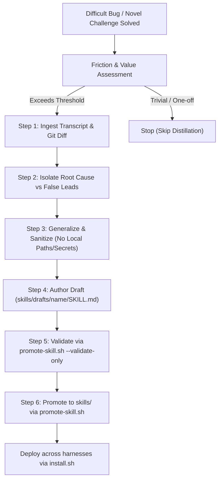

# Self-Improving Distiller

## Overview

The **Closed Learning Loop** (inspired by `NousResearch/hermes-agent`) enables the agent ecosystem to become progressively smarter with every problem solved. When an agent battles a difficult bug, navigates undocumented library quirks, or engineers a non-obvious workaround, that hard-won knowledge must not evaporate when the conversation ends.

This skill governs the systematic distillation of session transcripts, execution traces, and git diffs into high-quality, reusable agent skills saved as drafts under `skills/drafts/<skill-name>/SKILL.md` and graduated into production skills via `scripts/promote-skill.sh`.



---

## When to Distill (Friction Triggers)

Do not create skills for routine CRUD tasks or standard framework usage documented in official manuals. Distill **only** when at least one of these criteria is met:

1. **High-Friction Debugging (>= 3 attempts)**:
   - Multiple hypotheses failed before isolating the root cause.
   - Cryptic, misleading, or suppressed error messages made triage painful.
   - Concurrency bugs, race conditions, or timing-dependent failures were unmasked.

2. **Undocumented Behavior & Edge Cases**:
   - Library version incompatibilities or breaking upstream changes with zero search hits.
   - Subtle cross-platform differences (e.g., macOS BSD tools vs Linux GNU tools, Docker networking quirks, browser WebKit vs Blink variances).

3. **Complex Multi-Step Operational Recipes**:
   - Multi-step migration recovery or database backfill choreography.
   - Non-trivial auth handshakes (e.g., OAuth mobile in-app webview breakouts, session bridging).

4. **Explicit User Invocations**:
   - User commands: `/learn`, "distill this into a skill", "document this workaround as a skill", or "save what we just learned".

---

## Distillation Protocol: Step-by-Step

### Step 1: Ingest Evidence & Context
Review the terminal history, tool call transcripts, and git changes from the completed task:
- Run `git diff HEAD~1` or `git status --short` to see the exact code delta.
- Review error logs and stack traces that initially blocked progress.
- Note the failed attempts: *What looked like the problem, but was actually a symptom?*

### Step 2: Isolate Root Cause vs Symptoms
Ask the foundational questions before drafting:
- **What was the underlying root cause?** (e.g., missing index, stale build cache, silent promise rejection, symlink resolution).
- **What was the false lead?** Document the traps that wasted time so future agents immediately skip them.
- **What is the absolute minimum fix?** Strip away exploratory scaffolding and retain only the necessary change.

### Step 3: Generalize and Sanitize
Transform specific implementation details into a universally applicable pattern:
- **Strip machine-specific absolute user paths**: Never include hardcoded developer directory paths. Use standard environment variables (`$HOME`), relative paths, or placeholders.
- **Sanitize secrets & credentials**: Redact API tokens, database passwords, internal domain names, and customer identifiers.
- **Abstract project-specific symbols**: Convert project-specific table names or class names into standard conceptual models (e.g., `orders`, `users`, `AuthService`).

### Step 4: Author the Draft Skill
Create a new directory and skill file at `skills/drafts/<skill-name>/SKILL.md`.

Ensure the draft strictly adheres to the standard harness structure:

```markdown
---
name: <skill-name>
description: <Clear, actionable description: what problem it solves, when it triggers, and key tags>
---

# <Human-Readable Skill Title>

## Overview
High-level summary of the problem pattern and the proven architectural solution.

## When to Use
Bullet list of symptoms, error messages, and contexts where this skill applies.

## Root Cause Analysis
Explain WHY the failure occurs under the hood. Contrast the root cause with superficial symptoms.

## Step-by-Step Resolution Procedure
Numbered, concrete instructions with exact commands, file patterns, and code snippets.

## Traps & False Leads to Avoid
Explicit anti-patterns that failed during troubleshooting.

## Verification & Proof
Exact commands (tests, curl, lint) to conclusively verify that the fix succeeded.
```

### Step 5: Validate the Draft
Run the skill promoter in validation mode:
```bash
./scripts/promote-skill.sh --validate-only <skill-name>
```

The validation suite verifies:
1. Directory and file naming: `skills/drafts/<skill-name>/SKILL.md` where `<skill-name>` is lowercase kebab-case (`^[a-z0-9]+(-[a-z0-9]+)*$`).
2. Frontmatter integrity: `name` matches the directory name, and `description` is non-empty.
3. Cross-machine portability: Zero machine-specific user directory paths (e.g. use relative paths or environment variables).

### Step 6: Promote & Propagate
When validation passes, promote the skill into the shared kit:
```bash
./scripts/promote-skill.sh <skill-name>
```

This graduates the draft into `skills/<skill-name>/` and executes `./scripts/verify.sh` to ensure zero kit breakages. If verification fails, the promoter automatically rolls back the promotion.

Finally, propagate the new skill across installed local agent harnesses:
```bash
./scripts/install.sh --targets all --rules
```

---

## Skill Authoring Quality Gates

| Quality Gate | Standard | Failure Consequence |
| :--- | :--- | :--- |
| **Kebab-Case Naming** | `^[a-z0-9]+(-[a-z0-9]+)*$` | Rejected by `verify.py` and `promote-skill.sh`. |
| **Portability Invariant** | Zero machine-specific user paths | Blocks `./scripts/verify.sh` on CI/CD and pre-commit. |
| **Actionable Steps** | Includes copy-pasteable commands and code | Fails quality review; abstract advice is discarded. |
| **Anti-Patterns Stated** | Documents at least one trap / false hypothesis | Risk of future agents repeating identical failed steps. |
| **Verification Gate** | Clear command to prove problem is solved | Cannot verify outcome reliably. |
