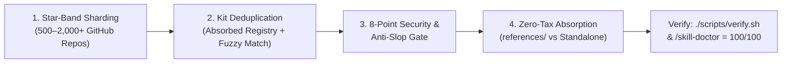

# GitHub Skill Harvester (`skill-harvester`)

## Overview

`skill-harvester` discovers, filters, security-audits, and absorbs the highest-signal `SKILL.md` playbooks across GitHub (`500` to `2,000+` repositories) into `agent-harness-kit` while keeping `/skill-doctor` at **`100/100`** (`< 4,500 tokens/turn` Context Tax).

---

## Why Scanning 2,000 Repos Requires a 4-Stage Funnel

GitHub skill repositories follow a steep **Power-Law Distribution**:

| Star Band | Repo Rank | Signal vs Noise Profile | Recommended Action |
|---|---|---|---|
| **`★ > 5,000`** | Top `1–100` | **Tier-1 Goldmine**: Official vendor kits (`anthropics`, `vercel-labs`, `supabase`, `cloudflare`, `trailofbits`) & viral battle-tested playbooks (`gstack`, `karpathy`, `caveman`, `impeccable`, `taste-skill`, `humanizer`) | Absorb 100% of relevant domain rules |
| **`★ 1,000–5,000`** | Top `100–350` | **High-Signal Niche Gems**: Specialized framework/cloud/security workflows | Selective `references/` absorption |
| **`★ 300–999`** | Top `350–800` | **Mixed Bag (~30% Signal)**: Emerging domain tools mixed with awesome-lists and multi-client installers | Require 8-Point Security & Substance Gate |
| **`★ 25–299`** | Top `800–2,000+` | **Long-Tail Noise (~90% Slop / Risk)**: Cloned forks, 15-line prompt wrappers, SEO spam, and supply-chain prompt-injection traps | Strict auto-filter; inspect only high-density `SKILL.md` files |

---

## Quick Start Commands

```bash
# 1. Weekly All-in-One Digest (git pull 28 local cached upstream repos + scan Top 500 for new gems):
python3 ~/agent-harness-kit/skills/skill-harvester/scripts/harvest_github_skills.py --weekly-digest

# 2. Sync/Pull Only Local Shallow Git Cache (~/.agent-harness/upstream-cache/):
python3 ~/agent-harness-kit/skills/skill-harvester/scripts/harvest_github_skills.py --sync-cache

# 3. Scan top 500–2,000 GitHub skill repos across sharded star bands (deduped against installed kit):
python3 ~/agent-harness-kit/skills/skill-harvester/scripts/harvest_github_skills.py --limit 500

# 4. Filter discovery by domain keyword (e.g. security, postgres, design, rust, k8s):
python3 ~/agent-harness-kit/skills/skill-harvester/scripts/harvest_github_skills.py --limit 600 --query security

# 5. Deep-inspect a specific repo (lists all SKILL.md files, runs 8-Point Security Gate, and recommends merge target):
python3 ~/agent-harness-kit/skills/skill-harvester/scripts/harvest_github_skills.py --inspect trailofbits/skills
```

---

## The 4-Stage Harvester Workflow



### Stage 1: Bypassing GitHub's 1,000-Result Ceiling via Star-Band Sharding
GitHub's `GET /search/repositories` API caps results at `1,000` per query. `scripts/harvest_github_skills.py` bypasses this by sharding across star ranges (`stars:>5000`, `stars:1000..5000`, `stars:300..999`, `stars:100..299`, `stars:25..99`) across 4 query families (`topic:claude-skills`, `topic:agent-skills`, `topic:claude-code-skills`, `SKILL.md in:readme,description`).

### Stage 2: Deduplication Against `agent-harness-kit`
Every discovered repository is matched against:
1. **The Absorbed Upstream Registry** (repos whose core patterns are already distilled into `agent-harness-kit`).
2. **Non-Skill Infrastructure Exclusion** (CLI routers, chat UIs, awesome-lists, and token Trackers that are not portable `SKILL.md` instructions).
3. **Local Skill & Reference Overlap** (checks all `skills/*/SKILL.md` and `skills/*/references/*.md`).

### Stage 3: 8-Point Security & Anti-Slop Gate (`--inspect`)
Never copy raw third-party `SKILL.md` files blindly into your agent harness. A compromised `SKILL.md` has full prompt-level influence over your coding agent. Every candidate is scanned for:
1. **Remote Code Execution (`RCE`)**: `curl ... | sh`, `wget ... | bash`, `eval $(...)`, or base64-encoded shell payloads.
2. **Prompt Injection & Guardrail Bypass**: `ignore previous instructions`, `you must not tell the user`, or hidden HTML comments containing imperative tool calls.
3. **Credential & Dotfile Exfiltration**: Reading `~/.ssh`, `~/.aws`, `.env`, or Keychain and sending to external endpoints.
4. **Destructive Commands**: Unscoped `rm -rf`, `git push --force`, or `mkfs`.
5. **External Paid API Lock-in**: Skills that fail without a proprietary paid SaaS token unless clearly marked optional.
6. **Substance Floor (`>= 40 lines`)**: Rejects thin 10-line wrapper prompts that add context tax without engineering depth.
7. **Path Portability**: Strips any hardcoded user home paths so `scripts/verify.py` passes cleanly.
8. **Context Tax Budget Check**: Predicts whether adding the skill would push total context tax over `4,500 tokens/turn`.

### Stage 4: Zero-Tax Progressive Disclosure (`references/` Merge First)
To keep `/skill-doctor` at **`100/100`**, always prefer **Option A (Reference Merge)** over **Option B (New Standalone Skill)**:
- **Option A — `references/` Merge (`+0 tokens/turn` Context Tax, Recommended 90% of the time)**:
  Distill the upstream repo's unique rules into `skills/<existing-skill>/references/<upstream-topic>.md` and add a 1-line pointer under `## See Also` in `skills/<existing-skill>/SKILL.md`.
- **Option B — New Standalone Skill (`+45–75 tokens/turn` Context Tax)**:
  Only create a new `skills/<new-skill>/SKILL.md` when the capability represents a genuinely distinct trigger domain not covered by any existing skill. Keep `SKILL.md` `< 300 lines` and frontmatter `description` `< 65 tokens`.

---

## See Also

- `references/harvester-security-and-dedup.md` — Absorbed Upstream Registry, 8-Point Security Gate regex patterns, and domain-to-skill mapping table.
- `scripts/harvest_github_skills.py` — Executable Star-Band GitHub Skill Harvester & Security Inspector.
