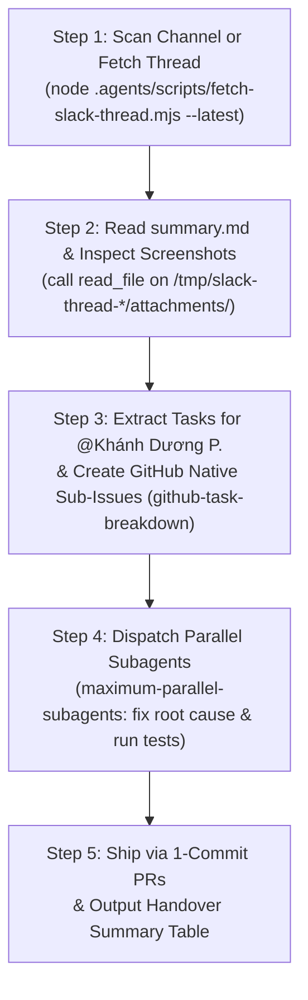

# Slack Index Autofix: Autonomous Feedback Thread & Bug-Fixing Pipeline

## Purpose
Enable zero-overhead, autonomous bug fixing and feedback triage directly from Slack channels (default: `#index-dev` / `C09E30T7V7T` on `itify-workspace`). 

Whenever a user says *"fix cái chat bên index"*, *"check slack index-dev"*, *"đọc slack"*, *"quét slack fix bug"*, or pastes any Slack thread URL, this skill:
1. Automatically scans `#index-dev` (or fetches the provided Slack thread).
2. Downloads all attached screenshots, images, and video recordings to local disk (`/tmp/slack-thread-<ts>/attachments/`).
3. Discovers linked GitHub tickets/issues and filters direct/shared tasks for `@Khánh Dương P.` (`U09NR1YEC3Y` / GitHub `khanhduong22`).
4. Creates any missing GitHub Native Sub-Issues linked to the parent issue via `github-task-breakdown`.
5. Dispatches parallel subagents (`maximum-parallel-subagents`) to fix each task at root cause in `index-web`, `index-api`, or `index-admin-cms`, verifies with tests + `tsc --noEmit`, and ships via 1-commit PRs.

---

## When to Use This Skill
Activate this skill whenever:
- User says: *"fix cái chat bên index"*, *"check slack index-dev"*, *"đọc slack"*, *"quét slack"*, *"lấy task trên slack"*, *"xem anh Long feedback gì trên slack"*.
- User pastes a Slack message or thread URL from `itify-workspace.slack.com`.
- A sprint feedback thread (e.g. `#Thread feedback STG -DD/MM`) needs to be transformed into GitHub sub-issues, resolved, and verified without manual copy-pasting.

---

## Default Entities & Channels

| Entity | Identifier | Details |
| :--- | :--- | :--- |
| **Default Slack Channel** | `C09E30T7V7T` | `#index-dev` on `itify-workspace` |
| **Default Target User** | `U09NR1YEC3Y` | `@Khánh Dương P.` in Slack |
| **Default GitHub Assignee** | `khanhduong22` | GitHub username for assigned tasks |
| **Workspace Scope** | `index` monorepo | `index-web`, `index-api`, `index-admin-cms`, `index-data` |
| **Secrets Location** | `~/.config/agent-harness/secrets.env` | Requires `SLACK_USER_TOKEN="xoxp-..."` |

---

## 5-Step Autonomous Workflow



---

### Step 1: Scan Channel or Fetch Slack Thread

Execute `fetch-slack-thread.mjs`. If no URL is provided, it automatically connects to `#index-dev` (`C09E30T7V7T`), queries recent history, ranks candidates by feedback score, selects the top thread, and downloads all replies and media:

```bash
# Auto-scan latest feedback thread in #index-dev (no URL needed!)
node .agents/scripts/fetch-slack-thread.mjs --latest

# Or if a specific Slack thread URL was provided by the user:
node .agents/scripts/fetch-slack-thread.mjs "<SLACK_THREAD_URL>"

# Or scan active feedback threads in the last 24 hours:
node .agents/scripts/fetch-slack-thread.mjs --hours 24
```

The script outputs:
- Parsed thread messages and author names.
- Auto-downloaded screenshots and videos in `/tmp/slack-thread-<ts>/attachments/`.
- Markdown summary at `/tmp/slack-thread-<ts>/summary.md`.
- Structured raw JSON at `/tmp/slack-thread-<ts>/thread.json`.

---

### Step 2: Read Markdown Summary & Inspect Screenshots

1. **Read the Summary**:
   Load `/tmp/slack-thread-<ts>/summary.md` to see the complete message sequence, author notes, and linked GitHub ticket URLs.

2. **Inspect Attached Screenshots & Media**:
   For every image or screenshot listed in `📎 Attached Files & Screenshots` (e.g. `file:///tmp/slack-thread-<ts>/attachments/5_1_F0CDG..._Screenshot.png`), call the `read_file` tool on the local file path.
   - Analyze UI discrepancies, red annotations, highlighted buttons, or error overlays.
   - Note exact URL paths shown in browser address bars or navigation headers in screenshots (e.g. `/cong-dong`, `/chung-khoan`, home page tabs).

---

### Step 3: Identify Tasks & Create GitHub Native Sub-Issues

1. **Inspect Detected Direct Tasks**:
   Check the `## 🎯 Detected Direct Tasks for @Khánh Dương P.` section generated in `summary.md`.
   - Identify which tasks are explicitly assigned to `<@U09NR1YEC3Y>` (`@Khánh Dương P.` / `khanhduong22`) or marked as shared tasks.
   - Note any parent GitHub issue linked in the thread root (e.g. `https://github.com/idx-vn/index-web/issues/3844`).

2. **Query Parent Issue for Existing Sub-Issues**:
   ```bash
   gh issue view <parent_issue_number> --repo idx-vn/index-web --json title,body,subIssues
   ```

3. **Create Missing Sub-Issues via `github-task-breakdown`**:
   For each task assigned to `khanhduong22` that does not yet have a sub-issue on GitHub:
   - Use the GraphQL `addSubIssue` mutation (or `gh-subissue` helper from `github-task-breakdown`) to link it directly under the parent issue.
   - Title format: `[<Domain>] [<Page/Component>] <Concise Action Title>` (e.g. `[FE] [Home] Fix 404 navigation and expand click target for Community section`).
   - Assign to `khanhduong22`.
   - Attach relevant screenshot paths or descriptions in the sub-issue body.

---

### Step 4: Dispatch Parallel Subagents & Fix at Root Cause

For independent sub-issues across different components or services (`index-web`, `index-api`, `index-admin-cms`), leverage **`maximum-parallel-subagents`**:

1. **Decompose by Domain/File Boundary**:
   - Subagent A (`Model: "flash"`): Fix authentication gate and default empty state on alerts.
   - Subagent B (`Model: "flash"`): Synchronize AI Deep-Dive sidebar behavior between PC and mobile.
   - Subagent C (`Model: "flash"`): Fix navigation links and expand click target for community cards.
   - Subagent D (`Model: "flash"`): Prevent premature home screen state update before saving watchlist popup.

2. **Implement at Root Cause (Ponytail Mindset)**:
   - Trace callers end-to-end; do not patch symptoms or add superficial `@ts-ignore` / hacky timeouts.
   - Adhere strictly to the **3-Tier Viewport & Dynamic Overlay Protocol** (`frontend-performance-lighthouse`).
   - Maintain type safety and avoid unvalidated any-casts.

3. **Verification**:
   In each affected service directory:
   ```bash
   # In index-web:
   bun test
   bun run lint
   bun run typecheck # or tsc --noEmit
   ```

---

### Step 5: Ship via 1-Commit PRs & Report Table

1. **Squash & Commit**:
   Follow the Single-Commit PR protocol: exactly 1 Start-Case Conventional Commit per PR (e.g., `git commit -m "Fix: Community card click target and 404 navigation"`).

2. **Push & Create PR**:
   ```bash
   git push -u origin <branch-name>
   env -u GITHUB_TOKEN gh pr create --title "..." --body "..."
   ```

3. **Handover Summary**:
   Provide the user with an executive Markdown summary table:

| # | Task / Feedback Item | Assignee | Service | Root Cause & Solution | GitHub Sub-Issue / PR | Status |
| :-: | :--- | :--- | :--- | :--- | :--- | :--- |
| 1 | Require login for alert creation | `khanhduong22` | `index-web` | Protected alert trigger with auth modal | `#3845` / `PR #3846` | ✅ Ready |
| 2 | Community click target & 404 | `khanhduong22` | `index-web` | Expanded anchor area to card container | `#3847` / `PR #3848` | ✅ Ready |

---

## Diagnostics & Troubleshooting

| Symptom | Probable Cause | Remedy |
| :--- | :--- | :--- |
| `Error: No Slack token found` | Missing `SLACK_USER_TOKEN` in `~/.config/agent-harness/secrets.env` | Add `SLACK_USER_TOKEN="xoxp-..."` with `channels:history`, `files:read`, `users:read`. |
| `channel_not_found` | Bot or User has no access to `C09E30T7V7T` | Verify channel membership in `#index-dev` or use a User Token (`xoxp-`). |
| `No active feedback threads found` | Channel messages contain no feedback markers | Pass `--hours 48` or pass the exact thread URL. |
| Screenshot download failed | Slack CDN redirect or expired URL | Ensure `downloadSlackFile` strips `Authorization` on S3 signed URL redirects (already handled). |
