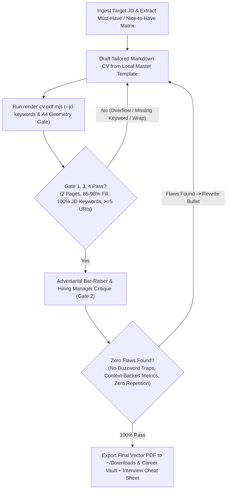

# Tailor CV to Job Description & Autonomous `/goal` Adversarial Convergence Loop

Use this skill whenever the user provides a Job Description (JD), target company, or role and wants a tailored, interview-defensible CV delivered directly as a final, ready-to-submit 2-page A4 Vector PDF.

## Core Principles & Non-Negotiable Invariants

1. **Master Template as Single Source of Truth**:
   - Always locate and branch from the candidate's local Master Template in the Career Vault (`resumes/templates/*Master_Template*.md`).
   - Never fabricate unverified experience or add technologies not present in the Master Template. Re-rank, highlight, and adjust keyword phrasing to mirror the target JD while preserving 100% interview defensibility.

2. **Interview-Defense Truthfulness Guardrails (Never Include Un-defensible Claims)**:
   - **Strict Stack Whitelist**: Only include languages, databases, queues, and frameworks that exist in the approved Master Template. Never inject unverified buzzwords (such as legacy languages, niche OLAP databases, message brokers, or micro-frontend frameworks not in the Master Template) unless the user explicitly confirms them.
   - **Mechanism-Backed High-Scale Metrics**: Every high-throughput, latency, or compression metric must retain its concrete physical architecture context from the Master Template:
     - High-concurrency API throughput must specify the horizontal instance count, in-memory cache layer, TTL jitter, and mutex lock stampede protection.
     - Probabilistic cardinality estimation (e.g., HyperLogLog) must specify high-cardinality feed context and the fixed memory cap per key (`12KB cap/key`).
     - Bitwise time-series / heatmap compression must specify the bit-packing layout (`1 Byte/day` for 8 daily flags via `BITFIELD` & bitwise ALU ops).
   - **Seamless Year-Only Timelines**:
     - Use year-only dates across all roles and sub-projects (`YYYY – Present`, `YYYY – YYYY`).
     - Ensure consecutive sub-projects within the same company connect seamlessly with zero timeline gaps.
   - **Single-Source Velocity Multiplier**: State engineering productivity multipliers (e.g., `4x` agentic workflow velocity) **once** at the strongest project bullet with its concrete mechanism (parallel worktree orchestration + shift-left quality gates), rather than repeating the multiplier across multiple sections.

3. **Strict 2-Page A4 Layout & Typography Invariants**:
   - **Heading Hierarchy**:
     - `## <CANDIDATE FULL NAME> — <Target Role Title>` (`h2`, `21px`)
     - `### I. CORE COMPETENCIES...` / `### II. PROFESSIONAL EXPERIENCE` / `### III. EDUCATION...` (`h3`, `17.5px`)
     - `#### **<Company Name>** | _<Role Progression>_ | YYYY – YYYY` (`h4`, `~15px`)
     - `##### **Project: <Name> (<Descriptor> | https://<domain>)**` (`h5`, `~13.5px` — always use `#####` so project/product headings remain visually subordinate to company headings).
   - **Single-Line Contact Bar**:
     ```markdown
     <Location> | <Phone> | <Email> | [github.com/<handle>](https://github.com/<handle>) | https://<portfolio-domain>
     ```
     Must stay on **1 single line** (`height <= 26px`) with the portfolio URL (`https://...`) on the far right and all links clickable.
   - **No Raw Markdown Backticks Inside HTML `<table>`**:
     - `marked.js` does not parse Markdown backticks (`` `...` ``) inside HTML `<td>` blocks. Always use `<code>...</code>` inside HTML `<table>` cells, never raw backticks.
   - **Explicit Page 1 / Page 2 Boundary**:
     Insert `<div style="page-break-before: always; break-before: page;"></div>` at the designated Page 1 / Page 2 project boundary so Page 1 ends cleanly (`85%–98%` page fill) and Page 2 starts cleanly at the top margin and finishes after Section III (`85%–98%` page fill, strictly `2` pages total).

---

## Autonomous `/goal` Loop: Adversarial JD-Review & Convergence Protocol

Never deliver the first unreviewed draft. Whenever executing this skill, run the **Autonomous `/goal` Adversarial Convergence Loop** (up to 5 iterations) until **ALL 4 Quality Gates pass 100%**:



### Gate 1: JD Requirement & Keyword Mirroring Audit (Target: 100% Core Keywords)
- Extract every **Must-Have** and **Nice-to-Have** keyword/responsibility from the JD and pass them to `--jd-keywords "kw1,kw2,..."` in `render-cv-pdf.mjs`.
- Verify that:
  1. The **Headline Title** and **Section I Overview Paragraph** mirror the JD's exact role title and primary engineering pillars (e.g., RESTful APIs, data modeling, background services, modern web interfaces, AI productivity).
  2. The **4 Columns of Section I Table** are ordered so Column 1 & Column 2 match the JD's highest-priority domains.
  3. Every core JD responsibility is backed by at least one concrete bullet in **Section II**.

### Gate 2: Adversarial "Bar-Raiser / Skeptical Principal Engineer" Critique (`doubt-driven-development`)
Switch persona to a **Skeptical Principal Engineer / Bar-Raiser at the target company** and audit every line against 6 questions:
1. **Metric Plausibility**: Does every high-scale number include its physical mechanism (instance count, cache layer, lock mechanism, memory cap per key, bit-packing layout) so a Senior Backend interviewer nods in agreement instead of suspecting exaggeration?
2. **Zero Buzzword Traps**: Did any technology outside the Master Template whitelist slip in? If yes, remove immediately.
3. **Zero Redundant Claims**: Is any metric (`4x`, `98%`, `60%`, `250x`) repeated multiple times across sections? Keep each metric once at its strongest point of impact.
4. **Action + Mechanism + Impact Formula**: Does every bullet state *what was built*, *which specific algorithm/data structure/pattern was used*, and *what measurable outcome resulted*?
5. **Timeline & Progression Integrity**: Are dates strictly year-only with zero gaps, and does the career progression read naturally?
6. **Visual & Syntax Hygiene**: Visually inspect the rendered PDF pages using `view_file` to confirm zero raw backticks, zero awkward single-word orphan lines, and crisp visual balance.

### Gate 3 & Gate 4: Deterministic 2-Page A4 Density & ATS Vector PDF Verification
Run the bundled compiler & verifier script (`scripts/render-cv-pdf.mjs`):

```bash
node ~/.claude/skills/tailor-cv-to-jd/scripts/render-cv-pdf.mjs \
  --input <path/to/tailored/CV_Role_Company.md> \
  --output <path/to/tailored/Candidate_Name_Role_Company.pdf> \
  --downloads ~/Downloads/<Candidate_Name>_<Role>_<Company>.pdf \
  --jd-keywords "python,fastapi,typescript,rest,redis,postgresql,react"
```

The script automatically enforces and fails with a non-zero exit code if any of these invariants break:
- `pdfPagesCount === 2` (strictly 2 pages)
- `page1FillPct` between `85%` and `98%`
- `page2FillPct` between `85%` and `98%`
- `contactSingleLine === true` (`contactHeightPx <= 26`)
- `hasRawBackticksInTable === false`
- `clickableUrisCount >= 5` (native `/URI` hyperlinks + selectable ATS text layer)
- `jdKeywordAudit.missingKeywords.length === 0`

---

## Final Delivery Standard

Once all 4 gates in the `/goal` loop pass:
1. Sync the active preview copy to the user's primary local preview markdown file if applicable.
2. Present to the user:
   - Clickable link to the ready-to-submit Vector PDF in `~/Downloads/`
   - Clickable link to the Career Vault `.md` and `.pdf`
   - The **Adversarial Bar-Raiser Audit Summary Table** (showing JD Keyword Coverage %, Page 1/2 Fill %, and the top 3–5 tailored talking points to ace the interview).
