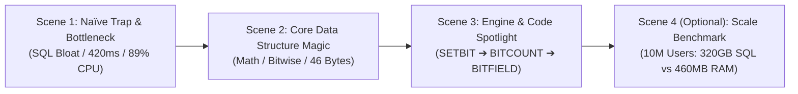

# Skill: Tech Reel Factory (Remotion + Craft Minimalism)

## Purpose
Automate the end-to-end production of production-grade 1080x1920 (9:16) 60FPS vertical Tech Explainer Reels for Facebook Reels, TikTok, and YouTube Shorts. Any agent or subagent equipped with this skill can take a technical topic or battle drill and produce a published MP4 video with studio-quality Vietnamese voiceover and pixel-perfect Dark UI matching `khanhdp.com`.

---

## 🧭 Invariant Design System: Paco Coursey / Craft Minimalism (`khanhdp.com`)

Every video generated by this skill MUST strictly adhere to these design tokens:
- **Canvas Background:** `#0a0a0a` (`bg-[#0a0a0a]`) with subtle radial hairline dot grid.
- **Card Containers:** `#111111` (`bg-[#111111]`) with hairline borders (`border border-white/[0.08]`).
- **Brand Status Indicator:** Pulsing emerald LED (`bg-emerald-500 ring-4 ring-emerald-500/20 animate-pulse`).
- **Telemetry Waveform:** 32-bar audio telemetry waveform reactive to playback frames.
- **Typography:**
  - `Inter`: Titles, hooks, captions, body text.
  - `JetBrains Mono`: Code blocks, bitstreams, benchmarks, frame timecodes, hashes.
- **Segmented 5-Scene Timeline Progress Bar (MANDATORY INVARIANT):**
  - Height: `h-3.5` (14px) or `h-4` (16px) with `rounded-full`.
  - Grid: `grid grid-cols-5 gap-4 w-full` at the very top of the canvas.
  - Active segment: Bright white with bloom/glow (`boxShadow: '0 0 16px rgba(255,255,255,0.95)'`), filling dynamically (`sceneProgress * 100%`).
  - Completed segments: `bg-white` 100%. Inactive segments: subtle hairline track `bg-white/[0.12]`.
  - **Zero-Obscurity Rule:** Never render badges, watermarks, or player HUD elements overlapping the top timeline bar.
- **Mobile Legibility Standard (1080x1920 Canvas Typography):**
  - In 1080x1920 vertical format, NEVER use desktop web sizes (`text-xs` / `text-sm` for content look like 4px on mobile!).
  - Main Scene Titles: `text-6xl` to `text-7xl font-black`.
  - Subtitles: `text-3xl font-semibold`.
  - Card Titles & Section Headings: `text-2xl` to `text-3xl font-bold`.
  - Code Snippets, SQL, & Tree Nodes: `text-2xl font-mono leading-relaxed`.
  - Content & Explanations: `text-2xl leading-relaxed`.
  - Badges & Pills: `text-lg` to `text-xl font-semibold px-4 py-2`.
  - Metric Numbers: `text-3xl` to `text-4xl font-mono font-bold`.
  - Icons: `w-7 h-7` to `w-10 h-10`.
  - Footer Telemetry & Timecode: `text-2xl font-mono font-bold`.
- **Accent Accents:**
  - `#10b981` (Emerald): Hits, sub-5ms latency, verified status.
  - `#f59e0b` (Amber): Scanning cursors, warnings, mutex locks.
  - `#f43f5e` (Rose): Un-cached joins, stampede bottlenecks, RAM explosions.
- **The 3-Second Micro-Pacing Law (MANDATORY INVARIANT):**
  - In 9:16 vertical reels, NEVER leave a screen visually static for > 3.5 seconds.
  - Every 12-15s scene MUST feature 3-4 progressive micro-beats (progressive card reveal, kinetic code highlight, dynamic tree branching, bar chart animation).
- **The Intuitive Metaphor Standard (Anti-Confusion Rule):**
  - Complex data structures and architectures MUST open with a 5-second real-world analogy (e.g. family tree genealogy for materialized paths, hotel room keys for distributed mutexes, conveyor belt buffers for async queues) BEFORE displaying code or formulas.
- **The "Zero Project Disclosure & Pure Technical" Invariant:**
  - NEVER publicize or mention internal/client project names (`Winter Arc`, `vantoi-calis`, `Lim Art`, `Index`) or internal container names (`vantoi_web`, `vantoi_api`) in video voiceovers or visuals.
  - NEVER include self-promo Outro scenes (`khanhdp.com` outro) or internal Docker flex scenes.
  - 100% of video scenes must focus purely on universal System Design, Data Structures, Code Execution, Edge-Case Handling, and accurate Engineering Benchmarks (e.g., 10K - 1M users, 46 Bytes vs 32 KB, < 0.1ms latency).
- **The "Đọc Tới Đâu - Sáng Đèn Tới Đó" Invariant (Per-Beat Deterministic Audio Synthesis & 0ms Spotlight Sync):**
  - NEVER light up all cards or all code blocks simultaneously — this overwhelms the viewer's eye and breaks focus.
  - **PROHIBITED (Anti-Drift Rule):** Never synthesize a multi-beat scene as a single monolithic audio file and guess hardcoded beat transition timestamps (`currentTime < 5.2`). Neural TTS duration varies by 20–35% from estimates, causing 1–4 seconds of cumulative spotlight lag.
  - **MANDATORY Per-Beat Audio Pipeline:**
    1. Define explicit `beats: [{ id, spotlight, label, transcript }]` inside each scene in `scenes.json`.
    2. Run `python3 scripts/phonetic_normalizer.py --sync-scenes` to populate `transcript_phonetic` for every beat.
    3. Synthesize **each beat into its own `.wav` file** (`s1_beat1.wav`, `s1_beat2.wav`, `s1_beat3.wav`), measure its exact duration via `wave.open()`, record exact `startSec` and `endSec` on each beat, and concatenate the beat `.wav` files into `scene{id}.wav`.
    4. Export `beats` in `constants.ts` and drive `isBeatActive` in Remotion directly from `beat.startSec <= currentTimeInScene < beat.endSec` (0ms drift):
       - Active element currently being spoken about: `opacity-100 scale-[1.02] border-emerald-400/90 bg-emerald-950/25 shadow-[0_0_45px_rgba(16,185,129,0.3)]`.
       - Inactive elements (not yet spoken or already passed): `opacity-20 scale-[0.98] border-white/[0.05] grayscale`.
- **The Visual Data-Structure Simulation Invariant (No Text-Only Cards):**
  - NEVER render beat cards that contain only plain text or a single line of code (`CREATE TABLE...` or `await valkey.setbit(...)`).
  - Every Beat card MUST pair concise code/metrics with a **concrete visual diagram or animated simulation** of the underlying data structure and memory mechanics:
    - *Database Bloat*: Visual table rows piling up (`#001 | user_42 | PRESENT | 88B`) + animated red CPU/Latency overload gauge bar.
    - *Bitwise / Memory Compression*: Visual bit cells (`[1][1][1][0]...`), byte packing blocks (`46 Contiguous Bytes`), and proportional memory bars (`32,000 B` full red bar vs `46 B` razor-thin emerald sliver).
    - *Engine Operations*: Visual memory tape showing `O(1)` index pointer flipping bit `0 ➔ 1` (`SETBIT`), parallel hardware `POPCNT` bit-adder (`BITCOUNT`), and `u30` sliding window bracket extracting 30 contiguous bits (`BITFIELD`).
- **The Mandatory Script Review Gate:**
  - ALWAYS present the detailed scene script, spoken text, and visual beat-sync plan to the user for review and approval BEFORE running TTS synthesis or Remotion rendering.
- **The "Hình Một Đằng - Giọng Một Nẻo" Invariant (English-Vietnamese Developer Phonetics):**
  - *On-screen visual typography*: Keep 100% standard international English (`PostgreSQL`, `Valkey`, `Redis`, `SETBIT`, `BITCOUNT`, `BITFIELD`, `O(1) CPU`, `JSON`, `Filter`).
  - *Spoken AI voiceover*: MUST automatically run through `scripts/phonetic_normalizer.py` to generate `voiceover_phonetic` and `transcript_phonetic`.
  - **English Acronym Standard:** Always use natural English-based developer pronunciation (`CPU` ➔ *Xi-Pi-Diu*, `DB` ➔ *Đi-Bi*, `VPS` ➔ *Vi-Pi-Ét*, `UUID` ➔ *Diu-Diu-Ai-Đi*, `CDC` ➔ *Xi-Đi-Xi*, `CRDT` ➔ *Xi-A-Đi-Ti*, `B-Tree` ➔ *Bi-Tri*). NEVER use outdated French-style letter spellings (`Cê-Pê-U`, `Đê-Bê`, `Vê-Pê-Ét`).
- **Cache-Busting & Web Scrubber Telemetry:**
  - Video URLs in web review apps must include dynamic version query strings (`?v=<timestamp>`).
  - Web Review player must always show an interactive 5-segment timeline scrubber above playback controls.

---

## 🎬 The Pure Technical Scene Blueprint (Zero Filler / Zero Outro)

Every video must strictly focus 100% on pure technical architecture (3 to 4 scenes, no project flex, no self-promo outro). The top segmented timeline bar dynamically matches `SCENES_TIMINGS.length`:



1. **Scene 1 (Naïve Trap & Bottleneck):** Show the intuitive/naïve developer approach and why it collapses under scale (query choke, memory explosion, lock contention).
2. **Scene 2 (Core Principle & Data Structure):** Visual intuition + mathematical/bitwise foundation (e.g., 1 Day = 1 Bit, 365 Days = 46 Bytes).
3. **Scene 3 (Engine Execution & Progressive Code Spotlight):** Step-by-step commands/code where **ONLY the command currently being spoken lights up** (`SETBIT` lights up first ➔ then `BITCOUNT` ➔ then `BITFIELD`), concluding with the architectural takeaway.

---

## 🧠 Storytelling & Script Design (Adapted from `faceless-explainer`)

### The Faceless Storytelling Law
> *"An article or vault note is an information dump. A video is a guided act of understanding. Never paraphrase source text sequentially. Extract the thesis, identify the failure mode, and build a high-stakes dramatic arc."*

### 4 Standard Narrative Structures:
1. **`concept-explainer`** (Theoretical Models): Name the concept $\rightarrow$ reveal mechanism layer-by-layer $\rightarrow$ land concrete implication (e.g., HyperLogLog, B+ Tree, LSM-Tree).
2. **`how-to-process`** (Pipelines & Protocols): A 3-5 step sequence on a consistent visual stage with one clear move per scene (e.g., Direct Upload R2, Transactional Outbox Relay).
3. **`story-explainer`** (Incident Postmortems & Traps): Incident Setup $\rightarrow$ High-Stakes Crash $\rightarrow$ Pivot / Senior Discovery $\rightarrow$ Generalizable Architectural Law (e.g., 15s JVM GC Pause, Circular Deadlock ORA-00060).
4. **`listicle`** (Co-Equal Traps / Rules): Hook $\rightarrow$ 3 parallel high-impact pitfalls $\rightarrow$ Unified takeaway (e.g., 3 P99 APM measurement pitfalls, 4 RAG vector traps).

---

## 🎨 Remotion Animation Blueprints (Reusable Components)
Import from `src/remotion/animation-blueprints.tsx`:
- **`KineticTypeBeats`**: Highlight spoken words dynamically as tokens pop or flip color on voiceover beats (`kinetic-type-beats`).
- **`useCountUpMetric`**: Numeric interpolation hook for data-viz metrics count-up / count-down (e.g. 800ms $\rightarrow$ 5ms, 16.7M $\rightarrow$ 4,000, 0% collisions, `dataviz-countup`).
- **`AgentProgressTheater`**: Multi-step agent or async pipeline state machine with animated checklists and glowing statuses (`agent-progress-theater`).
- **`SpatialPanStations`**: Virtual camera or progressive pipeline layout (Client $\rightarrow$ API Gateway $\rightarrow$ Broker $\rightarrow$ Sink).

---

## 🚀 Autonomous Execution Modes

### Mode A: Fully Automated One-Line Generation
When given a slug and topic or existing `scenes.json`, run the factory automation script:
```bash
# Example 1: From raw topic (Scaffolds kịch bản, sinh audio, dựng visualizer và render)
python3 scripts/auto_produce_reel.py \
  --slug ep5-consistent-hashing \
  --title "Consistent Hashing" \
  --topic "Cách Distributed Caching chia tải mà không băm lại toàn bộ keys"

# Example 2: From custom scenes.json
python3 scripts/auto_produce_reel.py \
  --slug ep5-consistent-hashing \
  --from-json path/to/scenes.json
```

### Mode B: Sub-Agent Manual Step-by-Step Production

When executing custom visual animations, follow these 5 deterministic steps:

#### Step 1: Create Isolated Episode Directory
```bash
mkdir -p src/episodes/<ep-slug> public/audio/<ep-slug>
```

#### Step 2: Write `scenes.json` Spec
Define 5 scenes with natural Vietnamese studio voiceover text:
```json
[
  {
    "id": 1,
    "phase": "Hook & Trap",
    "title": "Cạm Bẫy Hiệu Năng",
    "hook": "Tại sao giải pháp truyền thống khiến Database quá tải?",
    "concept": "DATABASE BOTTLENECK",
    "keyPoints": ["Latencies > 800ms", "Pool connection exhaustion"],
    "voiceover": "Khi hàng nghìn request cùng ùa vào, truy vấn đệ quy sẽ khiến database sập ngay lập tức!"
  }
]
```

#### Step 3: Generate Studio Voiceover (Edge Neural TTS)
```bash
edge-tts --voice vi-VN-NamMinhNeural --rate="+5%" --text "..." --write-media "public/audio/<ep-slug>/scene1.mp3"
afconvert -f WAVE -d LEI16@24000 "public/audio/<ep-slug>/scene1.mp3" "public/audio/<ep-slug>/scene1.wav"
```

#### Step 4: Extract Frame-Accurate Timings
Run the built-in timing calculator:
```bash
python3 scripts/sync_audio_durations.py public/audio/<ep-slug>/
```
Copy the resulting `AUDIO_DURATIONS` array directly into `src/episodes/<ep-slug>/constants.ts`.

#### Step 5: Render Verification Stills & Master MP4
```bash
# 1. Stills Verification Gate
bunx remotion still src/episodes/<ep-slug>/index.tsx <ReelID> out/<ep-slug>_still.png --frame=200

# 2. Production Video Render (1080x1920 @ 60FPS)
bunx remotion render src/episodes/<ep-slug>/index.tsx <ReelID> out/<ep-slug>.mp4 --concurrency=4
```

---

## 🏛️ 5. Pure Reelcrew Paper Whiteboard Standard (`sumif-office` & `english-3-loi` Archetype)

When producing `niche-explainer-short` style videos (inspired by Reelcrew's `sumif-office` and `english-3-loi`), strictly enforce these 4 visual and pacing invariants:

1. **Full-Stage Card Replacement ("Chuyển là chuyển hết")**:
   - Never stack 3 dimmed/brightened cards vertically on one screen.
   - Each card (`[1/6]` through `[6/6]`) occupies the entire central stage on a warm dot-grid cream paper background (`#F5F2E8` with `#DCD6C6` dots).
   - Remove all top/bottom telemetry clutter (no top progress bars, no `#hashtag` header rows, no bottom frame counters). Keep the top `175px` and bottom `330px` completely empty for 9:16 platform safe zones.
2. **65% Breathing White Space & Calm 2-State Reveal**:
   - Top of card: A slightly tilted (`-0.6deg`) warm yellow sticky-tape banner (`#FCE373`) with translucent scotch tape and a `[1/6]`..`[6/6]` pill badge (`border-[3.5px] border-[#1B2234]`).
   - Main whiteboard card (`#FFFFFF`, `border-[3px] border-[#1B2234]`): Keep `>= 60%` clean white space with ONLY 1 large centered diagram and at most 1 calm secondary reveal (`~35%` into the card).
   - Below the card: A compact `Cách cũ / Cách mới` (`Hay làm / Làm đúng`) summary strip paired with the flat-illustrated mascot.
3. **Zero-Jump 1-Line Bilingual Subtitle Pill (`KaraokeSubtitleBar.tsx`)**:
   - Chunk words using `cuesFromWords(maxChars = 30, maxWords = 6)` and classify foreign/English tokens using the Vietnamese syllable structure regex (`VI_SYLLABLE_REGEX`).
   - Position the compact dark-navy speech pill (`#1B2234`, `text-[30px] font-bold`, top pointer `▲`) at `bottom: 330px` so player controls never overlap it.
   - **Zero Horizontal Layout Shift**: Never change `padding`, `margin`, `font-weight`, or `scale` on the active word. Highlight the active word purely by text color (`#FBBF24` warm gold) while spoken English/tech terms stay soft gold (`#FDE68A`).
4. **Portable Private Repo & 1-Command Setup (`khanhduong22/video-factory`)**:
   - Full repository with Reelcrew `v0.2.33` unlocked (`rc-dev`), 1,367 free SFX (`846` Freesound `.wav` + `521` Kenney `.ogg`), 21 showcase videos, and 147 style frames:
     ```bash
     git clone https://github.com/khanhduong22/video-factory.git
     cd video-factory
     ./install.sh
     ```

---

## 📋 Quality & Verification Checklist Before Handover
- [ ] Frame rate is strictly `60 FPS` and resolution is `1080x1920` (9:16 vertical).
- [ ] Design matches either Pure Reelcrew Paper Whiteboard (`#F5F2E8` paper, `#FCE373` tape, `#FFFFFF` card) or Paco Coursey minimalism (`#0a0a0a`, `#111111`), with 9:16 safe zones clear.
- [ ] Subtitle pill has **zero horizontal jumping** (`Zero Layout Shift`) and sits at `bottom: 330px`.
- [ ] Audio voiceover is normalized to `-14 LUFS` (`python3 scripts/vf_cli.py normalize`) and passes `python3 scripts/vf_cli.py check` + `rc-dev inspect` contact-sheet verification.
- [ ] `bunx tsc --noEmit` passes 100% without typecheck errors.

