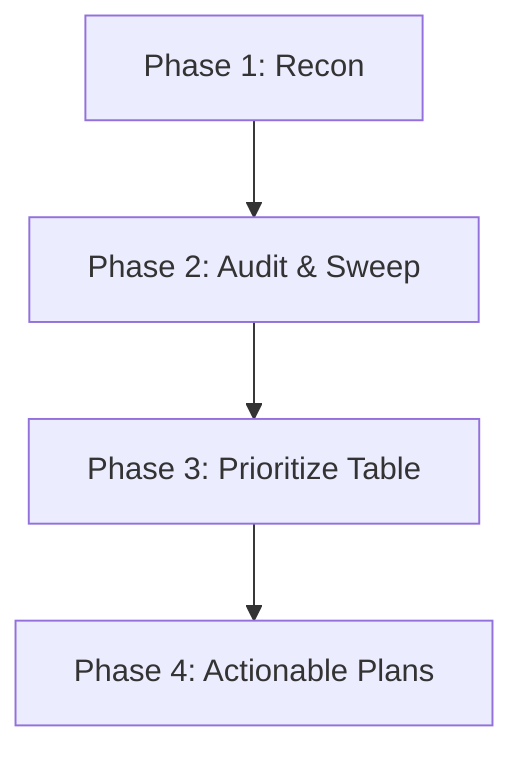

# Emil Kowalski Motion & Craft Engineering Standards

> Distilled from Emil Kowalski's design-engineering philosophy (*AI Skills for UI*, creator of Sonner, Vaul, ex-Linear/Vercel) across `emil-design-eng`, `review-animations`, `improve-animations`, and `animation-performance`.

---

## 1. Core Philosophy: The Design Engineer's Eye

- **Taste is trained, not innate**: Good animation is not decorative decoration sprinkled on top; it is an invisible, physical extension of user intent.
- **Unseen details compound**: Tiny mistakes (a sluggish `ease-in`, a popover expanding from the screen center, a button lacking press feedback, a `scale(0)` entrance) accumulate into interface friction and "AI-slop".
- **Beauty is leverage**: Interfaces that feel snappy, physical, and cohesive build deep user trust.
- **When in doubt, delete it**: The single highest-leverage motion decision is often removing unnecessary animation entirely.

---

## 2. The Animation Decision Framework

Before writing a single keyframe or transition, answer these 4 questions in order:

### 1. Should this animate at all? (The Frequency Table)

| Frequency | Animation Decision | Rationale |
|---|---|---|
| **100+ times/day** (keyboard shortcuts, command palette, tab switches, code typing, back-to-top) | **No animation. Ever (0ms).** | Frequent users build muscle memory. Animation forces them to wait and feels slow. *(Raycast has zero window open/close animation).* |
| **Tens of times/day** (hover effects, list item navigation, sidebar collapse) | **Remove or drastically reduce** (≤ 150ms). | Subtle micro-feedback only. |
| **Occasional** (modals, drawers, sheets, toast notifications) | **Standard animation** (150–300ms). | Spatial continuity helps the user track context. |
| **Rare / First-time** (onboarding tour, payment celebration, level-up) | **Can add delight** (300–600ms). | Emotional resonance is permitted. |

> [!CRITICAL]
> **Zero Animation on Keyboard Shortcuts**: Any action triggered by a keyboard shortcut must execute with **instant state change (0ms)**. Never add transition delay or motion to keyboard interactions.

### 2. What is the purpose of the motion?
Valid purposes:
- **Spatial continuity**: Shows where an element originated from or where it retired.
- **State indication**: Clarifies that data, view, or toggle state mutated.
- **Feedback**: Acknowledges user input before server response resolves.
- **Explaining relationships**: Shows parent-child hierarchy (e.g. accordion expanding).
- **Preventing jarring changes**: Softens a rough DOM swap.

*"It looks cool"* on any frequently seen UI element is a hard violation.

### 3. Which easing curve to use?

| Motion Type | Easing Category | Recommended Curve |
|---|---|---|
| **Entering / Expanding** | `ease-out` (starts fast, decelerates into rest) | `cubic-bezier(0.23, 1, 0.32, 1)` |
| **Exiting / Dismissing** | `ease-in` or snappy custom curve | `cubic-bezier(0.4, 0, 1, 1)` |
| **Internal Repositioning** (moving across screen) | `ease-in-out` | `cubic-bezier(0.77, 0, 0.175, 1)` |
| **Hover / Color shifts** | `ease` | `ease` |
| **Continuous / Linear** (spinners, marquees) | `linear` | `linear` |
| **iOS-Style Sheet / Drawer** | iOS Drawer Curve | `cubic-bezier(0.32, 0.72, 0, 1)` |

> [!WARNING]
> **Never use `ease-in` for entering UI elements!**
> Built-in `ease-in` starts slowly, delaying the exact moment the user is watching. It makes interfaces feel laggy and unresponsive. Always enter with `ease-out`.

### 4. Duration Budgets & Perceived Speed

| UI Element | Duration Target | Hard Ceiling |
|---|---|---|
| **Button press feedback** (`:active`) | 100–160ms | 200ms |
| **Tooltips & badges** | 125–200ms | 250ms |
| **Dropdowns, popovers, select menus** | 150–250ms | 300ms |
| **Modals, dialogs, bottom sheets** | 200–350ms | 500ms |
| **Toast notifications** (Sonner standard) | 350–400ms `ease` | 450ms |

- **Sub-300ms Rule**: Standard interactive UI animations must complete in **< 300ms**. Modals, drawers, and toasts are the only documented exceptions.
- **Perceived Speed Trick**: Faster loading spinners (e.g. 600ms rotation instead of 1200ms) make users perceive waiting times as shorter, even when the actual network latency is identical.

---

## 3. Physicality & Anti-AI-Slop Standards

### 1. Never Animate from `scale(0)`
- **The Anti-Pattern**: Expanding an element from `scale(0)` to `scale(1)` makes it look like it popped out of an imaginary vacuum pinhole. This is the #1 signature of AI-generated animations.
- **The Polish Standard**: Always animate scale from **`0.90` to `0.97`** paired with **`opacity: 0 → 1`**:
  ```css
  /* Bad - AI Slop */
  @keyframes popIn {
    from { transform: scale(0); opacity: 0; }
    to { transform: scale(1); opacity: 1; }
  }

  /* Good - High Craft */
  .popover-enter {
    transform: scale(0.95);
    opacity: 0;
    transition: transform 180ms cubic-bezier(0.23, 1, 0.32, 1),
                opacity 180ms cubic-bezier(0.23, 1, 0.32, 1);
  }
  .popover-enter-active {
    transform: scale(1);
    opacity: 1;
  }
  ```

### 2. Origin-Aware Popovers & Menus
- Popovers, dropdown menus, and tooltips must expand **from the trigger element**, not from the center of the viewport or top-left of the screen.
- Set `transform-origin` dynamically to align with the trigger button:
  ```css
  /* Anchored popover */
  .dropdown-menu {
    transform-origin: var(--radix-popover-content-transform-origin, top left);
  }
  ```
  *(Modals and dialogs are exempt — they represent viewport-level state and should remain centered).*

### 3. Immediate Button Press Feedback
- Every clickable button must acknowledge a tap/click immediately:
  ```css
  .btn:active {
    transform: scale(0.97);
    transition: transform 120ms cubic-bezier(0.23, 1, 0.32, 1);
  }
  ```
- Keep the compression subtle: **0.95 to 0.98** (never scale below 0.92 for buttons).

### 4. Asymmetric Enter / Exit Timing
- Exits must be approximately **two-thirds ($\approx 66\%$) of the enter duration**.
- Enter: 240ms `ease-out`.
- Exit: 160ms `ease-in` (clears the canvas quickly so the user can continue working).

### 5. Shared Tooltip Group Delay
- The first tooltip can have a 300–400ms hover delay to prevent accidental popups while moving the mouse.
- **Once one tooltip is active**, all subsequent tooltips hovered within a warm window (e.g. 500ms) must open **instantly with 0ms delay**. Use a shared `TooltipProvider` with `skipDelayDuration`.

### 6. Interruptibility Over Rigid Keyframes
- Keyframes restart from time 0 when re-triggered, causing jarring visual snaps.
- Use **CSS transitions** or **physics-based springs** (`useSpring` / Motion) for rapidly triggered elements (toggles, toasts, drags) so that interrupting the motion preserves velocity and retargets smoothly from the current position.

### 7. Modern Native CSS Enter with `@starting-style`
- For modern browsers, use native `@starting-style` for zero-JS enter transitions:
  ```css
  dialog[open] {
    opacity: 1;
    transform: scale(1);
    transition: opacity 200ms var(--ease-out), transform 200ms var(--ease-out);

    @starting-style {
      opacity: 0;
      transform: scale(0.96);
    }
  }
  ```

### 8. Micro-Typographic & UI Polish Details
| Problem | Root Cause | Solution |
|---|---|---|
| Numbers jitter horizontally when updating | Variable-width font glyphs | `font-variant-numeric: tabular-nums` |
| Large hero headings feel loose | Default font tracking is tuned for body text | `letter-spacing: -0.02em` (or `-0.03em`) on large displays |
| Long text lines cause reading fatigue | Uncapped line lengths | `max-width: 65ch` |
| Borders feel harsh and prominent | High-contrast opaque border | Replace with subtle semi-transparent box shadow: `box-shadow: 0 0 0 1px rgba(0,0,0,0.08)` |
| Avatar turns into an ellipse | Flex parent compresses children | `flex-shrink: 0` on avatar image/container |
| Transition crossfade feels rough | Imperfect DOM alignment during swap | Apply `filter: blur(2px)` during transition to soften the bridge |

---

## 4. The Ten Non-Negotiable Standards (Animation Review Rubric)

When reviewing animation and motion code, measure every transition against these 10 standards:

1. **Justified Motion**: Must answer *why* it moves (feedback, spatial context, state shift). "It looks cool" on frequent UI is rejected.
2. **Frequency-Appropriate**: 100+/day = **0ms (no motion)**. Keyboard shortcuts = **0ms**. Tens/day = **subtle**. Occasional = **standard**.
3. **Responsive Directional Easing**: `ease-out` on enter. Built-in CSS `ease-in` on UI entry is blocked.
4. **Sub-300ms Budget**: Interactive UI transitions must finish under 300ms.
5. **Origin & Physicality**: Never `scale(0)` (floor is `0.95`+opacity). Menus scale from triggers (`transform-origin`).
6. **Interruptibility**: Transitions/springs for dynamic UI; keyframes banned on dynamic toggles.
7. **GPU Composite-Only**: Animate ONLY `transform` and `opacity`. Never `width`, `height`, `top`, `left`, `margin`, `padding`.
8. **Accessibility & Reduced Motion**: Honor `@media (prefers-reduced-motion: reduce)`. Gate hover effects with `@media (hover: hover) and (pointer: fine)`.
9. **Asymmetric Enter/Exit**: Exit is ~33% faster than enter (~66% of enter duration).
10. **Cohesion & Tone**: Motion matches product personality (crisp dashboard vs bouncy consumer). Ban `transition: all`.

---

## 5. Review Findings & Output Contract (`review-animations`)

When asked to review animations, generate output in two required sections:

### Part 1: Findings Table

| File & Line | Before (Current) | After (Remediation) | Why & Standard Violated |
|---|---|---|---|
| `src/Button.tsx:24` | `transition: all 300ms` | `transition: transform 120ms var(--ease-out)` | Ban `transition: all`; non-GPU properties trigger layout recalculations. |
| `src/Dialog.tsx:42` | `scale: 0` | `scale: 0.96; opacity: 0` | Standard 5: Never scale from 0. Start at 0.96 with opacity fade. |
| `src/Menu.tsx:18` | `ease-in 250ms` | `cubic-bezier(0.23, 1, 0.32, 1) 180ms` | Standard 3 & 4: `ease-in` delays visual feedback; UI must be sub-200ms. |
| `src/Tooltip.tsx:30` | `transform-origin: center` | `transform-origin: var(--radix-tooltip-content-transform-origin)` | Standard 5: Tooltips and popovers must emerge from trigger, not center. |

### Part 2: Impact-Tiered Verdict

Evaluate severity into tiers:
- **Tier 1 (Feel-Breaking Regressions)**: `scale(0)`, `ease-in` on UI, animations on keyboard shortcuts, sluggish > 300ms transitions.
- **Tier 2 (Performance & Jank)**: Animating layout properties (`height`, `top`, `left`), `transition: all`.
- **Tier 3 (Physicality & Polish)**: Center origin on popovers, missing button `:active` scale, missing `tabular-nums`.
- **Tier 4 (Accessibility)**: Missing `prefers-reduced-motion` reduction.

**Final Verdict**:
- **BLOCK**: Contains any Tier 1 regression or layout animation on active UI.
- **APPROVE**: All 10 standards satisfied; zero feel-breaking issues.

---

## 6. Codebase Animation Improvement Roadmap (`improve-animations`)

When auditing a project codebase to upgrade motion quality across the board:



### Phase 1: Reconnaissance Sweeps
Run grep patterns to locate the full motion surface:
```bash
# Locate transition and animation declarations
grep -rn "transition:" src/
grep -rn "@keyframes" src/
grep -rn "transition-all" src/
grep -rn "motion\." src/
grep -rn "ease-in" src/
grep -rn "scale(0)" src/
grep -rn "prefers-reduced-motion" src/
```

### Phase 2: Audit Findings by Leverage
Group findings into a prioritized backlog by **Leverage = Impact ÷ Effort**:
1. **Quick Wins (High Impact, Low Effort)**:
   - Replace `transition: all` with targeted `transform, opacity`.
   - Swap `scale(0)` to `scale(0.96)`.
   - Add `transform: scale(0.97)` on `:active` for primary buttons.
   - Add `font-variant-numeric: tabular-nums` to financial/counter metrics.
2. **Structural Improvements (High Impact, Medium Effort)**:
   - Convert layout property animations (`height: auto`, `top`) to GPU `transform` or `clip-path: inset()`.
   - Wire trigger-relative `transform-origin` on popovers and dropdown menus.
   - Add `@media (prefers-reduced-motion: reduce)` fallbacks.
3. **Craft Refinements (Medium Impact, Medium Effort)**:
   - Calibrate entrance/exit asymmetry (exit 66% duration of enter).
   - Add shared tooltip hover delays.
   - Stagger group lists with 30–50ms offsets (capped at 300ms total).

---

## 7. Performance & Hardware Acceleration Rules

1. **The Composite-Only Golden Rule**:
   - Web browsers execute animations on 3 pipelines: **Layout → Paint → Composite**.
   - Animating `width`, `height`, `margin`, `padding`, `top`, `left` triggers full **Layout recalculation** across all sibling DOM nodes (dropping FPS to < 30fps).
   - Animating `color`, `background-color`, `box-shadow` triggers **Repaint**.
   - Animate ONLY **Composite-layer properties**: `transform` and `opacity`. They run directly on the GPU compositor thread without blocking the JavaScript main thread.
2. **The `blur()` Warning**:
   - Keep animated CSS `filter: blur(...)` **under 20px**. Animated heavy blurs cause severe GPU rasterization bottlenecks on mobile devices.
3. **`will-change: transform` Caution**:
   - Do NOT apply `will-change: transform` globally across CSS. It consumes persistent GPU memory.
   - Only apply it on elements with visible subpixel jitter or active high-frequency motion, and remove it when idle.
4. **Motion Shorthands (Framer Motion / Motion)**:
   - For versions prior to `motion` 14.2, use explicit `transform: "translate3d(0, 8px, 0)"` strings or upgrade to 14.2+ to prevent main-thread layout thrashing.
